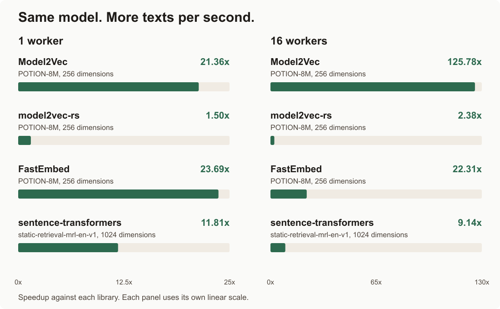
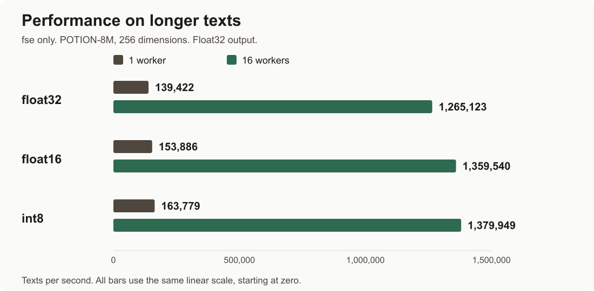
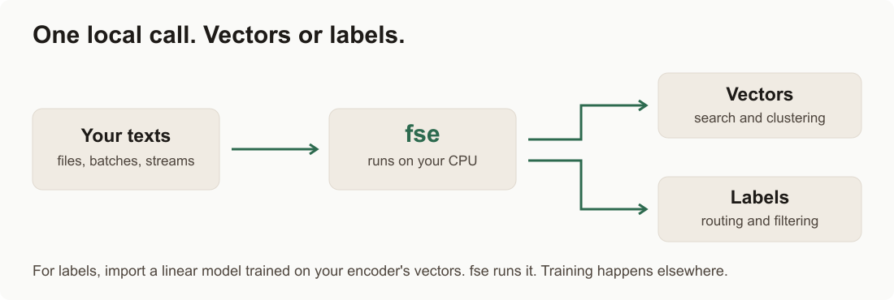

<p align="center">
<picture>
<source media="(prefers-color-scheme: dark)" srcset="https://raw.githubusercontent.com/oborchers/Fast_Sentence_Embeddings/master/docs/assets/logo/fse-logo-dark.svg">

</picture>
</p>

<h2 align="center"><strong>The fastest inference engine for static embeddings on the planet*</strong></h2>
<p align="center"><sub>* That's our goal, at least.</sub></p>

<p align="center">
<a href="https://github.com/oborchers/Fast_Sentence_Embeddings/actions/workflows/ci.yml"></a>
<a href="https://pypi.org/project/fse/"></a>
<a href="https://pypi.org/project/fse/"></a>
<a href="https://pepy.tech/project/fse"></a>
<a href="https://github.com/astral-sh/ruff"></a>
<a href="https://github.com/oborchers/Fast_Sentence_Embeddings/blob/master/LICENSE"></a>
</p>

<p align="center"><strong>Compute more than 7 million text embeddings per second.</strong></p>

Fast Sentence Embeddings turns text into vectors for search, clustering and classification.
It runs ready-made static models on your CPU. No GPU needed.
Use your Model2Vec model, a supported static Sentence Transformers model, or existing word vectors.
Bring a trained linear classifier to label text in the same application.


[^headline] 100 million WikiText sentences (28.7 tokens on average) embedded and written to disk in 13.46 seconds. Float32 model table, int8 output, 16 workers, AMD EPYC 9575F (32 vCPU), RunPod, 2 November 2026.

[How we measured](https://github.com/oborchers/Fast_Sentence_Embeddings/blob/a77a732043ec89a40dd52fe97d7a48b5de034179/docs/benchmarks/readme-evidence.md)

[^headline]: Median of three runs. On the same machine, 32 workers took 16.75 seconds, so we use 16 workers here.

## Speed first

### fse vs other libraries

Each row compares the same model, input and float32 output in both libraries.

<picture>
<source media="(prefers-color-scheme: dark)" srcset="https://raw.githubusercontent.com/oborchers/Fast_Sentence_Embeddings/00877326d8dd37a9e469f2af3439fcd530ac065e/media/readme/library-speed-dark.png">

</picture>

AMD EPYC 9575F, 32 vCPU, RunPod, 2 November 2026. WikiText sentences, about 26 words each. Each bar is a paired comparison: 2 million sentences with one worker; 18 million with 16 workers for POTION-8M, 5 million for static-retrieval-mrl-en-v1.

#### One worker

| Library | Model (dimensions) | fse, texts/s | Library, texts/s | Speedup |
|---|---|---:|---:|---:|
| FastEmbed | POTION-8M (256) | 684,332 | 29,285 | 23.69× |
| Model2Vec | POTION-8M (256) | 701,927 | 33,065 | 21.36× |
| sentence-transformers | static-retrieval-mrl-en-v1 (1024) | 217,338 | 18,554 | 11.81× |
| model2vec-rs | POTION-8M (256) | 625,842 | 413,173 | 1.50× |

AMD EPYC 9575F, 32 vCPU, RunPod, 2 November 2026. 2 million sentences per pair, about 26 words each.

#### 16 workers

| Library | Model (dimensions) | fse, texts/s | Library, texts/s | Speedup |
|---|---|---:|---:|---:|
| Model2Vec | POTION-8M (256) | 6,603,476 | 52,772 | 125.78× |
| FastEmbed | POTION-8M (256) | 6,513,573 | 290,270 | 22.31× |
| sentence-transformers | static-retrieval-mrl-en-v1 (1024) | 2,064,693 | 225,927 | 9.14× |
| model2vec-rs | POTION-8M (256) | 6,505,489 | 2,775,350 | 2.38× |

AMD EPYC 9575F, 32 vCPU, RunPod, 2 November 2026. 18 million sentences per POTION-8M pair; 5 million for the static-retrieval pair, about 26 words each.

Model2Vec uses its default thread path on 16 allowed CPUs, using about four CPUs. Sentence Transformers uses batch size 32 with one worker. With 16 workers, it uses the recommended CPU process pool and batch size 1024.

The Sentence Transformers model has 1024 dimensions, four times POTION-8M's 256. fse computes and writes four times as many numbers per sentence, so its absolute throughput is lower. The speedup compares both libraries on that same 1024-dimensional model.

### Performance on longer texts

Encode longer texts with one or 16 workers:

<picture>
<source media="(prefers-color-scheme: dark)" srcset="https://raw.githubusercontent.com/oborchers/Fast_Sentence_Embeddings/00877326d8dd37a9e469f2af3439fcd530ac065e/media/readme/dtype-speed-dark.png">

</picture>

| Model precision | 1 worker, texts/s | 16 workers, texts/s |
|---|---:|---:|
| float32 | 139,422 | 1,265,123 |
| float16 | 153,886 | 1,359,540 |
| int8 | 163,779 | 1,379,949 |

AMD EPYC 9965, 32 logical CPUs, RunPod, POTION-8M, 1 to 2 November 2026. 4.62 million WikiText-103 passages, average 119.1 words, float32 output.

## Get started

```sh
pip install "fse>=2.0"
```

Moving an existing application? Read the [migration guide from fse 1.x](docs/migrating-from-1x.md) before upgrading.

Python 3.11 to 3.15. Wheels target Linux (x86_64 and aarch64, glibc or musl),
macOS (Apple Silicon, arm64) and Windows (x86_64).

Load a model and make a vector for each text:

```python
from fse import Encoder

encoder = Encoder.from_pretrained("minishlab/potion-base-8M")
vectors = encoder.encode(["the cat sleeps", "a dog runs"])
```

A vector is a list of numbers that represents a text. Here you get a NumPy array with one row per text.
For document vectors, pass your documents as strings. The model's text-length limits still apply.
The first load downloads the model. Its license applies separately.
For complete applications, explore the nine [recipes](https://github.com/oborchers/Fast_Sentence_Embeddings/blob/master/recipes/README.md) below.

### Already using Model2Vec?

Switch the import for the common loading and encoding calls:

```python
from fse import StaticModel  # replaces: from model2vec import StaticModel

model = StaticModel.from_pretrained("minishlab/potion-base-8M")
vectors = model.encode(["the cat sleeps", "a dog runs"])
```

The supported API is similar, but conversion can change float32 rounding.
`save_pretrained` and `push_to_hub` export fse folders. Reload them with `fse.StaticModel.from_pretrained`.
They are not Model2Vec 0.10.0 export files.

### Using a static Sentence Transformers model?

```python
from fse import Encoder

encoder = Encoder.from_pretrained("sentence-transformers/static-retrieval-mrl-en-v1")
vectors = encoder.encode(["How do I reset my password?", "Open your account settings."])
```

This supports compatible static models. It does not run contextual transformers such as MiniLM or BGE.

## Choose a model and memory budget

Start with POTION-base-8M for a small English model. Use retrieval models for search and multilingual models for other languages.
Compare quality and size below, then check the model on your own data.

| Model (Hub ID) | Quality[^quality] | Float32 file size |
|---|---:|---:|
| [`minishlab/potion-base-32M`](https://huggingface.co/minishlab/potion-base-32M) | 55.26 | 124.1 MiB |
| [`minishlab/potion-retrieval-32M`](https://huggingface.co/minishlab/potion-retrieval-32M) | 54.51 | 124.1 MiB |
| [`minishlab/potion-base-8M`](https://huggingface.co/minishlab/potion-base-8M) | 53.95 | 29.2 MiB |
| [`sentence-transformers/static-retrieval-mrl-en-v1`](https://huggingface.co/sentence-transformers/static-retrieval-mrl-en-v1) | 51.89 | 119.7 MiB |
| [`sentence-transformers/static-similarity-mrl-multilingual-v1`](https://huggingface.co/sentence-transformers/static-similarity-mrl-multilingual-v1) | 51.43 | 415.1 MiB |
| [`fse/fasttext-crawl-subwords-300-sif10`](https://huggingface.co/fse/fasttext-crawl-subwords-300-sif10) | 51.42 | 4.50 GiB |
| [`fse/paragram-300-sl999-sif10`](https://huggingface.co/fse/paragram-300-sl999-sif10) | 50.98 | 1.93 GiB |
| [`fse/paranmt-300-raw`](https://huggingface.co/fse/paranmt-300-raw) | 50.69 | 89.5 MiB |
| [`minishlab/potion-multilingual-128M`](https://huggingface.co/minishlab/potion-multilingual-128M) | 49.96 | 502.1 MiB |
| [`fse/glove-wiki-gigaword-300-sif10`](https://huggingface.co/fse/glove-wiki-gigaword-300-sif10) | 49.79 | 463.6 MiB |
| [`fse/word2vec-google-news-300-sif10`](https://huggingface.co/fse/word2vec-google-news-300-sif10) | 49.26 | 3.41 GiB |

[^quality]: MTEB(eng, v2), measured on 1 November 2026 with MTEB 2.26.25. Scores are the unweighted mean over 40 of 41 English tasks, multiplied by 100. MIND was not computed. Classic-model scores use the historical benchmark recipe. SIF-10 scores use a WikiText-103 fit, whereas the linked Hub SIF-10 models use wordfreq weights and a FineWeb fit. See each Hub card for that version's own results. Sizes refer to float32 fse files. [Quality results and file sizes](https://github.com/oborchers/Fast_Sentence_Embeddings/blob/21ebf1f7839cc2db91594d59a6de9c443657a0b6/docs/benchmarks/readme-quality.json).

Start with float32. Try float16 or int8 when memory matters, then check quality again.

```python
from fse import Encoder

compact = Encoder.from_pretrained("minishlab/potion-base-8M").quantize("int8")
compact.save("compact.safetensors")
```

See all [30 classic Hub models](https://github.com/oborchers/Fast_Sentence_Embeddings/blob/0b127c8da4bc177005c78b6a241459bb776244c7/docs/models.md) with float32, float16 and int8 download sizes.
`-raw` in a classic Hub model name means no SIF weighting. It does not mean unnormalized output.

You can also use your own GloVe, word2vec or FastText vectors with the optional `fse[gensim]` adapter.
The [SIF and uSIF recipe](https://github.com/oborchers/Fast_Sentence_Embeddings/blob/master/recipes/01-sif-usif.ipynb) shows how to prepare classic word vectors for sentence search.

## Recipes: from a model to a working application

These nine recipes show the full workflow, including preparation, execution and checks.
Start with the job you want to do:

| Use case | Recipe |
|---|---|
| Start here: fse 101 | [Turn sentences into vectors, find similar text, and save your results.](https://github.com/oborchers/Fast_Sentence_Embeddings/blob/master/recipes/00-fse-101.ipynb) |
| Sentence search | [Make classic word vectors more useful for sentence search.](https://github.com/oborchers/Fast_Sentence_Embeddings/blob/master/recipes/01-sif-usif.ipynb) |
| Text classification | [Train a text classifier, compare its accuracy, and save it for your app.](https://github.com/oborchers/Fast_Sentence_Embeddings/blob/master/recipes/02-linear-heads.ipynb) |
| Files with resume | [Turn a text file into vectors and continue after an interruption.](https://github.com/oborchers/Fast_Sentence_Embeddings/blob/master/recipes/03-files-with-resume.ipynb) |
| Queues and Qdrant | [Turn queued news into searchable vectors and replay safely.](https://github.com/oborchers/Fast_Sentence_Embeddings/blob/master/recipes/04-kafka-and-qdrant.ipynb) |
| Folder listener | [Pick up completed files and add each one to your search store.](https://github.com/oborchers/Fast_Sentence_Embeddings/blob/master/recipes/05-folder-listener.ipynb) |
| Integrations | [Use one local encoder with your search, topic, and table libraries.](https://github.com/oborchers/Fast_Sentence_Embeddings/blob/master/recipes/06-integrations.ipynb) |
| Local compute and HTTP | [See when a local HTTP request costs more than encoding the text.](https://github.com/oborchers/Fast_Sentence_Embeddings/blob/master/recipes/07-local-compute-and-http.ipynb) |
| Folded classifier | [Fold a trained classifier into word vectors, then save a smaller model for your app.](https://github.com/oborchers/Fast_Sentence_Embeddings/blob/master/recipes/08-folded-classifier.ipynb) |

The [recipe index](https://github.com/oborchers/Fast_Sentence_Embeddings/blob/master/recipes/README.md) has setup instructions and recorded results.
The queue recipe uses a fake queue and local Qdrant. The folder recipe polls for completed files.
These are worked examples you can adapt, not hosted services.

## Label text with a linear classifier

Route support requests, filter documents or classify a dataset.
Train a supported linear model in scikit-learn, then let fse run it directly on text.
The model must be trained on this encoder's vectors.
`normalize=False` works for every supported model, including our classic Hub models under `fse/`.
Our classic Hub models load normalized by default. For folding, load with `normalize=False` before training the linear head.
Install `scikit-learn` first: `pip install scikit-learn`.

```python
from sklearn.linear_model import LogisticRegression
from fse import Classifier, Encoder

encoder = Encoder.from_pretrained("minishlab/potion-base-8M", normalize=False)
texts = ["I cannot log in", "My password is lost", "Send me a quote", "What does it cost?"]
head = LogisticRegression().fit(encoder.encode(texts), ["support", "support", "sales", "sales"])
classifier = Classifier.from_sklearn(encoder, head)
labels = classifier.predict(["I need a new password"])
classifier.save("router.safetensors")
```

Train on real labeled data for your application.
Load the saved model with `Classifier.load("router.safetensors")` and predict without scikit-learn.

The [classification recipe](https://github.com/oborchers/Fast_Sentence_Embeddings/blob/master/recipes/02-linear-heads.ipynb) compares this with Model2Vec's own classifier, TF-IDF and fastText.

### Why folding works

A sentence vector averages the vectors of its words or word pieces.
A linear head multiplies that average by weights W and adds a bias b.
Multiplying and averaging can swap order:

`W · mean(v) + b = mean(W · v) + b`

fse computes W · v once for each word and stores the scores.
A four-label classifier can then keep 4 scores per word instead of 256 values.
Prediction looks up those scores, averages them and adds the bias.
There is no full sentence vector or head matrix multiplication per text.

The [folding recipe](https://github.com/oborchers/Fast_Sentence_Embeddings/blob/master/recipes/08-folded-classifier.ipynb) found identical AG News labels, with probability differences up to about 0.000003 from rounding.
The complete POTION-8M file uses 29.2 MiB, compared with 0.86 MiB for the standalone file.

POTION-8M, AG News, Apple M1 Pro, 1 November 2026.

This works for linear classification and regression heads trained on plain averages, including logistic regression, `LinearSVC` and `Ridge`, without requesting sentence vectors.
fse runs linear heads trained on normalized vectors explicitly, because normalization prevents this fold.
Neural heads with hidden layers cannot use this fold, and fse does not run them.

<picture>
<source media="(prefers-color-scheme: dark)" srcset="https://raw.githubusercontent.com/oborchers/Fast_Sentence_Embeddings/71b69be83efdd8adbf071ada302be8bf1db68b24/media/readme/vectors-and-labels-dark.png">

</picture>

## Use fse with your framework

Use the same local encoder in LangChain, LlamaIndex, or Haystack.
Each framework has a separate package, so fse core needs no framework dependency.

| Framework | Install | Embedding interface |
|---|---|---|
| LangChain | `pip install langchain-fse` | `langchain_fse.FseEmbeddings` |
| LlamaIndex | `pip install llama-index-embeddings-fse` | `llama_index.embeddings.fse.FseEmbedding` |
| Haystack | `pip install fse-haystack` | `FseTextEmbedder` and `FseDocumentEmbedder` from `haystack_integrations.components.embedders.fse` |

See [recipe 06](https://github.com/oborchers/Fast_Sentence_Embeddings/blob/master/recipes/06-integrations.ipynb) for complete local search examples with POTION and real news articles.

## When to use fse

**Choose fse when throughput matters more than squeezing out the highest possible model quality.**
Static models give each word or word piece a fixed vector. They do less work than contextual transformers.
That makes them useful for large collections, local applications and repeated classification.
A good contextual transformer may handle meaning, ambiguity and difficult search tasks better.
Check the quality on your own data before choosing the faster model.

This trade-off concerns the model you choose. Switching a Model2Vec static model to fse does not mean choosing a weaker model.
fse runs finished models; it does not train or distill them.

| Tool | A good fit when you want to... |
|---|---|
| **fse** | Run static embeddings, fitted linear classifiers and file or stream jobs on a CPU. |
| **Model2Vec** | Create, distill or fine-tune static models, as well as run them. |
| **Sentence Transformers** | Run or train contextual transformers, or use its static models and broader model ecosystem. |
| **gensim / Doc2Vec** | Train document vectors or word-vector models in gensim. |

## Why is fse so fast?

**We build and tune the whole path, from reading text to writing results.**
That includes splitting text into tokens, finding their vectors, combining them and saving the output.
The goal is to keep useful work together and avoid overhead between steps.

| Design choice | What it does |
|---|---|
| Prepare once | Reuse a finished model's fixed word vectors for every text. |
| Keep work together | The CPU fast path groups tokenization and vector calculation in compiled code. |
| Share the work | CPU workers process batches in parallel. |
| Control the output path | Files and streams can write to fse's vector store without collecting all results in memory. |

## Memory use

Large output arrays can take more space than the model itself.
For a list of texts with float32 output, fse [allocates the result array once](https://github.com/oborchers/Fast_Sentence_Embeddings/blob/9a0bc841e9ac6a9f3cb41c1b06ac746b5f27337b/src/fse/_runtime/_sinks.py#L145-L177).
CPU workers write directly into their rows. There is no final join of separate result arrays.

The batch paths in [Model2Vec 0.10.0](https://github.com/MinishLab/model2vec/blob/745bf944406a125be439ddfdfe523747baec1983/model2vec/model.py#L416-L431) and [Sentence Transformers 6.2.0](https://github.com/huggingface/sentence-transformers/blob/0b6937d55981e3486caf9b64ad2664c9a9edb51d/sentence_transformers/sentence_transformer/model.py#L945-L1001) collect results, then join them with `np.concatenate` or `torch.stack`.
During that join, the parts and the final array coexist, using roughly twice the space for output data alone.
This is not a measurement of total memory use.

**Size calculation:** 18 million texts × 256 values × 4 bytes = 18.4 GB per float32 matrix.
For results larger than RAM, write to a `ShardSink` or the vector store. fse limits the output work in flight.
Returning one array from an input of unknown length still collects and joins parts, so use a disk sink for large streams.

## More

- [Documentation](https://github.com/oborchers/Fast_Sentence_Embeddings/blob/master/ARCHITECTURE.md): supported APIs, model formats, exports and guarantees.
- [Contributing](https://github.com/oborchers/Fast_Sentence_Embeddings/blob/master/CONTRIBUTING.md): AI-assisted contributions are welcome with reproducible checks and evidence.
- [Changelog](https://github.com/oborchers/Fast_Sentence_Embeddings/blob/master/CHANGELOG.md) and [security policy](https://github.com/oborchers/Fast_Sentence_Embeddings/blob/master/SECURITY.md).

fse 2.0 uses the [MIT License](https://github.com/oborchers/Fast_Sentence_Embeddings/blob/master/LICENSE).
The 1.x releases remain GPL-3.0. Model and dataset licenses apply separately.
Built by [Dr. Oliver Borchers](https://www.drborchers.com).
