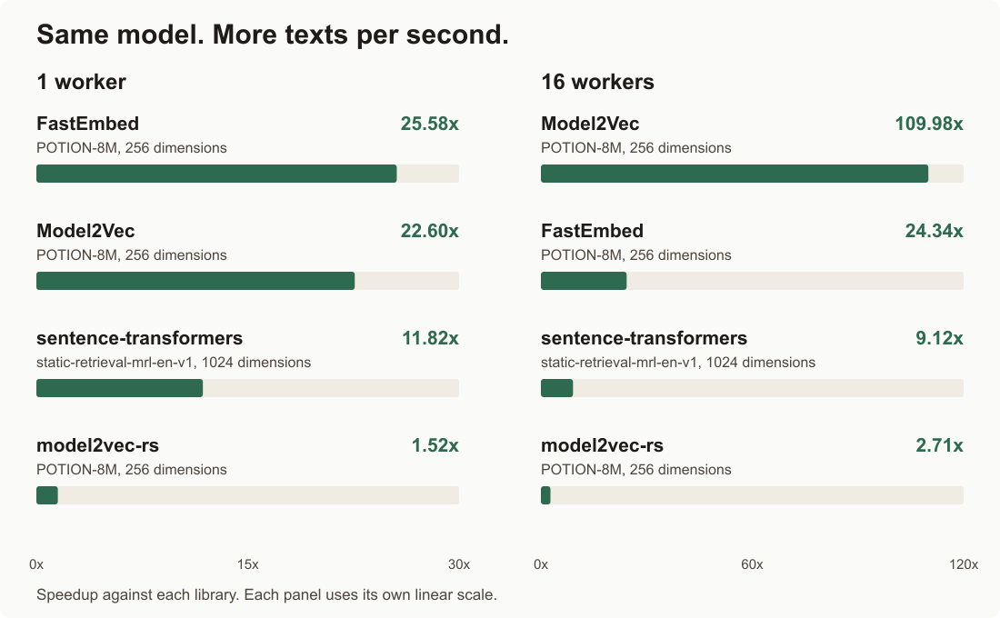
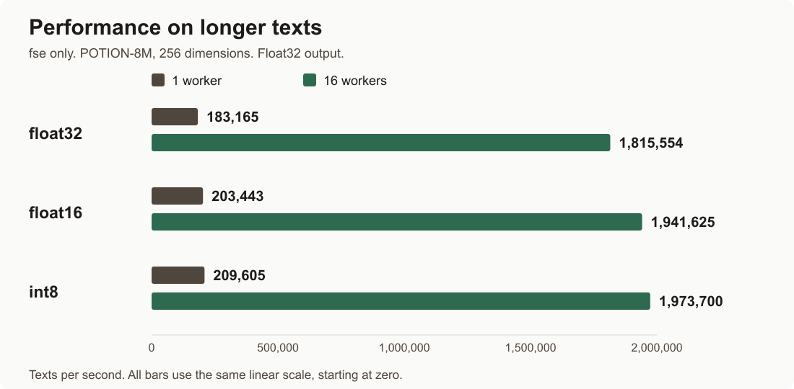
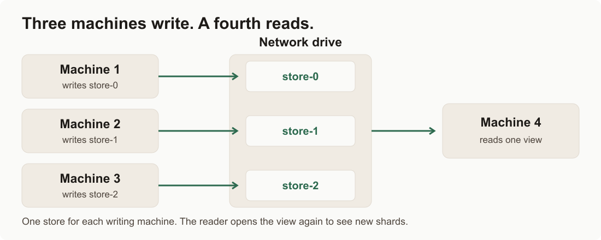
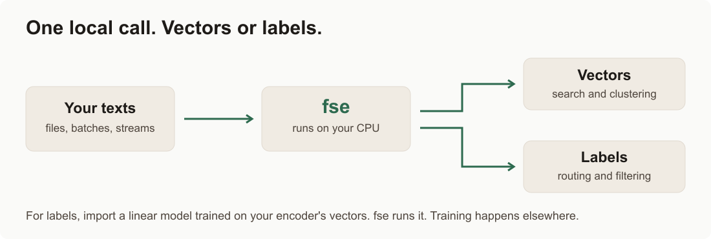

<p align="center">
<picture>
<source media="(prefers-color-scheme: dark)" srcset="https://raw.githubusercontent.com/oborchers/Fast_Sentence_Embeddings/master/docs/assets/logo/fse-logo-dark.svg">

</picture>
</p>

<h2 align="center"><strong>The fastest inference engine for static embeddings on the planet*</strong></h2>
<p align="center"><sub>* That's our goal, at least.</sub></p>

<p align="center">
<a href="https://github.com/oborchers/Fast_Sentence_Embeddings/actions/workflows/ci.yml"></a>
<a href="https://pypi.org/project/fse/"></a>
<a href="https://pypi.org/project/fse/"></a>
<a href="https://pepy.tech/project/fse"></a>
<a href="https://github.com/astral-sh/ruff"></a>
<a href="https://github.com/oborchers/Fast_Sentence_Embeddings/blob/master/LICENSE"></a>
</p>

<p align="center"><strong>Embed more than 7 million sentences per second.</strong><br>
<strong>Classify more than 17 million sentences per second.</strong><br>
<strong>Embed 1 billion sentences in under 4 minutes.</strong></p>

Fast Sentence Embeddings turns text into vectors for search, clustering and classification.
It runs ready-made static models on your CPU. No GPU needed.
Use your Model2Vec model, a supported static Sentence Transformers model, or existing word vectors.
fse also runs linear models on those vectors. Bring a classifier or regressor trained in scikit-learn, and fse returns labels, probabilities or scores directly from text, in the same application.
Several heads share one encoding pass, and a classifier can be folded into the word vectors for a smaller model.


[^headline] Embed: 100 million WikiText sentences (28.7 tokens on average) embedded and written to disk in 13.46 seconds. Float32 model table, int8 output, 16 workers, AMD EPYC 9575F (32 vCPU), RunPod, 2 November 2026.

[^classify] Classify: 100 million WikiText sentences labeled in 5.84 seconds with the toxicity head [fse/bekko-civil-comments-toxicity-classifier](https://huggingface.co/fse/bekko-civil-comments-toxicity-classifier). 16 workers, AWS m8id.8xlarge (Intel Xeon 6975P-C, 32 vCPU), 14 November 2026.

[^billion] One billion: 1 billion WikiText sentences embedded and written as int8 to local NVMe in 217.38 seconds. POTION-8M with a float32 table, 16 workers, AWS m8id.8xlarge (Intel Xeon 6975P-C, 32 vCPU), 14 November 2026.

How we measured: [Embed (fse 2.0)](https://github.com/oborchers/Fast_Sentence_Embeddings/blob/a77a732043ec89a40dd52fe97d7a48b5de034179/docs/benchmarks/readme-evidence.md), [Classify and one billion (fse 2.1)](https://github.com/oborchers/Fast_Sentence_Embeddings/blob/05c9c1dcc004ed125b53f156f0837dfb17f73d1d/docs/benchmarks/readme-evidence.md#large-runs-m8id8xlarge)

[^headline]: Median of three runs. On the same machine, 32 workers took 16.75 seconds, so we use 16 workers here.
[^classify]: Median of three runs. The labels are `toxicity` and `insult`. Predicting probabilities took 5.71 seconds.
[^billion]: Median of three runs on a separate machine from the embed figure. The rates are not combined.

## Speed first

### fse vs other libraries

Each row compares the same model, input and float32 output in both libraries.

<picture>
<source media="(prefers-color-scheme: dark)" srcset="https://raw.githubusercontent.com/oborchers/Fast_Sentence_Embeddings/1b3d0c22fc7097fc539116dfe7e47ae6675d6e51/docs/assets/readme/library-speed-dark.png">

</picture>

AWS m8a.8xlarge (AMD EPYC 9R45, 32 vCPU), 14 November 2026. WikiText sentences, about 26 words each. Each bar is a paired comparison: 2.5 million sentences with one worker for POTION-8M, 2 million for static-retrieval-mrl-en-v1; 20 million with 16 workers for POTION-8M, 10 million for static-retrieval-mrl-en-v1.

#### One worker

| Library | Model (dimensions) | fse, texts/s | Library, texts/s | Speedup |
|---|---|---:|---:|---:|
| FastEmbed | POTION-8M (256) | 670,526 | 26,180 | 25.58× |
| Model2Vec | POTION-8M (256) | 670,426 | 29,672 | 22.60× |
| sentence-transformers | bekko-static-embedding-v1 (1024) | 254,598 | 16,865 | 15.10× |
| sentence-transformers | static-retrieval-mrl-en-v1 (1024) | 199,278 | 16,868 | 11.82× |
| model2vec-rs | POTION-8M (256) | 666,904 | 437,786 | 1.52× |

AWS m8a.8xlarge (AMD EPYC 9R45, 32 vCPU), 14 November 2026. 2.5 million sentences per POTION-8M pair; 2 million per Sentence Transformers pair, about 26 words each.

#### 16 workers

| Library | Model (dimensions) | fse, texts/s | Library, texts/s | Speedup |
|---|---|---:|---:|---:|
| Model2Vec | POTION-8M (256) | 6,932,525 | 63,230 | 109.98× |
| FastEmbed | POTION-8M (256) | 6,912,861 | 284,540 | 24.34× |
| sentence-transformers | bekko-static-embedding-v1 (1024) | 2,893,536 | 231,822 | 12.48× |
| sentence-transformers | static-retrieval-mrl-en-v1 (1024) | 2,252,066 | 246,911 | 9.12× |
| model2vec-rs | POTION-8M (256) | 6,988,893 | 2,578,779 | 2.71× |

AWS m8a.8xlarge (AMD EPYC 9R45, 32 vCPU), 14 November 2026. 20 million sentences per POTION-8M pair; 10 million for static-retrieval-mrl-en-v1 and 8 million for bekko-static-embedding-v1, about 26 words each.

Model2Vec uses its default thread path on 16 allowed CPUs. Sentence Transformers uses batch size 32 with one worker. With 16 workers, it uses the recommended CPU process pool and batch size 1024.

The Sentence Transformers models have 1024 dimensions, four times POTION-8M's 256. fse computes and writes four times as many numbers per sentence, so its absolute throughput is lower. The speedup compares both libraries on that same 1024-dimensional model.

### Performance on longer texts

Encode longer texts with one or 16 workers:

<picture>
<source media="(prefers-color-scheme: dark)" srcset="https://raw.githubusercontent.com/oborchers/Fast_Sentence_Embeddings/1b3d0c22fc7097fc539116dfe7e47ae6675d6e51/docs/assets/readme/dtype-speed-dark.png">

</picture>

| Model precision | 1 worker, texts/s | 16 workers, texts/s |
|---|---:|---:|
| float32 | 183,165 | 1,815,554 |
| float16 | 203,443 | 1,941,625 |
| int8 | 209,605 | 1,973,700 |

AWS m8a.8xlarge (AMD EPYC 9R45, 32 vCPU), POTION-8M, 14 November 2026. WikiText-103 passages, average 119.0 words, float32 output: 600,000 passages with one worker, 5 million with 16 workers.

### Large runs

| Task | Texts | Median time | fse, texts/s |
|---|---:|---:|---:|
| Embed and write to disk | 100 million | 15.29 s | 6,538,517 |
| Embed and write to disk | 1 billion | 217.38 s | 4,600,136 |
| Predict labels with a linear head | 100 million | 5.84 s | 17,132,557 |
| Predict probabilities with a linear head | 100 million | 5.71 s | 17,521,793 |

AWS m8id.8xlarge (Intel Xeon 6975P-C, 32 vCPU, local NVMe), 16 workers, 14 November 2026. WikiText sentences, 28.7 tokens on average. Embedding uses POTION-8M with a float32 table and int8 output. Prediction uses the toxicity head [fse/bekko-civil-comments-toxicity-classifier](https://huggingface.co/fse/bekko-civil-comments-toxicity-classifier) (labels `toxicity` and `insult`). Median of three runs each. The headline at the top comes from a separate measurement on another machine and is not combined with these rows.

## Get started

```sh
pip install "fse>=2.1"
```

Moving an existing application? Read the [migration guide from fse 1.x](docs/migrating-from-1x.md) before upgrading.

Python 3.11 to 3.15. Wheels target Linux (x86_64 and aarch64, glibc or musl),
macOS (Apple Silicon, arm64) and Windows (x86_64).

Load a model and make a vector for each text:

```python
from fse import Encoder

encoder = Encoder.from_pretrained("minishlab/potion-base-8M")
vectors = encoder.encode(["the cat sleeps", "a dog runs"])
```

A vector is a list of numbers that represents a text. Here you get a NumPy array with one row per text.
For document vectors, pass your documents as strings. The model's text-length limits still apply.
The first load downloads the model. Its license applies separately.
For complete applications, explore the [recipes](https://github.com/oborchers/Fast_Sentence_Embeddings/blob/master/recipes/README.md) below.

### Already using Model2Vec?

Switch the import for the common loading and encoding calls:

```python
from fse import StaticModel  # replaces: from model2vec import StaticModel

model = StaticModel.from_pretrained("minishlab/potion-base-8M")
vectors = model.encode(["the cat sleeps", "a dog runs"])
```

The supported API is similar, but conversion can change float32 rounding.
`model.tokenizer` has the public type `fse.typing.Tokenizer`; its `encode` and `encode_batch` return `fse.typing.Encoding` objects with token IDs. Import these types to annotate caller code.

Import `PathLike`, `ModelRef` and `WorkerCount` from `fse.typing` for input annotations.
`PathLike` accepts local text paths (`str` or `os.PathLike[str]`). `ModelRef` also allows
a string Hub identifier; a path object always stays local. `WorkerCount` accepts a positive
Python or NumPy integer, or `None` for the available CPUs. Boolean values remain invalid.

`save_pretrained` and `push_to_hub` export fse folders. Reload them with `fse.StaticModel.from_pretrained`.
They are not Model2Vec 0.10.0 export files.

### Using a static Sentence Transformers model?

```python
from fse import Encoder

encoder = Encoder.from_pretrained("sentence-transformers/static-retrieval-mrl-en-v1")
vectors = encoder.encode(["How do I reset my password?", "Open your account settings."])
```

This supports compatible static models. It does not run contextual transformers such as MiniLM or BGE.

## Choose a model and memory budget

Start with POTION-base-8M for a small English model. Use retrieval models for search and multilingual models for other languages.
Compare quality and size below, then check the model on your own data.

| Model (Hub ID) | Quality[^quality] | Float32 file size |
|---|---:|---:|
| [`hotchpotch/bekko-static-embedding-v1`](https://huggingface.co/hotchpotch/bekko-static-embedding-v1)[^bekko] | 56.83 | 390.6 MiB (float16) |
| [`minishlab/potion-base-32M`](https://huggingface.co/minishlab/potion-base-32M) | 55.26 | 124.1 MiB |
| [`minishlab/potion-retrieval-32M`](https://huggingface.co/minishlab/potion-retrieval-32M) | 54.51 | 124.1 MiB |
| [`minishlab/potion-base-8M`](https://huggingface.co/minishlab/potion-base-8M) | 53.95 | 29.2 MiB |
| [`sentence-transformers/static-retrieval-mrl-en-v1`](https://huggingface.co/sentence-transformers/static-retrieval-mrl-en-v1) | 51.89 | 119.7 MiB |
| [`sentence-transformers/static-similarity-mrl-multilingual-v1`](https://huggingface.co/sentence-transformers/static-similarity-mrl-multilingual-v1) | 51.43 | 415.1 MiB |
| [`fse/fasttext-crawl-subwords-300-sif10`](https://huggingface.co/fse/fasttext-crawl-subwords-300-sif10) | 51.42 | 4.50 GiB |
| [`fse/paragram-300-sl999-sif10`](https://huggingface.co/fse/paragram-300-sl999-sif10) | 50.98 | 1.93 GiB |
| [`fse/paranmt-300-raw`](https://huggingface.co/fse/paranmt-300-raw) | 50.69 | 89.5 MiB |
| [`minishlab/potion-multilingual-128M`](https://huggingface.co/minishlab/potion-multilingual-128M) | 49.96 | 502.1 MiB |
| [`fse/glove-wiki-gigaword-300-sif10`](https://huggingface.co/fse/glove-wiki-gigaword-300-sif10) | 49.79 | 463.6 MiB |
| [`fse/word2vec-google-news-300-sif10`](https://huggingface.co/fse/word2vec-google-news-300-sif10) | 49.26 | 3.41 GiB |

[^quality]: MTEB(eng, v2), measured on 1 November 2026 with MTEB 2.26.25. Scores are the unweighted mean over 40 of 41 English tasks, multiplied by 100. MIND was not computed. Classic-model scores use the historical benchmark recipe. SIF-10 scores use a WikiText-103 fit, whereas the linked Hub SIF-10 models use wordfreq weights and a FineWeb fit. See each Hub card for that version's own results. Sizes refer to float32 fse files. [Quality results and file sizes](https://github.com/oborchers/Fast_Sentence_Embeddings/blob/21ebf1f7839cc2db91594d59a6de9c443657a0b6/docs/benchmarks/readme-quality.json).

[^bekko]: bekko-static-embedding-v1 is a multilingual model with 1024 dimensions (MIT license). Its score was measured on 7 November 2026 with MTEB 2.26.25 on the same 40 tasks, on a Mac like the other quality scores in this table. Its table holds 200,000 tokens with 1024 values each and is stored as float16; fse keeps the float16 table, so the size is that of the float16 file. The library comparison under [Speed first](#speed-first) includes it.

### fse compared with transformer models

Static models trade quality for speed. The table puts numbers on that trade.
Quality is the mean over the 39 English tasks that every row completed. Throughput is measured on different hardware: fse on 32 CPU cores, the transformers on one GPU.

| Model | Runs on | Quality, 39 tasks[^transformer-quality] | Sentences/s[^transformer-speed] |
|---|---|---:|---:|
| [`Qwen/Qwen3-Embedding-0.6B`](https://huggingface.co/Qwen/Qwen3-Embedding-0.6B) | GPU, Sentence Transformers | 71.36 | 1,351 |
| [`sentence-transformers/all-mpnet-base-v2`](https://huggingface.co/sentence-transformers/all-mpnet-base-v2) | GPU, Sentence Transformers | 61.72 | 6,685 |
| [`hotchpotch/bekko-static-embedding-v1`](https://huggingface.co/hotchpotch/bekko-static-embedding-v1) | CPU, fse | 56.91 | 2,893,536 |
| [`minishlab/potion-base-8M`](https://huggingface.co/minishlab/potion-base-8M) | CPU, fse | 54.21 | 6,932,525 |
| [`sentence-transformers/static-retrieval-mrl-en-v1`](https://huggingface.co/sentence-transformers/static-retrieval-mrl-en-v1) | CPU, fse | 51.87 | 2,252,066 |

On the GPU, [`all-MiniLM-L6-v2`](https://huggingface.co/sentence-transformers/all-MiniLM-L6-v2) reached 13,925 sentences/s and [`bge-small-en-v1.5`](https://huggingface.co/BAAI/bge-small-en-v1.5) 11,696. Their quality was not measured, so they have no row.

[^transformer-quality]: MTEB(eng, v2) with MTEB 2.26.25, unweighted mean of the main scores over 39 tasks, multiplied by 100. MIND is missing for every row, and Touche2020-v3 for Qwen3-Embedding-0.6B (GPU out of memory), so both are left out for all rows. That is why the static scores differ slightly from the 40-task table above. The transformers ran on an NVIDIA RTX 6000 Ada Generation in float32 on 13 November 2026. Qwen3-Embedding-0.6B's TRECCOVID score comes from a rerun on an NVIDIA A40 with an 8192-token limit. The static models ran on a Mac. [Scores per task](https://github.com/oborchers/Fast_Sentence_Embeddings/blob/400b7de3979c7a3b00835868b185ffebb8d75a07/docs/benchmarks/readme-transformers.json).

[^transformer-speed]: WikiText-103 sentences, about 26 words each. Transformers: one NVIDIA L40S with 16 vCPU, RunPod, 15 November 2026, Sentence Transformers `encode` with tokenization inside the timer on 8 CPU threads, float16 (Qwen3-Embedding-0.6B bfloat16), batch 512 (Qwen3-Embedding-0.6B 128), median of three runs. fse: AWS m8a.8xlarge (AMD EPYC 9R45, 32 vCPU), 16 workers, normalized float32 output, 14 November 2026, from the 16-worker table under [Speed first](#speed-first). The two sides run on different hardware, so the table shows their rates side by side and computes no speedup.

Start with float32. Try float16 or int8 when memory matters, then check quality again.

```python
from fse import Encoder

compact = Encoder.from_pretrained("minishlab/potion-base-8M").quantize("int8")
compact.save("compact.safetensors")
```

See all [30 classic Hub models](https://github.com/oborchers/Fast_Sentence_Embeddings/blob/0b127c8da4bc177005c78b6a241459bb776244c7/docs/models.md) with float32, float16 and int8 download sizes.
`-raw` in a classic Hub model name means no SIF weighting. It does not mean unnormalized output.

You can also use your own GloVe, word2vec or FastText vectors with the optional `fse[gensim]` adapter.
The [SIF and uSIF recipe](https://github.com/oborchers/Fast_Sentence_Embeddings/blob/master/recipes/01-sif-usif.ipynb) shows how to prepare classic word vectors for sentence search.

## Recipes: from a model to a working application

These recipes show the full workflow, including preparation, execution and checks.
Start with the job you want to do:

| Use case | Recipe |
|---|---|
| Start here: fse 101 | [Turn sentences into vectors, find similar text, and save your results.](https://github.com/oborchers/Fast_Sentence_Embeddings/blob/master/recipes/00-fse-101.ipynb) |
| Sentence search | [Make classic word vectors more useful for sentence search.](https://github.com/oborchers/Fast_Sentence_Embeddings/blob/master/recipes/01-sif-usif.ipynb) |
| Text classification | [Train a text classifier, compare its accuracy, and save it for your app.](https://github.com/oborchers/Fast_Sentence_Embeddings/blob/master/recipes/02-linear-heads.ipynb) |
| Files with resume | [Turn a text file into vectors and continue after an interruption.](https://github.com/oborchers/Fast_Sentence_Embeddings/blob/master/recipes/03-files-with-resume.ipynb) |
| Queues and Qdrant | [Turn queued news into searchable vectors and replay safely.](https://github.com/oborchers/Fast_Sentence_Embeddings/blob/master/recipes/04-kafka-and-qdrant.ipynb) |
| Folder listener | [Pick up completed files and add each one to your search store.](https://github.com/oborchers/Fast_Sentence_Embeddings/blob/master/recipes/05-folder-listener.ipynb) |
| Integrations | [Use one local encoder with your search, topic, and table libraries.](https://github.com/oborchers/Fast_Sentence_Embeddings/blob/master/recipes/06-integrations.ipynb) |
| Local compute and HTTP | [See when a local HTTP request costs more than encoding the text.](https://github.com/oborchers/Fast_Sentence_Embeddings/blob/master/recipes/07-local-compute-and-http.ipynb) |
| Folded classifier | [Fold a trained classifier into word vectors, then save a smaller model for your app.](https://github.com/oborchers/Fast_Sentence_Embeddings/blob/master/recipes/08-folded-classifier.ipynb) |
| fse behind Kafka | [Write vectors for a stream and continue at the right record after a crash.](https://github.com/oborchers/Fast_Sentence_Embeddings/blob/master/recipes/09-fse-behind-kafka.ipynb) |
| External indexes | [Put FAISS, USearch, or hnswlib on your vectors, then let fse give the hits exact scores.](https://github.com/oborchers/Fast_Sentence_Embeddings/blob/master/recipes/10-external-ann-indexes.ipynb) |
| Rerank candidates | [Let fse find 100 candidates, then let a local cross-encoder of your choice put the best ones on top.](https://github.com/oborchers/Fast_Sentence_Embeddings/blob/master/recipes/11-reranker-candidates.ipynb) |
| Filter large text collections | [Store scores with document IDs and change filters without running the encoder again.](recipes/13-filter-texts.ipynb) |
| FastAPI search | [Answer many searches at once from one store, then from three stores on a shared drive.](https://github.com/oborchers/Fast_Sentence_Embeddings/blob/master/recipes/12-fastapi-search.ipynb) |

The [recipe index](https://github.com/oborchers/Fast_Sentence_Embeddings/blob/master/recipes/README.md) has setup instructions and recorded results.
The queue recipe uses a fake queue and local Qdrant. The folder recipe polls for completed files.
These are worked examples you can adapt, not hosted services.

## Several machines, one network drive

<picture>
<source media="(prefers-color-scheme: dark)" srcset="https://raw.githubusercontent.com/oborchers/Fast_Sentence_Embeddings/95d93b754235b3df1bde22615dc983234249862c/docs/assets/readme/shared-drive-dark.png">

</picture>

Give each writing machine its own store. Two writers in one store race for the name of the next shard.
`encode(..., shard=(i, 3))` gives machine `i` one of three disjoint parts of the rows, cut at multiples of 16,384 rows.
The reading machine opens one view over the stores. Nothing is copied or merged.

```python
import tempfile
from pathlib import Path

import numpy as np

from fse import Encoder, ShardSink, VectorStore

encoder = Encoder.from_pretrained("minishlab/potion-base-8M")
texts = [f"sentence number {i} about cats and dogs" for i in range(50_000)]
drive = Path(tempfile.mkdtemp())  # stands in for the network drive


def write(machine, machines=3):  # runs on machine `machine`
    with ShardSink(drive / f"store-{machine}", encoder, resume=True, doc_ids=True) as sink:
        encoder.encode(texts, doc_ids=np.arange(len(texts)), sink=sink, shard=(machine, machines))


for machine in range(3):
    write(machine)

view = VectorStore.open_view(sorted(drive.glob("store-*")), encoder=encoder)  # machine 4
hits = view.search(encoder.encode(["a cat sleeps"]), k=3)
view.close()
```

A view has no `refresh`. Open it again to see shards that were published later.
Network drives lie outside the crash contract, which covers local APFS, ext4 and XFS.
Clients can cache directory lists, so do not assume that a view is current.
An exact search is fast on a network drive only with a warm page cache or a local copy. No speed figure is claimed.
The [FastAPI search recipe](https://github.com/oborchers/Fast_Sentence_Embeddings/blob/master/recipes/12-fastapi-search.ipynb) runs this layout with a service that opens a new view at a fixed distance.

## Linear heads: classify text and save scores

Route support requests, filter documents or classify a dataset.
Train a supported linear model in scikit-learn, then let fse run it directly on text.
The model must be trained on this encoder's vectors.
`normalize=False` works for every supported model, including our classic Hub models under `fse/`.
Our classic Hub models load normalized by default. For folding, load with `normalize=False` before training the linear head.
Install `scikit-learn` first: `pip install scikit-learn`.

```python
from sklearn.linear_model import LogisticRegression
import fse
from fse import Classifier, Encoder

encoder = Encoder.from_pretrained("minishlab/potion-base-8M", normalize=False)
texts = ["I cannot log in", "My password is lost", "Send me a quote", "What does it cost?"]
head = LogisticRegression().fit(encoder.encode(texts), ["support", "support", "sales", "sales"])
classifier = Classifier.from_sklearn(encoder, head)
labels = classifier.predict(["I need a new password"])
classifier.save("router.safetensors")
```

Train on real labeled data for your application.
Load the saved model with `Classifier.load("router.safetensors")` and predict without scikit-learn.

The [classification recipe](https://github.com/oborchers/Fast_Sentence_Embeddings/blob/master/recipes/02-linear-heads.ipynb) compares this with Model2Vec's own classifier, TF-IDF and fastText.

### Several heads in one pass

`fse.Heads` groups named heads from the same encoder. Each head keeps its own labels and file.
The group tokenizes each text once. This tiny training set only demonstrates the API.

```python
import numpy as np
from sklearn.multiclass import OneVsRestClassifier

indicator = np.array([[1, 0], [1, 0], [0, 1], [0, 1]])
model = OneVsRestClassifier(LogisticRegression()).fit(encoder.encode(texts), indicator)
tags = Classifier.from_sklearn(encoder, model, labels=["support", "sales"])
heads = fse.Heads(route=classifier, tags=tags)
outputs = heads.predict(texts, output="proba")  # a mapping, one array per head
```

### Save scores with document IDs

Store decisions (logits, the values before the probability rule) to derive probabilities and labels later.
A score store needs no sentence vectors. Use a fresh directory for this example.

```python
doc_ids = np.array([101, 102, 103, 104], dtype=np.int64)
with fse.ScoreSink("request-scores", heads=heads, doc_ids=True) as sink:
    for batch in heads.predict_batches([(texts, doc_ids)], doc_ids=True, score_sink=sink):
        pass
scores = fse.ScoreStore.open("request-scores", heads=heads)
scores.verify()
np.testing.assert_array_equal(scores.get_doc_ids(), doc_ids)
```

### Change filters after inference

Multilabel heads test each label independently, strictly above its threshold. Equality is false.
`predict_batches` derives masks from stored scores. Your code uses a mask to select IDs.

```python
for batch in scores.predict_batches(thresholds={"tags": {"support": 0.7}}):
    support = batch.outputs["tags"][:, 0]
    selected_ids = batch.doc_ids[support]
scores.close()
```

Save all scores for unrestricted later thresholds. If you discard rows, softer thresholds cannot recover them from that subset.
The [filtering tutorial](recipes/13-filter-texts.ipynb) checks this with seven labels on a small Civil Comments sample.
Its counts demonstrate the workflow, not moderation quality.

### Write vectors and scores in one run

Use two sinks and two folders. `return_vectors=True` computes full sentence vectors, so raw-mean heads take the unfolded path.
This gives up the narrower pooling of folding. Each folder is durable separately, without an atomic commit across folders.
`batch.durable_rows` confirms the smaller durable prefix of the two sinks.
Read the final count from both sinks after the iterator finishes and flushes its last partial shard.

```python
with fse.ShardSink("request-vectors", encoder, doc_ids=True) as vectors, fse.ScoreSink(
    "request-scores-with-vectors", heads=heads, doc_ids=True
) as sink:
    for batch in heads.predict_batches(
        [(texts, doc_ids)], doc_ids=True, return_vectors=True,
        vector_sink=vectors, score_sink=sink,
    ):
        confirmed_rows = batch.durable_rows
    confirmed_rows = min(vectors.durable_rows, sink.durable_rows)  # after the final flush
```

### Import a linear Model2Vec classifier

A finished Model2Vec classifier with one linear layer can also run through fse.
Hidden layers are rejected. Pass a trained classification object or its exported pipeline:

```python
# trained_model2vec is your finished StaticModelForClassification with n_layers=0.
imported = Classifier.from_model2vec(trained_model2vec)
imported.save("imported-classifier.safetensors")
```

For an exported local folder or a Hub repository, use `Classifier.from_pretrained(path_or_repo, revision=commit)`.
See the [head formats](docs/architecture/formats.md) for supported links and import limits.

### Why folding works

A sentence vector averages the vectors of its words or word pieces.
A linear head multiplies that average by weights W and adds a bias b.
Multiplying and averaging can swap order:

`W · mean(v) + b = mean(W · v) + b`

fse computes W · v once for each word and stores the scores.
A four-label classifier can then keep 4 scores per word instead of 256 values.
Prediction looks up those scores, averages them and adds the bias.
There is no full sentence vector or head matrix multiplication per text.

The [folding recipe](https://github.com/oborchers/Fast_Sentence_Embeddings/blob/master/recipes/08-folded-classifier.ipynb) found identical AG News labels, with probability differences up to about 0.000003 from rounding.
The complete POTION-8M file uses 29.2 MiB, compared with 0.86 MiB for the standalone file.

POTION-8M, AG News, Apple M1 Pro, 1 November 2026.

This works for linear classification and regression heads trained on plain averages, including logistic regression, `LinearSVC` and `Ridge`, without requesting sentence vectors.
fse runs linear heads trained on normalized vectors explicitly, because normalization prevents this fold.
Neural heads with hidden layers cannot use this fold, and fse does not run them.

<picture>
<source media="(prefers-color-scheme: dark)" srcset="https://raw.githubusercontent.com/oborchers/Fast_Sentence_Embeddings/71b69be83efdd8adbf071ada302be8bf1db68b24/media/readme/vectors-and-labels-dark.png">

</picture>

## Use fse with your framework

Use the same local encoder in LangChain, LlamaIndex, or Haystack.
Each framework has a separate package, so fse core needs no framework dependency.

| Framework | Install | Embedding interface |
|---|---|---|
| LangChain | `pip install langchain-fse` | `langchain_fse.FseEmbeddings` |
| LlamaIndex | `pip install llama-index-embeddings-fse` | `llama_index.embeddings.fse.FseEmbedding` |
| Haystack | `pip install fse-haystack` | `FseTextEmbedder` and `FseDocumentEmbedder` from `haystack_integrations.components.embedders.fse` |

See [recipe 06](https://github.com/oborchers/Fast_Sentence_Embeddings/blob/master/recipes/06-integrations.ipynb) for complete local search examples with POTION and real news articles.

## Did the model cut my text?

Static models cut long texts without a word: their tokenizer keeps at most a fixed number of tokens (512 for Model2Vec models). Ask for a report to see how many texts were cut and by how much:

```python
import fse

model = fse.Encoder.from_pretrained("minishlab/potion-base-8M")
vectors, report = model.encode(texts, lengths="per_row")
print(report.n_truncated, "of", report.n_rows, "texts were cut")
cut = report.truncated_rows()  # their positions
```

`lengths="summary"` keeps only the sums (use it for big streams), `count_truncated=True` adds how many tokens and characters were cut, and `on_truncation="raise"` raises `fse.TruncationError` for the first text the model would cut. The same keywords work on `encode_batches` (each batch comes with its own report), on `fse.Heads` and on a single `Classifier` or `Regressor` (`labels, report = clf.predict(texts, lengths="summary")`). `report.empty` marks texts without any token: they become the zero vector. A zero vector can have other causes, so it does not always mean bad text. Without these keywords nothing is recorded and nothing changes. A text that reaches the cut costs at most one more word to find out whether more follows; counting the cut tokens tokenizes the rest of the text.

## When to use fse

**Choose fse when throughput matters more than squeezing out the highest possible model quality.**
Static models give each word or word piece a fixed vector. They do less work than contextual transformers.
That makes them useful for large collections, local applications and repeated classification.
A good contextual transformer may handle meaning, ambiguity and difficult search tasks better.
Check the quality on your own data before choosing the faster model.

This trade-off concerns the model you choose. Switching a Model2Vec static model to fse does not mean choosing a weaker model.
fse runs finished models; it does not train or distill them.

| Tool | A good fit when you want to... |
|---|---|
| **fse** | Run static embeddings, fitted linear classifiers and file or stream jobs on a CPU. |
| **Model2Vec** | Create, distill or fine-tune static models, as well as run them. |
| **Sentence Transformers** | Run or train contextual transformers, or use its static models and broader model ecosystem. |
| **gensim / Doc2Vec** | Train document vectors or word-vector models in gensim. |

## Why is fse so fast?

**We build and tune the whole path, from reading text to writing results.**
That includes splitting text into tokens, finding their vectors, combining them and saving the output.
The goal is to keep useful work together and avoid overhead between steps.

| Design choice | What it does |
|---|---|
| Prepare once | Reuse a finished model's fixed word vectors for every text. |
| Keep work together | The CPU fast path groups tokenization and vector calculation in compiled code. |
| Share the work | CPU workers process batches in parallel. |
| Control the output path | Files and streams can write to fse's vector store without collecting all results in memory. |

## Memory use

Large output arrays can take more space than the model itself.
For a list of texts with float32 output, fse [allocates the result array once](https://github.com/oborchers/Fast_Sentence_Embeddings/blob/9a0bc841e9ac6a9f3cb41c1b06ac746b5f27337b/src/fse/_runtime/_sinks.py#L145-L177).
CPU workers write directly into their rows. There is no final join of separate result arrays.

The batch paths in [Model2Vec 0.10.0](https://github.com/MinishLab/model2vec/blob/745bf944406a125be439ddfdfe523747baec1983/model2vec/model.py#L416-L431) and [Sentence Transformers 6.2.0](https://github.com/huggingface/sentence-transformers/blob/0b6937d55981e3486caf9b64ad2664c9a9edb51d/sentence_transformers/sentence_transformer/model.py#L945-L1001) collect results, then join them with `np.concatenate` or `torch.stack`.
During that join, the parts and the final array coexist, using roughly twice the space for output data alone.
This is not a measurement of total memory use.

**Size calculation:** 18 million texts × 256 values × 4 bytes = 18.4 GB per float32 matrix.
For results larger than RAM, write to a `ShardSink` or the vector store. fse limits the output work in flight.
Returning one array from an input of unknown length still collects and joins parts, so use a disk sink for large streams.

## More

- [Documentation](https://github.com/oborchers/Fast_Sentence_Embeddings/blob/master/docs/README.md): guides by task, then the reference pages for supported APIs, model formats, exports and guarantees ([architecture index](https://github.com/oborchers/Fast_Sentence_Embeddings/blob/master/ARCHITECTURE.md)).
- [Contributing](https://github.com/oborchers/Fast_Sentence_Embeddings/blob/master/CONTRIBUTING.md): AI-assisted contributions are welcome with reproducible checks and evidence.
- [Changelog](https://github.com/oborchers/Fast_Sentence_Embeddings/blob/master/CHANGELOG.md) and [security policy](https://github.com/oborchers/Fast_Sentence_Embeddings/blob/master/SECURITY.md).

fse 2.0 and later use the [MIT License](https://github.com/oborchers/Fast_Sentence_Embeddings/blob/master/LICENSE).
The 1.x releases remain GPL-3.0. Model and dataset licenses apply separately.
Built by [Dr. Oliver Borchers](https://www.drborchers.com).
