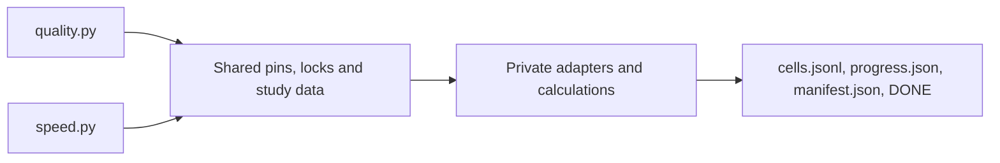

# Measuring quality and CPU speed

Use exactly two measurement entries:

| Entry | Purpose | Study data |
| :--- | :--- | :--- |
| `benchmarks/quality.py` | MTEB, offline SIF fits, STS, recall and score summaries | `benchmarks/config/quality.json` |
| `benchmarks/speed.py` | Paired libraries, table dtypes, precision, paragraphs, heads, versions and streamed writing | `benchmarks/config/speed.json` |

A new study adds data. A new Python library adds a native factory and a registry entry in `_speed_pipeline.py`. Do not add a separate runner. The retained Hub preparation and publication tools have another owner. These commands never publish models or change README values.

## Common contract

`benchmarks/config/pins.json` holds source revisions, model revisions, the corpus revision and the Linux image digest. The same directory holds dependency locks, study definitions and one bootstrap template. Review a changed pin as a new configuration. Never silently resolve `main` in place of a recorded revision.

Every kind of result writes the same four files through the lifecycle core `benchmarks/_harness/` (published studies, local development runs and the local quality run alike):

- `cells.jsonl`: one terminal record per requested cell, immediately flushed and synchronized.
- `progress.json`: current stage, cell, counts and remaining time (the local quality run writes it too, with its wall-time budget).
- `manifest.json`: every result member's relative path, size and SHA256.
- `DONE`: exit status and the manifest SHA256. Its presence means finished, including failure.

The core owns the durable record writer, manifest and DONE, `--collect`, the machine check, the time and money budget and the steps of an allocation. It imports only the standard library and itself; `tools/guardrails_imports.py` enforces that (`isolated-packages` in `pyproject.toml`), so the bootstrap script can run it on a bare interpreter. The entries and the local runs use it directly; no older path is left beside it.

Additional files retain per-round operations, correctness checks, input identities, fitted state and diagnostic telemetry. Models and full output matrices belong in the external work directory, never in Git or its evidence branch. No single Git file may exceed 10 MB without the coordinator's approval. Before every push inspect `git diff --stat` and new file sizes.



## Eleven measurement rules

1. Publish speed only from Linux. M1 timings and calls with only about 5,000 texts are withdrawn. Every measured fse inference call (encode or predict) must last at least two seconds. Search uses the whole-pool block rule below. Aim for three seconds with headroom. Rehearsal observations are never speed evidence.
2. Every number needs machine, CPU, date, workers, model, dimensions, table/output formats and text length. Report words or tokens per text beside texts/s. Sentences and paragraphs are different workloads.
3. One physical allocation is one cohort. Do not combine machines into a ratio. A CPU flavor does not guarantee a specific processor. Read the CPU and allowed affinity after allocation.
4. Use identical input within each pair on one machine. Alternate arms over at least three rounds. Report the median and the median of same-round time ratios. Different pairs may have different declared counts and digests. They are not a fixed-input scaling curve.
5. Correctness precedes speed. Check shape, dtype and a fixed sample, including saved UNK cases. Library pairs retain `rtol=3e-5`, `atol=3e-6`. Dtype controls are bit-exact. A failed check supplies no speed claim.
6. Load each library through its native API. Use its documented parallel path. ST uses its reusable CPU process pool, batch size 1024, one native thread per process and a checked, raised open-file limit. Do not substitute a compatibility loader that changes UNK behavior.
7. Record an initial quiet observation and rotate arms. Synchronize and remove owned output after checking it, before the next arm. A quiet start is not proof of later quietness. The approved library protocol has no duplicate A/A arm. Dtype controls retain an explicit symmetric 10 percent A/A gate.
8. Record load, memory, disk space and I/O before and after each operation. Preserve failures. Do not assign a cause to drift without the required telemetry. Host load on shared hardware is recorded, not treated as exclusive container load.
9. Before a paid run, rehearse every selected cell in the same pinned Linux image with small inputs. Preserve the memory calculation for real production sizes. Include restart, normal completion, SIGTERM and budget admission checks. A small rehearsal cannot prove full-size descriptor or shared-memory capacity.
10. Agree on cost and runtime before allocation, including setup, full warmups, slow arms, storage and collection reserve. Admission limits are soft and do not kill an active pair. Bootstrap remains in `sleep infinity` after success or failure. A restart never launches another measurement. The lifecycle owner collects, verifies and promptly deletes the allocation.
11. A watcher separates transport failure from a missing file during setup. Read-only monitoring must never start a second controller. Fetch progress and results continuously. On failure, preserve and collect first, then analyze locally.

## Match effort to the claim

Declare the question, class, decision, workload, practically relevant effect boundary,
total wall-time budget, estimated runtime/resources and stop rule before starting.
An estimate is a planning assumption, not a guaranteed duration. Include setup,
warmups, slow arms, waiting and collection reserve. Reject a plan whose known costs
cannot fit. Escalate exhausted budgets to the owner instead of extending them.

| Class | Question and protocol | Planning starting point |
| :--- | :--- | :--- |
| correctness | Does it work? Small reference probes, full applicable bits/conformance/quality gates. No speed decision. | No measurement minutes |
| descriptive | What does this feature cost? One arm, fixed repetitions, absolute median/IQR, no A/A or confirmation. | About 15 minutes per cell |
| regression | Could existing work become meaningfully slower? Paired builds and a predeclared relevant slowdown. A short screen can expose concerns or require escalation. | About 30 to 45 minutes total |
| optimization | Keep or reject? Full v2 tuning, independent A/A validation, comparison and confirmation. | Up to about 120 minutes after estimating costs |
| publication | What published speed claim or release guarantee can we support? Existing pinned Linux publication protocol and release evidence. | Separately agreed budget |

Published quality values remain class correctness and follow the reviewed summary process in [Local quality run](#local-quality-run-class-correctness).

New results write the class by its name. Results written before DR-294 (Messklassen mit lesbaren
Namen statt Einzelbuchstaben benennen) keep their former one-letter value unchanged.
`benchmarks/_measurement_claims.py` holds the only aliases: readers map an explicit class value
to its name and group old and new rows of one configuration together, without joining
machines, protocols or configurations. A row without a class stays without one, and a decision
label such as `descriptive_only` never determines a class.

These are planning suggestions, not empirical fse runtime guarantees. A descriptive result never
establishes a speedup or absence of regression. Comparing two descriptive medians does not
establish an optimization. A small regression median, including a value within one percent,
does not prove equivalence. This suite supplies no new equivalence test or screen
PASS heuristic. Short screens remain preliminary or inconclusive. Optimization screens never
return keep. Only the full optimization protocol can justify that local decision.

The class publication requires Linux publication evidence through the existing pinned protocol.
The only other case that requires a paired Linux comparison is an explicit approval
by the maintainer of a Linux machine for the ticket. Such an approved comparison can
also serve class regression or optimization. Voluntary Linux comparisons remain allowed. Local speed
results of the classes correctness, descriptive, regression and optimization are development indications with `publishable: false`.
Local correctness and quality results keep their validity. The PR states the
classes used and its actual Linux comparison status, and says explicitly when no
Linux comparison was run. Approval of a Linux machine does not approve paid
resources: rules 9 and 10 still apply before every paid run. Numerical
conformance, bit identity with the numpy reference and persistence checks apply
to every change.

Small probes precede long timing blocks: check the selected adapter against an
independent reference, full shape/dtype/count/bits, input checksums and actual build
identities. Tiny store probes record adjusted nonempty partial filters separately
from the declared study. The missing layout uses absent keys and still expects no hits.
Then retain the complete applicable quality gate. Cache that gate only
within the invocation for identical model, corpus, table dtype, workers and
document-ID profile/modes. Each
later child must still match its recorded build. These probes never replace full
conformance, persistence checks or Linux publication evidence.

Stabilize APIs before timing. Use affected tests and conformance for small review
fixes, then run the complete required `make check` on the final state. Repeat it
only for a new justified risk or failed gate. Profile representative changed paths
and resource risks rather than every parameter combination. Verify the executing
children, and retain the existing identity and age rules for evidence reuse. The
same calendar day alone never permits reuse. Existing and running v2 studies retain
their original contracts and interpretation.

Methodological basis: [pyperf runner](https://pyperf.readthedocs.io/en/stable/runner.html)
separates quick rough answers from rigorous runs and makes repetition explicit.
[pyperf analysis](https://pyperf.readthedocs.io/en/latest/analyze.html) retains raw
observations and reports variation. [ASV](https://asv.readthedocs.io/en/stable/commands.html)
labels quick runs as functional checks with unusable performance results.
[Kalibera and Jones](https://kar.kent.ac.uk/33611/) allocate repetitions to sources
of uncertainty. [Lakens](https://doi.org/10.1177/1948550617697177) distinguishes
absence of a detected difference from evidence within predeclared equivalence bounds.
These sources motivate proportional effort, not the numeric planning suggestions above.

## Local Unix development

The explicit `--diagnose` mode compares installed builds on macOS, Linux and other
Unix systems. Windows is rejected. Every local result is labelled `publishable: false`,
including Linux results. Local speed results are development indications, never README
speed evidence. The flag excludes published speed claims and speed publication evidence, not
validated quality results of class correctness. Local speed results still support the
development claim classes under their respective protocols. Such quality values may enter the
README through the reviewed summary process in [Local quality run](#local-quality-run-class-correctness).
The existing pinned Linux commands, studies and speed publication rules remain separate.

```sh
python benchmarks/speed.py --local-info
python benchmarks/speed.py --diagnose \
  --base-python /external/base/bin/python --candidate-python /external/candidate/bin/python \
  --cells potion-stsb-tokenizer potion-wikitext-tokenizer \
  --worker-name feature-owner --results /external/speed-01 --work /external/work-01
python benchmarks/quality.py --diagnose \
  --base-python /external/base/bin/python --candidate-python /external/candidate/bin/python \
  --worker-name feature-owner --results /external/quality-01 --work /external/quality-work-01
```

For class descriptive, select the explicit candidate-only phase:

```sh
python benchmarks/speed.py --diagnose --local-phase descriptive \
  --candidate-python /external/candidate/bin/python \
  --cells potion-stsb-tokenizer --descriptive-repetitions 5 \
  --wall-time-seconds 900 --estimated-seconds 600 \
  --results /external/costs-01 --work /external/costs-work-01
```

The descriptive phase uses the declared `resident_cycles` and `iterations` without sizing or A/A.
It runs exactly `warmup_calls` warmups per repetition, without a duration-driven
warmup loop, then one measured group. All measured repetitions enter the absolute
seconds median and IQR. It checks the candidate's complete direct/store quality
outputs and independently probes the selected adapter. No base interpreter, paired
factor, confirmation or optimization decision is used. The descriptive phase refuses reused controls.
`decision_gate: false` in an existing v2 contract retains its original paired
behavior and label. Only the new explicit phase selects this one-arm protocol.

For a short regression screen, use `--local-phase regression-screen --regression-limit 0.02`
with both interpreters. The limit is the predeclared relevant slowdown fraction,
not a statistical acceptance rule. This phase sizes common fixed inputs once and
runs five alternating pairs without A/A or confirmation. It always reports
`screen_requires_full_evidence`, status `inconclusive`, and a nonzero DONE, unless
it is a functional rehearsal. Inspect the raw pairs before requesting further work.
The existing optimization `screen` phase retains controls but cannot return keep.

Both local entries accept `--wall-time-seconds` and optional `--estimated-seconds`.
A declared estimate exceeding the budget, or a known measured-group lower bound
that cannot fit, is refused before result directories are created. This lower bound
excludes setup and warmups and never promises that a plan will finish. Defaults are 900 seconds for the descriptive phase and 7200 seconds for other local phases,
shared by the entire invocation, never multiplied by selected cells. Set an
explicit budget appropriate to the declared claim and workload. The monotonic
clock starts when the local session opens, before directory/environment capture.
Preparation, quality, warmups, calibration, comparison and lock/load waits all count.
The existing active calibration limit applies in addition.

Checks run before waits, children and stage transitions, including child warmup
boundaries. An active operation, verification, download or model load may finish safely
past the deadline. Preparation also checks between corpora, models and dtype exports. The next operation is refused. This is an admission budget,
not a hard process-kill timeout. Progress records the remaining budget and overrun,
with unknown remaining workload time as `null` rather than a fixed estimate.
Budget exhaustion produces `inconclusive_budget` for an active cell or a session
budget record when preparation stops. Unstarted cells remain `not_started`. Partial
blocks never become valid decisions. Raw receipts, final manifest and nonzero DONE
remain collectible, and owned locks are released. No automatic retry or extension
occurs. A functional rehearsal still enforces this wall-time budget.

`benchmarks/config/development.json` declares two pinned public models, STS-B and
WikiText, and four stages. Select cells explicitly for a bounded study. `--input`
or `--development-input` accepts a strict local contract. A venv directory is also
accepted as an interpreter, without resolving away its venv identity.

The `local-development-v2` timer uses repeated prepared inputs at constant resident
size. `resident_cycles` defaults to one complete corpus and never grows during
calibration. `iterations` counts complete stage operations inside one uninterrupted
timer. Both builds, warmups, A/A, comparisons and confirmation use the same frozen
count. Individual library operations may be short; the group must meet the duration
floor. This differs from the publication protocol's single-call requirement.

Tokenizer repeats encoding on one scanned source. Pooling reuses one exported batch
and one output array, without normalization. Memory encoding calls the public encode
API with a new Sink wrapper over the same allocated arrays on every iteration. The
regular allocating encode API has no output-buffer argument, so this stage measures
the reusable-target path, not allocation and concatenation of a fresh result. A full
byte-equivalence check against regular encode runs outside the timer before repetition.
The final output of each warmup/measured group is checked completely.

A ShardSink accepts only one run. Each disk iteration therefore encodes the same fixed
input file into a fresh ShardSink and closes it. The continuous group timer includes
all opens, complete encodes and closes. Read-to-close and including-open component
sums are descriptive, never substitutes for this continuous timer. Every produced
store is verified, synchronized and removed after the group, before another group.
Disk admission grows with iterations; resident inputs and result buffers do not.
Model loading, input preparation and output verification remain outside the timer.
The timer includes the repeat loop and release of preceding tokenizer outputs.

Quality uses the complete original STS-B train/dev/test texts and unrounded labels,
and every original WikiText-103 raw-v1 test row, including empty rows and headings.
Timing explicitly collapses whitespace to one space while preserving those row
positions, so file input has exactly one physical line per row. Every timing stage
uses that same text view. Workloads repeat whole fixed corpus cycles in source order.
The result records corpus hashes, count, preprocessing and repetition. Download is
anonymous and restricted to recorded public revisions. `--hf-cache` reads an existing
external cache first; missing artifacts download to the owned external work cache.

Defaults are six-second groups, at least two full warmups totaling twelve seconds and
fifteen pairs per block. AB/BA alternates; a cell can explicitly select ABBA. Its factor
is the sum of A times divided by the sum of B times. Every measured group meets the
frozen group duration floor. It is a continuous interval, not a sum of separately
timed snippets. `--functional` (the stage functional, see "Stage functional and resource plan")
labels small functional probes and disables timing decisions, not correctness checks.

Calibration sizes a common iteration count with reserve on both builds, keeping the
resident corpus fixed. This follows the calibrated loop pattern described by
[pyperf](https://pyperf.readthedocs.io/en/latest/runner.html#loop-iterations).
Sizing probes may be shorter, use two preliminary groups without the twelve-second
warmup requirement and explicitly have `valid_for_comparison: false`.
They never enter paired decision summaries. Calibration measures
A/A at targets six, twelve and twenty-four seconds, seeking a ratio IQR below 0.02.
The first suitable tier needs an independent A/A validation block. Limits are three
tiers, twenty-four seconds target and sixty active calibration minutes per cell.
Load/lock waiting is separate from the active calibration counter, but counts
against the total session wall-time budget. An active operation finishes before
a soft budget stop. Exhausted noise or resource limits produce an explicit inconclusive
or non-executable cell. No outliers are removed or repeated until a favorable sample.
These longer defaults are a policy choice, not a proven guarantee of lower noise.
Four fifteen-pair AB blocks at the six-second tier need at least 36 minutes per cell.

The factor is base/candidate time. Saving is `1 - 1 / median(paired factors)`.
Keep requires saving at least `max(3 * same-cell A/A IQR, 0.02)` and an independent
confirmation with positive saving and at least half the main effect.
Active decision gates cannot lower the noise multiplier below three, minimum saving
below two percent or confirmation fraction below one half. Weaker configurations
require `decision_gate: false` and retain the legacy paired `descriptive_only` label.
They do not select the new one-arm descriptive phase.
An optional study-level `decision` block (`cells@1`) combines named `main` cells and `edge` factor bounds. It never replaces the per-cell noise or confirmation rules. The internal `_development_decision.replay(results)` adapter re-evaluates complete recorded blocks without changing the source folder. Historical contracts need an explicit version adapter, never current defaults.

Maximum factor and maximum distance from one remain descriptive. Required cells cannot offset one
another. `--local-phase` selects `prepare`, `descriptive`, `regression-screen`, `calibrate`,
`aa`, `screen`, `compare` or `confirm`; the default `compare` includes controls and confirmation. A screen cannot
yield a final keep decision. Separate confirmation requires `--comparison-results`.
`--aa-results` can reuse a completed matching control with `compare` or `screen`.
`--reuse-work` reuses prepared external inputs. Reuse checks final manifests, source
hashes, builds, dependencies, available Git revision, machine boot, cell, order, dtype,
corpus and affinity. The environment records Git availability and tracked dirty state;
file hashes identify the runner even where mounted worktree metadata is unavailable.
Systems without a readable boot identity require fresh controls. A session interrupted
for fifteen minutes requires new controls for that cell. A later-finishing different
cell does not refresh an earlier cell's controls. Continuous long runs have no global
thirty-minute expiry.

The byte gate compares complete direct and stored float32, float16 and int8 payloads,
including scales and stored inverse norms, and checks direct/store equality within
each build. Logical rows are compared independently of shard layout. STS-B Pearson
and Spearman additionally compare exact little-endian float64 bits on each split.
The first difference stops further cells. Scores are confirmation data, not new
published benchmark values. Quality and stage-specific correctness precede speed.

`FSE_BENCH_LOCK` and `FSE_HEAVY_LOCK` configure shared mkdir locks across worktrees.
Defaults share a user-specific temporary directory. Each acquisition checks the peer
before and after mkdir. Never take over an existing owner, even if its PID disappeared.
Each lock has a separate sibling `<lock>.queue` directory. A nonblocking file
lock on its persistent `.guard` serializes registration. Monotonically numbered
tickets define FIFO order by successful registration, not process start time or
wall clock. Only the first live waiter attempts mkdir and the admission checks.
A head waiting for load or its peer blocks later tickets in that same queue.
There is no ordering guarantee between the two queues.

Every `waiting_for_lock` heartbeat reports `position` (starting at 1), `waiting`
(live tickets including itself), and `holder` / `peer_holder` (best-effort owner
snapshots, not liveness claims). While the guard is busy, position and count are
null. No notification or payload runs under the guard. SIGINT/SIGTERM, budget
expiry and exceptions remove the waiter's own ticket. Aborting takes at most the
poll interval (one second by default) plus one short guard section. A kernel file
lock, not a PID or timestamp, proves a waiter is still alive. After a crash,
including SIGKILL during registration, the next scanner removes its unlocked
ticket. A paused waiter stays alive and may block the queue. Resume or stop that
process explicitly. Never remove live tickets, replace the queue directory, or
remove `.guard`. Manual ticket cleanup is only for dead processes. Unknown
entries, symlinks and overlapping lock/queue paths are errors. These locks are
for local Unix filesystems; host/container shared file-lock behavior is not
established for Docker Desktop bind mounts. Separate coordination directories
mean separate queues.

For rollout, stop or drain all old waiting controllers and heavy wrappers, then
restart them from updated code. Existing holders may finish normally. Old waiters
still respect exclusion but may jump the queue, so mixed versions promise no FIFO
order. Holder recovery stays manual, including after a holder's PID disappears.

Timing holds bench.lock for a complete cell and rechecks heavy.lock before each arm.
Reused cells carry their last completed operation into the next run. The first wait
and the measurement child recheck that age before beginning work.
Builds and checks use the same reverse exclusion:

```sh
python benchmarks/speed.py --local-heavy --worker-name feature-owner -- make check PYTEST_N=4
```

The heavy wrapper forwards SIGINT/SIGTERM to its own job process group. It keeps
heavy.lock until the leader and its descendants have ended. A failed owner-file
write rolls back only the lock directory and file created by that acquisition.

Timing waits for `os.getloadavg()[0] < 5` before each cell, arm and measured call.
For an allocation, `speed.py --diagnose --allocation-root PATH --ignore-host-load`
disables this load gate at cell, arm and operation admission, including the
separate source-identity and rescore-cost cell paths. This explicit protocol
deviation was approved on 12 November 2026 for containers reporting shared host
load rather than exclusive container load. The flag requires both `--diagnose`
and `--allocation-root`. The default local path keeps its load gate. Heavy-lock
coordination, timing-lock ownership, budgets and session-expiry checks remain
active. Load telemetry is still recorded. The session contract and every child
job record `ignore_host_load`, so the deviation remains visible in the evidence.
Reused controls must match this load policy as part of their measurement context.
Foreign processes above fifty percent CPU are telemetry only; process arguments are
never collected. Measurement priority targets nice 0. `speed.py --diagnose` refuses a nonzero inherited nice before it creates directories or starts the budget, except with `--diagnostic-rehearsal` or `--local-phase prepare`, where `os.getpriority` is available. zsh's default BG_NICE adds 5 to the nice value of `cmd &` jobs and is the usual cause. Builds/checks use nice 10 when
available. macOS uses `taskpolicy -B` when available. Linux supports explicitly
requested `--cpu-affinity` and reports a readable governor without changing it.
Optional capabilities are reported rather than required. Missing RAM detection needs
`--memory-limit-bytes`; automatic admission uses at most 85 percent of the detected
physical/cgroup limit. The recorded input and processed row counts distinguish
resident rows from repeated work. No privileged frequency or scheduling changes are performed.

Results retain raw operations, warmups, telemetry, checks, decisions and build identities
with the existing `cells.jsonl`, `progress.json`, manifest and DONE collection contract.
Models, full output tensors and corpora stay in the external work directory. A nonzero
DONE is not success; rejected/inconclusive decisions are preserved.

The [benchmark skill](../../.agents/skills/fse-benchmark/SKILL.md#local-unix-development)
shows the pinned development Dockerfile and read-only repository mounts. It builds
this checkout's extension on Linux using CPython 3.13.18 of the image in `pins.json`, keeps models/data outside
the image and is never pushed to a registry. Rebuild after product changes. A container
functional probe establishes function only, with no Linux or host-Mac speed claim.

### CPU pressure and report-only noise labels

Each operation records `cpu_pressure` in its before/after telemetry. On Linux,
this includes `/proc/pressure/cpu`, the executing process's cgroup2
`cpu.pressure`, and `cpu.stat`. The runner resolves cgroup membership through
`/proc/self/cgroup` and `/proc/self/mountinfo`, rather than assuming the mount
root is the executing cgroup. Each source retains its path, monotonic observation
time and parsed counters. Missing, unreadable or unsupported sources, including
PSI on macOS, have values `"unavailable"`. They never refuse an operation.

The operation's `cpu_pressure` report uses the difference of PSI `total`
counters, in microseconds, divided by elapsed monotonic microseconds between
observations of that source. It retains `some` and, when supplied, `full` stall
fractions. Rolling `avg10`, `avg60` and `avg300` values remain raw context.
`contended` is true when either scope's `some` fraction exceeds 0.10. The scopes
remain separate because host pressure on shared hardware is not container
pressure. If neither scope is contended but one is unavailable, the combined
flag is `"unavailable"`. Missing observations, changed paths and decreasing
counters produce unavailable intervals. `cpu.stat` retains raw counters and
interval deltas, including available throttling counters, without a new gate.

Operation records cover measured calls, sizing and calibration. Warmups retain
separate observations. Search warmup sums active search-block durations to two
seconds and streams pressure observations outside the timer to a warmup JSONL
file and the child log. Repeated local groups use the full group interval, with
individual warmup and measured groups in the call log. Rust observations cover
the child process lifetime, including model/input loading and output writing,
because its inner timer runs inside the Rust executable.

Distribution summaries report `noisy` when IQR exceeds 0.10 times the median.
New IQR summaries use inclusive linear interpolation (a singleton has zero IQR).
Search keeps its existing exclusive quartiles. Arm reports count contended and
unavailable operations separately for each arm. Descriptive identity reports
aggregate only measured calls, excluding warmups and file preparation. Both `contended` and `noisy` are reporting labels only:
they do not change admission, validity, decisions, retries or exit status.
Existing A/A decision rules remain independent of these labels.

Sources: [kernel PSI interface](https://docs.kernel.org/accounting/psi.html)
(`total` units and the two scopes) and
[cgroup v2 CPU interface](https://docs.kernel.org/admin-guide/cgroup-v2.html#cpu)
(`cpu.stat` counters). Verification uses small external correctness probes,
without speed claims or a Linux comparison.

### Document-ID adapter profile

`profile: "document-ids@1"` and `document-ids-1m@1` extend the same v2 controller with optional stored IDs,
`store-search` and `store-open`. It does not add another timer or publication path.
`base_doc_ids` and `candidate_doc_ids` accept `none`, `ordered` or `shuffled`.
IDs are int64 row positions divided by `id_chunks` (default four), with seed-zero
shuffling when selected. All written labels are checked against their source rows.
Numerical tensors remain the common paired output proof. Search additionally checks
every returned label against its physical position and every position against the filter.

`benchmarks/config/document-ids-1m-local.json` defines the active smaller workload:
1,002,340 rows from 230 complete WikiText test cycles, two workers and float32 tables.
Both builds use the same resident count and complete corpus order. Every cell needs
fresh same-cell controls. Float32 without IDs versus ordered IDs precedes int8.
All v2 gates remain active: fifteen pairs, at least twelve seconds of warmup, A/A IQR
below two percent, at most sixty active calibration minutes, a saving threshold of
`max(3 * A/A IQR, 0.02)` and independent confirmation. A rejected speed decision does
not establish a numerical difference; complete byte checks are a separate gate.

The retained `benchmarks/config/document-ids-local.json` defines the earlier 10,001,610-row workload,
2295 complete WikiText test cycles, with two workers and float32 tables. It is not
the 100-million-row Linux headline or the earlier ten-million-row training-text study.
Float32 ordered-ID writing precedes the int8 configurations. These comparisons are
descriptive because optional ID work is an added feature, not a speed optimization.
Its first float32 cell was inconclusive when the active calibration budget expired
after nine of fifteen A/A pairs. Neither its partial observations nor its controls
are reused for the smaller profile. Raw evidence remains retained.

Both profiles require at least 30 GiB to remain
free after the conservative planned output allocation. Admission checks each cell and
each write group. Every repeated store is fully verified, synchronized and removed
outside its group's timer. `*.stores.jsonl` records logical file bytes and ID payload
bytes separately; these are not physical device writes.

This profile's file-write RAM admission counts common live inputs plus the larger
of encoding and complete store verification. FileSource maps the entire UTF-8 file.
It tokenizes bounded tasks rather than allocating a token array for all input rows.
The encode estimate includes the full mapped file, the 512 MiB runtime window,
both 64 MiB writer queues and an additional 1 GiB native-workspace allowance per
worker. Verification includes the full float32-sized store mapping, inverse norms,
scales and IDs, even for smaller output formats. Common state retains the general
reserve, model, Python-text, worker and ID budgets. The ledger records both phase
estimates. The safety fraction remains 85 percent. These are conservative admission
estimates, not observed RSS. Other profiles and stages retain their existing planner.

```sh
python benchmarks/speed.py --diagnose \
  --development-input benchmarks/config/document-ids-1m-local.json \
  --cells local-wikitext-1002340-float32-ordered-ids \
  --base-python /external/master/bin/python --candidate-python /external/candidate/bin/python \
  --worker-name document-ids --results /external/ids-results --work /external/ids-work
python benchmarks/quality.py --diagnose \
  --development-input benchmarks/config/quality-local.json \
  --base-python /external/master/bin/python --candidate-python /external/candidate/bin/python \
  --worker-name document-ids --results /external/ids-quality --work /external/ids-quality-work
```

The normal A/A blocks always use the base interpreter and base ID mode for both arms.
For the explicit ID-control cells, pass the candidate interpreter as both interpreters.
Their base and candidate ID modes are both ordered. Such controls are separate cells,
not reusable controls for a differently configured base/candidate comparison.

`document-ids-store-local.json` defines small, complete 4358-row WikiText stores.
These are explicitly separate from large-store evidence. Source-store construction,
full verification, synchronization and filter preparation happen outside the timer.
Search repeats exact scoring on an already open store. Open repeats opening and closing
the same store with warm OS caches. It does not measure cold storage latency.
Range, spread and missing filters use `filter_fraction` of the row or document domain.
`filter_kind: "none"` supplies no filter argument to public `store.search`; it does
not construct a full-domain row filter. `document-search-unfiltered-local.json`
compares master with the candidate on ordinary float32 stores without document IDs.
It uses one shared calibrated loop count and retains complete output bit checks.
Its explicit non-regression assessment requires median paired relative time overhead
in both comparison and confirmation below `max(3 * validated A/A IQR, 0.02)`.
The `descriptive_only` tool label does not establish that assessment.
`filter_kind` selects physical `rows` or logical `doc_ids`; `queries` and `k` are explicit.
Both installed builds must support the selected filter API. Use two candidate
interpreters for functional probes or controls where master lacks that API.
Run `--functional` with a separately named small-cycle configuration for
functional probes. Never report those observations as the large workload's throughput.

### Filtered-search cost profile

`document-search-cost@1` is an explicit extension of the shared v2 controller.
`benchmarks/config/document-search-cost-local.json` selects four pairs: 64 or 65,536
document values on ordered or seed-zero shuffled IDs. Both interpreters execute the
same candidate. The base arm calls the public `store.search` without a filter;
the candidate arm supplies `doc_ids`. Each store contains 1,002,340 real WikiText
rows with float32 POTION vectors, one fixed query, k=10 and two requested workers.
These cost cells use `decision_gate: false` and begin calibration at twelve seconds.
Independent A/A validation, fifteen pairs per block, confirmation and the 3,600-active-second
calibration budget remain required. Exhausted calibration stays inconclusive.

Before timing, the filter includes every unfiltered exact top-k document value and
a deterministic unique augmentation to its declared size. Its input order is then
permuted. This is a winner-inclusive workload, not random metadata filtering.
Both arms must retain identical complete positions and score bits, and every returned
document value is checked against its physical row and the unfiltered reference.
The numerical checks are never replaced with a boolean success marker.

Only this profile calibrates and freezes `base_iterations` and `candidate_iterations`
separately. The continuous group timer, duration floors, warmups, fifteen alternating
pairs, independent A/A validation and active calibration budget remain unchanged.
A/A uses the unfiltered base operation and its loop count in both arms. Paired ratios
use each arm's total seconds divided by its total public-call count, including ABBA.
Raw group seconds and actual loop counts remain in every record. The one-call output
proof compares the full numerical payload independently of different repetition counts.
All other profiles retain their original common-count formula and proof.

Results additionally contain `milliseconds_per_call` for both arms. These are medians
and IQRs of group-normalized public-call latencies, not a p95 distribution of individual
calls. Show each filtered result beside its own paired unfiltered reference. Model
loading, source-store construction, synchronization, reference search and filter input
generation remain outside the timer. Public validation, filter normalization and exact
search are inside. Stores and OS caches are warmed, not forcibly cleared.

Use the same declared cost rule for comparison and confirmation: median paired
relative overhead strictly below `max(3 * validated A/A IQR, 0.02)`. A raw tool reject
for lack of speedup is separate from this cost assessment. Keep all observations.

Filter memory uses the existing internal `speed.py --development-job` action
`filter-memory`, under `speed.py --local-heavy`. It reports warm incremental filter
preparation plus block selection separately from the full public search (which also
includes numerical scoring buffers). Caller arrays/lists and the independent row
oracle are created outside the traced interval. Array data bytes and list/element
representation sizes are separate from the measured incremental peak. Whole-child
RSS includes source-store construction and the oracle as well.
The filter-only probe uses the largest legal selection block, 65,536 rows, even
when the actual vector width makes the public search use smaller scoring blocks.
Both block sizes are recorded, so the budget evidence covers the general bound.

Probe counts include the actual admitted boundary `FILTER_BYTES // FILTER_ROW_BYTES`
and one entry above it. The latter must raise the filter-budget error before a large
internal allocation. Existing 64 MiB admission and 24 bytes per input entry remain
unchanged unless the recorded measurements justify a separately reviewed change.
No index or sorted copy of the store's ID column is introduced.

Calibrated loop counts and per-loop normalization follow the pattern documented in
the [pyperf runner](https://pyperf.readthedocs.io/en/latest/runner.html) and
[pyperf Run API](https://pyperf.readthedocs.io/en/latest/api.html#run-class).

## Inspect and set up

Describe without importing optional measurement packages:

```sh
python benchmarks/speed.py --describe
python benchmarks/quality.py --describe
```

Install into fresh external directories, using Python from the pinned Linux image:

```sh
python benchmarks/speed.py --setup /speed-env --allocated-at "$MEASURE_ALLOCATED_AT"
python benchmarks/quality.py --setup /quality-env --allocated-at "$MEASURE_ALLOCATED_AT"
```

The timestamp is the actual allocation start, including setup. Setup installs the pinned fse source into isolated environments. Python packages use exact versions and required hashes. uv's `unsafe-best-match` allows PyPI packages beside CPU Torch. Accepted distributions remain constrained by the hashes. Rust builds with the shared Cargo lock and pinned source. `uv pip check` verifies each Python environment.

Generate the single bootstrap for an immutable, pushed source commit:

```sh
python benchmarks/speed.py --bootstrap --source-revision FULL_COMMIT_SHA > /external/speed-bootstrap.sh
python benchmarks/quality.py --bootstrap --source-revision FULL_COMMIT_SHA > /external/quality-bootstrap.sh
```

The lifecycle owner uses `/bin/bash` as entrypoint with the generated script. Enable SSH injection and `22/tcp` when remote collection needs SSH. `PUBLIC_KEY` is read directly by the script. Set `MEASURE_ALLOCATED_AT`. Optional `MEASURE_INPUT` selects another reviewed study file. `MEASURE_STUDY` selects `libraries`, `dtypes`, `headline`, `bekko`, `paragraphs`, `heads`, `versions` or `all` for speed. No provider API is called by either entry.

The bootstrap starts SSH before setup, claims one persistent start marker and preserves existing results on restart. It then runs the allocation lifecycle (see "Allocation lifecycle" below). The default result/work/environment paths are `/speed-results`, `/speed-work`, `/speed-env` or their `quality` equivalents. Cache paths are outside the checkout. Never copy a credential into a study or result file.

## Allocation lifecycle

`benchmarks/config/allocation.json` (`allocation@1`, one section per entry) declares what one rented machine must be, which environments to install and the steps to run:

- `machine_check`: what the machine must be. Fields: `cpu_model` (exact), `required_flags`, `affinity_cpus`, `cpu_quota_cpus` (`cpu.max`), `memory_max_bytes` (`memory.max`), `disk_free_bytes`, `shm_bytes` and `nofile_hard_min`; ranges take `min` and `max`. `rehearsal_machine_check` is the same for the pinned rehearsal image (at most two CPU quota units and four GiB for quality, six GiB for speed). An unlimited quota or memory satisfies a minimum and violates a maximum; a declared value the machine does not show is a deviation.
- GPU checks add `gpu_name` (exact string), `gpu_count` (exact positive integer),
  `gpu_memory_bytes` (positive integer minimum per device) and
  `cuda_driver_version` (minimum numeric driver version, such as `570.26`).
  Driver components compare numerically; `570.26` equals `570.26.0`.
  Only allocations declaring a GPU field query `nvidia-smi`, with a ten-second
  timeout. The query records every device's name, UUID, memory and driver.
  [NVIDIA's query interface](https://docs.nvidia.com/deploy/nvidia-smi/index.html)
  reports `memory.total` in MiB, converted here to bytes. Missing tools, failed
  queries and malformed or unavailable fields reject a declared GPU check.
  CPU-only checks need no NVIDIA tool or driver.
- `environments`: `base`, `candidate` and `reference` environments, each with its own lock and a product revision (`"pins"` for the revision of `pins.json`, a full commit, or none). The candidate's source is `fse-source`; any other role gets `fse-source-<name>`.
- `steps`: ordered; each names an environment, a command with `{field}` placeholders (`{python}`, `{results}`, `{work}`, `{allocated_at}`, `{remaining_seconds}`, `{source}`, `{python_<environment>}` and `--param` values) and an `estimate_seconds`.

The bootstrap runs, in this order: clone, `begin`, setup, `run` (`python -m _harness.allocation`, from `benchmarks/`).

1. `begin` checks the machine before anything is installed. A deviation starts no step: every step folder and the allocation record are sealed with exit status 1 and the deviations as the reason, and the bootstrap stops.
2. `run` takes each step in order. Before every step the shared budget (`Budget`, counted from `--allocated-at`, the smaller of planned minutes and planned balance, with the collection reserve) must admit its estimate. A step that does not fit, or that follows a stop signal, is sealed as `not_started`.
3. Each step has its own result folder `<step>-results`, its own `DONE`, its own PID (`<step>-logs/measurement.pid`) and its own restart guard (`step-state/<step>`, claimed once; a second start is refused with status 77). The bootstrap keeps its allocation-level guard beside it.
4. A failed step does not hide an independent next step, and the allocation ends with status 1. A step may declare `requires`, a list of unique earlier step names. Unknown, repeated, forward and self references are refused. Dependent steps start only after every prerequisite finished with process exit 0 and a verified manifest and `DONE` with exit 0. A skipped, failed or unsealed prerequisite leaves the dependent step `not_started` with a reason. SIGTERM goes to the running step and stops every later step.
5. Optional `requires_by_seconds` is a positive finite admission deadline from allocation start, including setup, and requires a nonempty `requires` list. Admission must happen strictly before this deadline. The runner compares a receipt of each prerequisite against the current allocation root, timestamp, entry, definition, parameters, executing runner revision and Python source hashes, configuration JSON files, declared lock hashes and setup record (when present). It rechecks the sealed result inventory and DONE hash. Existing step result folders are refused without reuse or modification. Changed or missing evidence refuses admission. These checks do not extend the budget or retry work.
6. `{remaining_seconds}` is rendered separately for each step from `Budget.remaining()`, after the collection reserve. Caller parameters cannot override it.
7. The record `allocation-results/` holds `allocation.json`, `machine-check.json`, `steps.jsonl` and its own manifest and `DONE`.

`speed.py --collect ALLOCATION_ROOT --archive DIR` verifies and archives the record and every step folder; a single result folder (published, local development or local quality) takes `--collect FOLDER --archive FILE.tar.gz` as before.

The core holds no limit. The values live in the data of the allocation. Those of the published studies come from the 2.0 evidence (`sentence-speed-2026-11`, `environment.json`: `AMD EPYC 9575F 64-Core Processor`, 32 allowed CPUs, `memory.max` 128000000000), the kernel contract (`avx2`, `fma`, `f16c`) and the Linux plan (free disk at least 120 GB on pod 1, hard `nofile` at least 524288). Not evidenced yet, and marked as placeholders for the maintainer: `shm_bytes` (1 GiB, the rehearsal rule; the 2.0 archive does not record `/dev/shm`) and `cpu_quota_cpus` (at least 32; the 2.0 run did not record `cpu.max`).

`benchmarks/config/allocation-gpu.json` declares one NVIDIA L40S with at least
44 GiB (47244640256 bytes) of reported device memory. Its driver floor is
`570.26`, the Linux value for CUDA 12.8 GA in
[NVIDIA's CUDA Toolkit and Corresponding Driver Versions table](https://docs.nvidia.com/cuda/archive/12.8.0/cuda-toolkit-release-notes/index.html#cuda-driver).
This uses the toolkit driver floor rather than the weaker CUDA 12.x minor
compatibility floor. The rehearsal also requires this GPU, so a CPU-only
container cannot establish CUDA readiness.

Select this file with `MEASURE_ALLOCATION`, the `gpu` study and the
`gpu_billing` profile (60 minutes with a 300-second collection reserve).
The `main` environment retains the pinned fse installation; `gpu` uses
`speed-gpu.lock.txt` for CUDA 12.8. Both steps execute in `gpu`:
`gpu-probe` runs `speed.py --run --study gpu --gpu-phase probe`, then
`gpu-measure` runs the same entry with `--gpu-phase measure`.
The latter requires a verified successful `gpu-probe` receipt and admission
strictly before 1320 seconds from allocation start, including setup.
The step estimates are 240 and 1620 seconds. A later quality step can be
appended independently; this allocation currently declares only throughput.

`python -m _harness.controls --out DIR` (from `benchmarks/`) runs the lifecycle controls without any environment: normal, SIGTERM, budget end, rejected machine check, step 2 after a failed step 1, SIGTERM and budget end of an allocation. Dependency controls also cover success, failure, skipped and unsealed prerequisites, the exact deadline, foreign existing results, and mismatched evidence. Every rehearsal runs them too (below).

## Rehearse before allocation

Use the exact image digest from `pins.json`, Linux amd64, at most two CPU quota units and four GiB RAM (six GiB for the speed rehearsal, because of the bekko cells). Give the ST process pool at least one GiB `/dev/shm` and an adequate hard `nofile` limit. Inputs and generated outputs stay outside the repository. The production memory plan remains attached even though the actual rehearsal data are small.

```sh
/speed-env/main/bin/python /source/benchmarks/speed.py --rehearse --study libraries \
  --results /proof/speed-results --work /proof/speed-work \
  --reference-python /speed-env/reference/bin/python --allocated-at "$MEASURE_ALLOCATED_AT"
/quality-env/main/bin/python /source/benchmarks/quality.py --rehearse \
  --results /proof/quality-results --work /proof/quality-work \
  --allocated-at "$MEASURE_ALLOCATED_AT"
```

The speed rehearsal runs the configured pairs of the selected study with reduced sizes; `--study all` adds dtype controls and writing, and needs `--base-python` (for the `versions` cells) and a candidate fse with `fse.Heads` (for the `heads` cells). The bekko cells need a container of about 6 GiB, so the speed rehearsal machine check in `allocation.json` allows at most 6 GiB (6442450944 bytes). In a four GiB container the bekko cells fail with `MemoryError: fixed input exceeds the declared memory budget` (DR-320: Pin der fse-Revision für die Linux-Studien auf den aktuellen master heben). The maintainer approved the larger limit on 2026-11-08: "Das GB-Limit ist mir dabei egal". The rehearsal check of the quality section in `allocation.json` stays at four GiB, but `quality.py --rehearse` reads the limits of the speed section (`_measurement.rehearsal_limits`), so a direct quality rehearsal also accepts up to six GiB. The quality rehearsal exercises deterministic tiny SIF calculations, the real FineWeb sampling algorithm on eight local fixture shards, historical STS evaluation, neighbor recall and an entire small MTEB task. Functional records are labelled and excluded from publication summaries. Control proofs are written inside `controls/` in the result directory, before its final manifest and DONE. A failed control produces a nonzero outer completion. They exercise the real result writer, signal handler, budget gate and allocation runner (normal, SIGTERM, budget end, rejected machine check, step 2 after a failed step 1). The bootstrap restart proof executes the actual restart guard with only its setup leaf disabled. Keep this scope distinct from a full container restart, which the lifecycle owner should also check before a fresh launch.

Do not add repository tests for these measurement tools. Run the functional modes and the ordinary repository gates. These tools do not change the fse hot path, so no local performance result is required for moving them.

## Speed study data

A library cell declares `model`, `reference`, `workers`, `texts`, `dimensions`, `dtype`, `rounds`, `planned_input_bytes` and `estimated_seconds`. Keep the common input digest within a pair. Do not shrink only the slow arm. If the common workload is too expensive, obtain a new agreed workload before starting.

Dtype cells use `reference: fse-control`, the same table dtype in both arms and bit-exact output checks. For a source-code comparison, a reviewed data cell can use `reference: fse-base` with `--base-python /external/base-env/bin/python`. The base and candidate use their own installed package identities. Such a pair is a base/candidate comparison, not an identical-code A/A control.

### README study for 2.1

`speed.py --describe --study readme` shows the effective selection, overrides and
`readme_billing`, without importing optional measurement libraries. The same selection
feeds `--rehearse --study readme` and `--run --study readme`. Historical stage
selections keep their original workloads. A selected input with
`planned_input_sha256` must match both its byte count and its digest in production.

| Selection | Workload | Rounds |
| :--- | :--- | :--- |
| Eight library pairs | POTION: 2.5 million texts with one worker, 20 million with 16; static ST: 2 million and 5 million | 3 |
| Streamed headline | 100 million texts, 16 workers, float32 table, int8 output, durability `none` | 3 |
| Six paragraph dtype controls | 600,000 paragraphs with one worker, 5 million with 16 | 5 |
| Two bekko pairs | 2 million texts with one worker, 5 million with 16 | 3 |
| Three existing head pairs | 5 million texts, one worker | 3 against Model2Vec, otherwise 5 |
| Three search cells | Exact float32, exact int8, binary float32 over 832,318 rows | 3 rotating rounds |
| Absolute MiniLM transformer | 32,768 texts, 16 CPU workers, float32 weights and output, batch size 32 | 5 |

The selection has 24 cells. It excludes version comparisons, sentence dtype controls,
headline predictions, the 32-worker headline and the conditional prefilter.
DR-384 (Kopfarten und Sinks der linearen Köpfe in der Veröffentlichungsstudie messen)
will add its head-kind and sink cells to `readme.cell_ids` later. No placeholder IDs
are reserved. A shipped prefilter needs its own explicit selection after approval.
The 32-worker headline footnote is retired for this study. Existing published
README values are not changed by defining this workload.

The planned publication question is which 2.1 README values have valid Linux
evidence. An invalid cell supplies no replacement value and is never retried.
There is no effect-size decision in this publication study. Historical planning
limits in `readme_billing` are 295 minutes, USD 7.35 and a 600-second collection
reserve, including provisioning, setup, warmups, profiles, waits and collection.
These limits do not authorize spending. Exhaustion stops admission at a safe boundary.
The production memory plan must fit 85 percent of 128 GB (108.8 GB), independently
of the reduced functional plan. Profiles and the pinned Linux rehearsal belong to
the allocation acceptance before any paid publication run.

#### Absolute transformer variant (`transformer@1`)

Fields are device-neutral: `kind: transformer`, `reference: null`, `backend: st`,
`device`, `torch_dtype`, `dtype`, `batch_size`, `workers`, `texts`, `dimensions`,
`rounds`, `input: st` and `input_prefix_texts`. The current device is explicitly
`cpu`; missing devices and every other value are rejected. Both precision fields
must be `float32`. The model revision comes only from `pins.json`.

The adapter reuses `st_encoder`, its native Sentence Transformers loader and its
reusable CPU process pool, with one Torch thread per worker. It uses the documented
[encode default batch size of 32](https://www.sbert.net/docs/package_reference/sentence_transformer/SentenceTransformer.html#sentence_transformers.SentenceTransformer.encode)
for this transformer, rather than the static embedding cells' batch size 1024.
Each child checks the native single-process result against the warmed pool on
16 rows (including all eight UNK paragraphs), then checks the timed sample against
the warm sample. Shape, float32 output and finite values are checked. Warmup,
model loading, sample checks and pool startup are outside the timer.

MiniLM uses the first 32,768 lines of the two-million-line production `st` file,
including the eight mandatory UNK paragraphs. Sampling and shuffling use the parent
count before taking the prefix, so this is not a separate random draw. Its own
byte count and SHA256 are fixed in the cell. A future GPU cell can use exactly
these bytes. Rehearsal inputs remain reduced and do not claim that production hash.
The sizing assumption is an upper throughput of 10,000 texts/s on 16 CPU workers:
32,768 / 10,000 = 3.2768 seconds, above the two-second gate and three-second target.
This is an estimate, not a speed result. Any production call below two seconds
invalidates the cell, without automatic resizing or retry.

The result contains only absolute texts/s, their median and interquartile range
(IQR, inclusive quartiles). It has no fse arm, paired factor or optimization decision.
Raw operation receipts retain durations, package identities, workers and input/model
identities. Five complete rounds with a stable package identity are required.

### Protocol variants

`benchmarks/_speed_protocol.py` names the variant of each cell from its `kind` and `reference`, refuses a combination it does not list, and records the variant name in the cell result. The variants stay separate and versioned; the tolerances are the constants of `check_output` in `_speed_cells.py` (rtol 3e-5, atol 3e-6; they equal the `speed.json` `rules` values, which the code does not read) and no variant widens them. A study is refused before any download when it has `fse-base` cells and no `--base-python`, or head cells and an fse without `fse.Heads`.

| Variant | Cells | Output check | A/A control |
| :--- | :--- | :--- | :--- |
| `library-compare@1` | `encode` against `model2vec`, `rust`, `fastembed`, `st` | shared tolerance | none |
| `dtype-control@1` | `dtype` against `fse-control` | bits | fse against fse, at most 1.10 |
| `version-compare@1` | `dtype` against `fse-base` (two installed versions) | bits | none |
| `heads-compare@1` | `heads` against `model2vec`, `fse-unfolded`, `fse-separate` | tolerance, or bits for `fse-separate` | none |
| `version-write@1` | `write` against `fse-base` | persisted sample codes and scales, bit for bit across arms | none |
| `write@1` | `write` without a reference | bits (codes, scales, inventories) | none |
| `search-time@1` | `search`, against `fse-exact` | measured final pool pass: ids and score bits, binary candidate membership and recall | none |
| `transformer@1` | `transformer` without a reference | native single-process sample and warmed pool sample | none |
| `predict@1` | `predict` (labels or probabilities) | sample bits against cpu and numpy | none |

The registry also exposes `paired` (comparison arms), `own_memory_plan` (skip the
shared pair formula), and `needs_quiet` (prepare and run the quiet cell). Writing and
prediction own their resource plans and need no quiet cell. `version-write@1` has
two comparison arms; `write@1` and prediction have one arm.
These properties are independent so future protocols can choose each explicitly.

### Search time per request

`--study search` selects exact float32, exact int8 (prefilter off) and binary
float32 with persisted sign bits, k=10 and oversample=40. The model is the pinned
`sentence-transformers/static-retrieval-mrl-en-v1`, 1,024 dimensions, 16 workers.
`--study search-prefilter` selects only the shipped int8 prefilter and exact int8
comparison. It is excluded from `all`. A production prefilter selection is refused
before downloads unless the installed build enables a runnable variant. A
functional probe may enable a runnable variant in the adapter, with
`prefilter_enabled_by_adapter: true` and `publishable: false`. An unavailable
variant remains explicitly reported as a fallback, not evidence of entering it.

A model group builds float32 (including sign bits) and int8 stores from every
pinned WikiText-103 train paragraph once, without replacement. The functional
store uses 65,536 positions chosen by `hash-sample@1`, preserving prefilter domain.
Duplicate source texts are reported. Queries come from the pinned test split,
with the same whitespace, heading, word-count and sentence rules. Query texts
are unique and disjoint from the **entire** train source, including in functional
runs. PCG64 seed 0 samples without replacement; the first 256 finite, nonzero
float32 encodings form the fixed pool. Exclusions and remaining positions are
recorded. The first functional probe discovers `expected_test_sentences`; pin
that count before production. A missing count refuses publication preparation.

Individual search calls have no two-second minimum. Each call takes one query.
Warmup runs whole pool passes for at least two seconds. Calibration measures one
whole pool pass per cell and computes the passes needed to reach three seconds.
The maximum is frozen for all cells of that model. Every measured block follows
the same query sequence, whose digest is recorded. Run at least three rounds,
rotating cell order. A production block below two seconds is invalid. Time per
request is block seconds divided by (pool size times pass count). Report median,
IQR (interquartile range), minimum and maximum across rounds, not request latency
percentiles. Relative factors use same-round block times. Incomplete or invalid
comparisons have no published factor. Functional results remain functional only.

The last measured pool pass stays alive until timer end. Its ids and score bits
must match the saved exact reference of the corresponding store. For binary
search, independently derive sign bits from stored float32 vectors in bounded
blocks. Rank candidates by Hamming distance and physical position. Compute
`exact(rows=sorted(C_query))` separately for every query. Binary output must match
those bits and stay inside its candidates. Recall@10 against exact float32 is
reported as mean and minimum, without a quality gate. Every shard must have a
valid sign-bit companion. Separate untimed calls capture the actual prefilter
variant, instruction set, entered calls and fallback reasons.

Jobs and receipts bind every store file (manifests, vectors and sign bits), query and reference hashes, model
artifact, installed package contents and adapter code. Check them before and
after each operation and between rounds. Diagnostic profiles cannot enter search
summaries. Plans report numeric peak `phases`, their `phase_components` and total
additional disk for both stores and temporary files. Inventory scanning precedes
text materialization so the functional plan uses measured selected-source bytes.
The inventory records selected and total UTF-8 bytes before later preparation can
fail; no guessed corpus-byte ceiling replaces the actual phase admission.
Source inventory, model preparation, each store build, reference formation,
calibration and each whole round have budget admission boundaries. Refused work
is `not_started` or `partial`; raw files remain. Only successful groups remove
their owned stores before moving to the next model.

Prior art (source inspection, 2026-11-09):
[ann-benchmarks runner](https://github.com/erikbern/ann-benchmarks/blob/main/ann_benchmarks/runner.py)
divides batch search time by query count, and
[FAISS HNSW benchmark](https://github.com/facebookresearch/faiss/blob/main/benchs/bench_hnsw.py)
reports search batch time per query alongside recall.
[VectorDBBench serial runner](https://github.com/zilliztech/VectorDBBench/blob/main/vectordb_bench/backend/runner/serial_runner.py)
uses individual request durations and latency percentiles. This protocol adopts
whole-pool normalization, adds warmup and rotating rounds, and reports block
variation rather than percentiles of individually timed millisecond calls.

### Precision, paragraphs, heads and versions

- Stage `bekko`: a Sentence Transformers repository other than the `sentence-transformers/` namespace is read in that format when `speed.json` lists it under `model_formats`. The cell sets `table_dtype: float16` for fse (a float16 table, float32 output) and `widen_weights: true` for the Sentence Transformers arm, which widens its table to float32 before any timer so that no arm measures a half-precision path the other does not share. The receipt records `widened_weights`, and the memory plan adds the float16 original that exists while the table is widened.
- Stage `paragraphs`: `corpus: paragraphs` draws whole WikiText-103 paragraphs (the pinned 832,318, cut by the common character limit) instead of sentences, with the same seed and sampling. The planned byte counts of these cells are fixed like all others.
- Stage `heads`: the workload is the fixed head of the development study (`linear-heads@1`, four softmax outputs, float32 PCG64 seed 17; four heads for `linear-heads-multi@1`). Every arm returns the probabilities (output `proba`) of the heads in the order `head_0` to `head_3`, for raw means (the encoder never normalizes), as one float32 matrix of `dimensions` columns (4, or 16 for four heads). Folding the head into the table is outside every timer. Three pairs: folded `predict_proba` against Model2Vec `encode(normalize=False)` followed by the affine map and the softmax in NumPy; folded against unfolded (`predict_batches` with `return_vectors=True`); four heads in one `Heads.predict` against four single `predict_proba` calls (bits).
- Stage `versions`: ten README encoding configurations against the released fse 2.0.0 source (`v2.0.0`, commit `3b4061441d834eb06f605e1b6cd60dd0d118ceba`). The allocation builds the base with the same toolchain and the hashed `speed-base.lock.txt`, and passes its interpreter as `--base-python {python_base}`. The candidate writes each dtype artifact; the base loads that artifact. There is no base-side rebuild or silent compatibility fallback. The pinned Linux rehearsal must verify loading and bit identity for every dtype before a paid run. The `version-headline-100m` writing cell adds 100 million sentences, a float32
  table, int8 ShardSink output, durability `none`, 16 workers and three pairs.
- Stage `search` reports time per request, with output checked against exact search. The explicit `search-prefilter` selection is excluded from `all`.

The encoding version cells use five alternating pairs, with one full warmup per arm and
one measured call per round. `rounds` is an integer of at least three, checked
before preparation and again when summarizing complete paired observations.
Both version arms must pass the two-second production call gate. Functional
rehearsals disable that gate and prove only its logic, never production duration.
The ST cells set `input: st`: they preserve the sentence source without POTION's
character cut and include the eight historical mandatory UNK paragraphs, exactly
like the ST library cells. Both arms share the resulting file and digest.

| Version configuration | Texts, 1 worker | Texts, 16 workers | Input |
| :--- | ---: | ---: | :--- |
| POTION float32 | 2,500,000 | 20,000,000 | Sentences with common character cut |
| ST float32 | 2,000,000 | 7,000,000 | ST sentences plus mandatory UNK cases |
| POTION float32, float16, int8 | 600,000 each | 5,000,000 each | Whole paragraphs with common character cut |

`planned_input_bytes` fixes the seeded production file size of each cell. The
production memory preflight includes every selected pair against 85 percent of
128 GB (108.8 GB). Only a rejected seven-million-row ST-16 plan may fall back:
both arms use five million rows (681,709,559 input bytes), and the plan is checked
again. The preflight preserves the rejected plan in its fallback record. Other
rejected cells, or a rejected fallback, fail preparation and must be reported.
A functional rehearsal does not establish full-size capacity or the two-second gate.

The writing version cell uses `version-write@1`. Each round alternates candidate/base
and base/candidate order. Each arm writes the complete common input once as warmup
and once as the measured call, from first read through sink close. Warmup output is
synchronized and removed before the measured call. External synchronization and
cleanup stay outside timing. Only one store exists at a time, including between arms.
Both measured arms must reach two seconds in production. The paired factor is the
median of the same-round base seconds divided by candidate seconds, as for encoding.
No A/A control is run. Partial rounds yield no factor. A functional probe disables
the duration gate and establishes no speed claim.

Each arm verifies the complete store inventory and row count, then compares sampled
int8 codes and float32 scale bits with its own in-memory encoding. It saves those
codes, scales and sampled row indices in a small `.npz` with a digest before deleting
the store. Samples live in the result directory, so its manifest and collection
archive retain them; each receipt records the filename and digest. The controller
compares only these retained samples across arms, including
shape, dtype and bits. A mismatch makes the cell invalid, without a fallback. Store
file digests remain arm-local because persistence metadata can differ across versions.
Writing resource fields require positive integers, excluding booleans. The model
dimension is checked during preparation and loading; the production input byte
count is checked after writing the common file.
The resource preflight records the production writing plan alongside encoding plans
in `<results>/preflight-memory.json`. Its conservative components include retained corpus,
preparation arrays, input cache, all pages of one store, model copies, worker buffers,
samples and controller reserve, checked against 108.8 GB on the declared 128 GB machine.
The arms and their warmups run sequentially, so two full stores are never budgeted
as live together. Reduced functional input does not prove production capacity.

Selecting `--study versions` uses `versions_billing`: 120 minutes, USD 2.98 and
a 600-second collection reserve. These are historical planning values, not spending
authorization. The bootstrap resolves `<study>_billing` before machine inspection
and setup, exports `MEASURE_BILLING_PROFILE`, and passes the profile to the
allocation budget. Direct setup and run commands select the same study profile.
Setup records the effective billing in `<environment>/setup.json`. All allocation steps,
including future profile steps, share the original allocation timestamp and
budget admission checks. `--study all` retains the whole-study billing.
Standalone allocation commands select the same profile with `--study versions`
(or `--param study=versions`), or inherit `MEASURE_BILLING_PROFILE`. The machine
check records the resolved budget. Starting its steps with another profile, limit
or allocation timestamp is refused. Each child inherits the resolved profile.
Unknown profiles, conflicting explicit and inherited profiles, boolean or
nonfinite numeric budget fields, nonpositive planning values and negative
collection reserves are refused before merging profile overrides. Profile contracts retain their own shorter
diagnostic deadlines within the allocation's admission budget.

These limits admit work but do not kill an active setup command, cell or step.
The collection owner signals a safe stop at exhaustion and collects before deletion.
An active operation can overrun without a guaranteed bound. There is no automatic
extension or retry. Collection and deletion need their own agreed allowance.
The release study still requires workload, live price and allocation approval.
Regression interpretation uses exact runtime boundaries: optimize when
`paired_speedup <= 1 / 1.10`; report when
`1 / 1.10 < paired_speedup <= 1 / 1.05`. Otherwise this run has not demonstrated
a regression above the boundary. This is no equivalence proof. Round ratios
crossing a boundary are reported for maintainer review, without automatic reruns.

Writing cells record first native-file read through ShardSink close. They use a float32 table, int8 storage and `durability: none`. Model loading, input generation and verification are outside this timer. Sink opening and external file/directory synchronization have separate observations. Codes, scales, row counts and file inventories are checked before deletion. Logical file bytes are not device write amplification. Separate sequential worker configurations do not isolate a CPU-scaling effect.

The classification headlines `headline-100m-predict` (labels) and
`headline-100m-predict-proba` (probabilities) use the same seeded WikiText sentence
file as `headline-100m`, POTION-8M, and the configured ordered head labels. The default labels are `toxicity` and `insult`. Their timer
covers one `Classifier.predict(Path)` or `predict_proba(Path)` call, from native
file opening through the complete output in memory. Labels are a boolean matrix
(200 MB for 100 million rows and two labels), probabilities a float32 matrix (800 MB). There is
no output sink, Python text reading, or batching loop inside this timer.

Before building input, each cell records a declared production resource plan and
an actual-limit plan through `_harness.resources`. The plan includes sampling
arrays, mapped input, outputs, model copies, worker and sample buffers, a
controller reserve, and input/warmup disk space. Updated plans use actual file
sizes. Resource rejection or budget exhaustion during preparation yields
`not_started`. A changed production input digest or disagreement with the writing
cell in the same invocation yields `invalid`, without throughput. Each child
warms the same native-file path on a separate subset before its measured call.
Production warmups and measured calls must each last at least two seconds.
The fixed warmup has 20 million rows; a shorter call fails rather than silently
changing this workload. Hashing and verification follow the timer. A 10,000-row
sample must match cpu and numpy bit for bit. Output hashes and runtime/head
identities must match across all three rounds. Owned input and warmup files are
removed on success, rejection, and preparation failure.

`head` declares the head's kind and ordered labels (1 to 16 unique nonempty strings). The label count controls weights, output shapes, checks, and memory planning. `toxicity-placeholder@1` is
an untrained multilabel head (PCG64 seed 17, float32 weights and bias, raw means,
folded path, cutoffs 0.5). Receipts record its parameter hashes and fingerprint.
It is allowed only with `--rehearse`, never as publication evidence. A future
real-head configuration must pin `repo`, `revision`, `filename`, and `sha256`;
this PR deliberately refuses that kind until its loader is implemented. No Hub
head is downloaded here. The publication cells therefore remain `not_started`
outside rehearsal until the real toxicity head is integrated.

`--rehearse --study headline --workers 16` reduces each headline to 20,000 rows
and two workers, exercises both classification outputs, and labels every result
functional only. It supports correctness claims, never speed claims. The
profiling child-job command currently refuses prediction jobs. The allocation
command must pass explicit `--workers` for the headline study. Its historical
billing plan is 50 minutes and 1.25 USD, not spending authorization.

Select an agreed study:

```sh
/speed-env/main/bin/python /source/benchmarks/speed.py --run --study libraries \
  --results /speed-results --work /speed-work \
  --reference-python /speed-env/reference/bin/python --allocated-at "$MEASURE_ALLOCATED_AT"
```

The checked-in numbers and billing fields describe the original study, not current hardware prices or a new spending authorization. Update the data and obtain the agreed budget first. `--study headline` additionally requires `--workers 16` or `--workers 32`.

ST checks `RLIMIT_NOFILE` inside its adapter and raises the soft limit to at least 524288 before creating the pool. A lower hard limit fails clearly. The first historical pool attempt failed at soft limit 1024 with `received 0 items of ancdata`. The same code succeeded after the limit changed. This supports descriptor pressure, without a captured EMFILE syscall. Large shared outputs also require enough `/dev/shm`.

## Quality study data

Quality cells declare source model and revision through the common pins, backend, workers, corpus and task selection. Supported calculation kinds are offline SIF `fit`, plain `mean`, historical `sts`, `mteb`, neighbor `recall`. The local quality run also takes `rerank` (see the reranker study below). A fitted artifact is referenced by its preceding cell ID. The retired one-off GloVe corpus-selection experiment is not part of this entry.

Static quality loaders preserve the pinned model's normalization rule: fse Encoder
uses `normalize="model"`, and both StaticModel loaders use the setting from
`config.json` (default false). Each MTEB row's `normalization` records the effective
loaded rule. The static ST models and bekko therefore retain raw vector lengths
for clustering and classification. Native vector probes follow the same model
rule. Fitted SIF and ParaNMT artifacts keep their explicitly normalized output.
Transformer references keep their existing normalized path.

Dense reranker stages still search by cosine. Already normalized outputs pass
through unchanged, including potion vectors. Unnormalized outputs receive fse's
`normalize@1` through `fse._reference.postprocess` before the existing dot product.
Historical scores and README values are not rewritten by this loader correction.

MTEB remains pinned at 2.26.25 and unmodified. Expansion preserves the benchmark's actual language subsets, evaluation splits and seed. Evaluation resolves the configured benchmark task, not an unrestricted task with the same name. Summaries separate worker configurations. English evaluation excludes MindSmallReranking and is labelled 40 of 41 tasks. Its two failed attempts do not yield a score. NanoBEIR has 13 tasks. A single named task runs in full. Neither production nor rehearsal silently samples evaluation rows.

SIF uses wordfreq English weights and ten uncentered components fitted only on the pinned training corpus. The fit receipt includes corpus digest, revision, seed, frequency implementation, component state hash and exported encoder hash. FastText retains its OOV ngrams. ParaNMT can use the separate plain-mean action. Classical external-tokenizer evaluation uses the preserved historical tokenization. STS Pearson and MTEB Spearman are different metrics.

The historical STS helper reads a fixed object from a Git clone. Setup supplies that clone. An existing environment can set `--fixture-repo` explicitly. No STS fixture or model output is copied into Git.

Use `--cells` with explicit data IDs for a bounded selection. Include prerequisite fit cells. `--summarize` reads completed results and reports means only for complete matching coverage:

```sh
/quality-env/main/bin/python /source/benchmarks/quality.py --run --cells FIT_ID EVALUATION_ID \
  --results /quality-results --work /quality-work --allocated-at "$MEASURE_ALLOCATED_AT"
python benchmarks/quality.py --summarize /quality-results > /external/quality-summary.json
```

### Local quality run (class correctness)

`--run` without `--local-run` needs the pinned Linux Python. For quality questions, including README quality values, `--run --local-run` evaluates MTEB cells on any Unix machine, including macOS. Local speed results remain excluded from README speed claims:

```sh
python benchmarks/speed.py --local-heavy --worker-name feature-owner -- \
  /external/quality-env/bin/python benchmarks/quality.py --run --local-run \
  --cells eval-bekko-1024 eval-bekko-512 --local-budget-seconds 3600 \
  --results /external/quality-01 --work /external/quality-work-01
```

The environment is the owner's own (pinned MTEB 2.26.25, fse from the checkout); the run checks the MTEB version and the number of tasks of each benchmark like `--run`. `--cells` is required and names MTEB cells without a fit. The run is sequential, class correctness, with no speed value and no billing; every row, `environment.json` and `DONE` say `publishable: false`. It stops at a task boundary when the wall-time budget (`--local-budget-seconds`, default 3600 s, for the whole run) is used up or when a task fails; the rest is recorded as `not_started`. Nothing is repeated or extended. SIGINT and SIGTERM stop it the same way: the running task ends, the rest is recorded as `not_started`. The wall-time budget starts before the preparation. A local folder has the same `manifest.json`, `progress.json` and `DONE` as every other result and is collectable with `--collect`. `--summarize` reads the folder like any other and shows `publishable: false` and `class: correctness` of the rows (rows written before DR-294 (Messklassen mit lesbaren Namen statt Einzelbuchstaben benennen) keep their former one-letter value, which the summary groups as the same class). The rows record the stored table dtype (`float16` for bekko-static-embedding-v1) and `output_dim`, and summaries keep cells that differ in `truncate` or `output_dim` apart.

Here `publishable: false` excludes published speed claims and speed publication evidence. It still permits local speed evaluations under the development protocols and does not invalidate quality results of class correctness. Following the maintainer's decision of 11 November 2026, validated local quality values may enter the README or a model card through an explicitly updated, reviewed summary. First verify the result folder with `--collect`, then generate the summary with `--summarize`. The reviewed PR records the new cohort and provenance and preserves complete matching coverage. Local speed values remain excluded from published speed evidence; published speed values require the Linux publication protocol above.

The bekko cells need an fse with float16 sentence-transformers tables (DR-274: float16-Tabellen von sentence-transformers-Modellen als fse-float16 laden); the Linux setup installs `fse_revision` of `pins.json`, which must name such a commit before those cells run there.

### Multilingual quality (class correctness)

MTEB(Multilingual, v2) (131 tasks) and NanoBEIR-multilingual (13 tasks) are pinned benchmarks of MTEB 2.26.25 like MTEB(eng, v2) and NanoBEIR. A configured entry is a pinned benchmark, the explicit form `"MTEB(Multilingual, v2)/STS17"`, or a task name. Every task keeps the benchmark it was resolved from, because one name can hold different language subsets in two benchmarks (STS17 is English only in MTEB(eng, v2) and holds eleven language pairs in MTEB(Multilingual, v2)); a name that several pinned benchmarks hold is refused. MindSmallReranking is excluded from MTEB(eng, v2) only; it is no task of the others. Each task's data is unloaded after its evaluation, also after a failure; MTEB caches benchmark instances and does not unload data it did not load itself.

A local run needs absolute `HF_HOME` and `HF_DATASETS_CACHE` in its environment and records them, with the effective hub, Xet and datasets download folders of the installed libraries, and their sizes before and after. Every ten seconds, and the free disk also before every task, it checks each watched file system (results, work, all caches) and writes it, its resident set and the system's free memory to `telemetry.jsonl`. Below `--local-min-free-gb` (default 40) it stops at the next task; above `--local-rss-limit-gb` (default 12) it writes the running task as `aborted` and the rest as `not_started` and ends at once, because a stop signal waits for the running task; a failure of the guard itself aborts the same way. A task whose coarse memory estimate (texts and float32 vectors from the MTEB descriptive statistics of its evaluated subsets and its training split, twice) exceeds what is left below that limit is `refused` before loading; bitext mining counts every pair, so its estimate is far above its unique sentences. `--local-deadline-unix` gives a staged study one shared end: each call's budget is cut to what is left, including lock waits and earlier calls, and `DONE` reports the overrun of the running task separately. `--local-order task` runs all cells of one task in a row (probes first), so a task's data is loaded once and unloaded when the next task begins; rows record `data_reused`. Loading, not evaluation, dominates small multilingual tasks.

Each MTEB row records the MTEB training relation of the model for the task (`zero_shot`, `training_overlap` or `unknown`, from the pinned ModelMeta with MTEB's related tasks and source models), the execution path (output dimension and dtype; for Sentence Transformers also weight dtype, device, modules and torch threads against the requested workers); a registry revision other than the pin gives `unknown` unless its equivalence is recorded with evidence; the sha256 of every file of the pinned model snapshot and of the raw MTEB result. `environment.json` adds the Python and package versions, the fse identity and the runner commit. Probe cells (`kind: probe`) compare fse vectors with the native library on twenty multilingual texts and fail outside the library bound (`rtol=3e-5`, `atol=3e-6`, finite values, the same zero rows); a float16 table (bekko-static-embedding-v1) is compared with Sentence Transformers with its weights widened to float32, because Sentence Transformers averages float16 in float16.

`--summarize` puts multilingual rows in `multilingual`, on the unscaled MTEB main_score: per configuration and benchmark the planned set of (task, subsets, splits) from the run contract in `environment.json` against the valid set, with failed, aborted, refused, not started and missing rows apart; a selection mean only when every planned task is valid and a benchmark mean only when the cells asked for the whole benchmark and every task is valid; tables per language and per language pair (subsets whose languages differ), each with its task count; the tasks MTEB confirms as zero-shot for every configuration, with each configuration's mean over that set; and for files placed in `references/<org>__<model>/<revision>/<Task>.json`, the largest absolute difference per task over the shared subsets, with the reference's sha256. `language_view` of MTEB is display only and filters nothing here.

### Reranker study (`rerank` cells, DR-277)

The study of DR-277 (Rezept und Experiment für fse-Kandidaten mit nachgelagertem Reranker erstellen) is class correctness and measures how much a local reranker on the top N candidates of an fse search recovers. It runs through the local quality run with its own study file:

```sh
python benchmarks/speed.py --local-heavy --worker-name feature-owner -- \
  /external/quality-env/bin/python benchmarks/quality.py --run --local-run \
  --input benchmarks/config/rerank-local.json \
  --cells rerank-first-stages rerank-minilm rerank-qwen3-0-6b --local-budget-seconds 7200 \
  --results /external/rerank-01 --work /external/rerank-work-01
```

The environment is the quality environment with the two packages of `benchmarks/config/rerank.in` (bm25s 0.3.16, PyStemmer 3.1.0); on macOS `torch==2.15.0` replaces the CPU build so that a reranker may use the Apple GPU (MPS). fse itself imports none of them. A `rerank` cell names first stages from the study's `first_stages` and optionally one reranker with candidate depths, and expands into one cell per NanoBEIR task like an MTEB cell. The data are the pinned MTEB 2.26.25 NanoBEIR tasks with every query that has judged documents (649) and the full corpora, texts as MTEB reads them (title and text joined).

- **First stages.** Dense stages search exactly by cosine over the normalized vectors of the MTEB adapter of the cell (`_quality/mteb.py`), so fse cells load as their MTEB cells do. BM25 is bm25s with the Lucene variant (k1 1.5, b 0.75), English stop words and the PyStemmer English stemmer. Reciprocal Rank Fusion adds `1 / (60 + rank)` over the lists ([Cormack, Clarke and Büttcher, SIGIR 2009](https://doi.org/10.1145/1571941.1572114)); k = 60 is fixed in the study code. Every ranking holds 1,000 documents. Exact ties break by corpus position in dense and BM25 stages, and by the best rank in any input list, then position, in RRF.
- **Rerankers.** Sentence Transformers cross-encoders at the revisions of `pins.json`, with the dtype, device, `max_length` and batch size of the cell. Each (query, document) pair among the candidates of all stages of a cell is scored once; a reranked arm orders its first N candidates by that score (ties by first-stage rank) and keeps the rest of the first-stage list behind them.
- **Metrics.** NDCG@10, Recall@10 and Recall@100 by pytrec_eval, as MTEB computes them (a malformed ranking is refused); the summary (`--summarize`, key `rerank`) gives the unweighted mean over the 13 tasks only for an arm with all 13 tasks valid.
- **Check.** For the fse stages of `mteb_check`, unmodified MTEB runs on the same task and encoder. The raw cosine scores of the study, handed to pytrec_eval as MTEB hands them and rounded to five places as MTEB rounds, must give exactly MTEB's NDCG@10, Recall@10 and Recall@100, or the cell fails. The metrics of the study ranking are recorded beside them; they differ only where documents tie exactly, because pytrec_eval breaks ties by document ID. Study metrics are not rounded.
- **Raw data.** Each row writes the rankings (`*-rankings.npz`) and, with a reranker, every pair score (`*-pairs.npz`) to the result folder.

Reranker seconds per query are a local diagnostic (`timing_scope`), never a speed result. The cell `rerank-qwen3-4b` stays in the data for a machine with enough memory; on the 16 GB development Mac its probe did not finish (DR-277).

Model cards and the README consume reviewed quality summaries, including validated local results of class correctness collected with `--collect` and summarized with `--summarize`. Summarization never writes either file. Updating their quality values requires a reviewed PR that identifies the new cohort and provenance. Diagnostic quality wall times are not inference-throughput claims. Local speed values remain excluded from published speed evidence. Historical evidence, archives and protected 1.1 baselines remain unchanged.

### Published SIF-10 fit

The released SIF-10 variants use the FineWeb-Edu annotations corpus at revision `72df4c92fb1b48beceb16016e8f695ec40a6c3a5`. `published-sif10-*` data cells reproduce that frozen recipe, separately from historical WikiText quality configurations. They call the retained `sampled_corpus`, which streams `paragraphs` twice, chooses 859,346 eligible paragraphs without replacement at seed 0, then preserves source order. The tokenized published corpus must have xxh3-128 `88146a7f61a2c157c4710cfaf3e0cb4b`.

Only an explicitly selected production cell downloads the pinned source shards and fits on the full corpus. No full corpus fit was run during this tool consolidation. The small rehearsal uses a labelled local fixture, exercises both sampling and cache validation, and cannot provide a published-corpus or speed result.

Each source fits wordfreq weights and ten uncentered components, folds them into word and FastText ngram tables, and records the actual state and artifact hashes. Published-fit artifacts use `fse_words@1`. The corresponding `published-sts-*` and `published-recall-*` cells calculate controlled model-card correlations and neighbor recall for the precision variants. The fit also exports an external `*-selection.json` compatible with the retained builder's `--selection` input. It records a frozen corpus choice, not a new selection experiment. Compare generated fingerprints with the published manifest before claiming bit-identical reproduction.

The original GloVe comparison used STS and NanoBEIR to choose FineWeb. That comparison is retired, while its chosen sampling and fit recipe remains reproducible. These selection scores are not untouched holdout estimates. Controlled STS retains the historical external-tokenizer view and reports saved-tokenizer Pearson separately.

## Fit corpus equivalence

The shared WikiText verifier accepts two explicit xxh3-128 values:

- Historical raw serialization: `c89c1a2929270add9040835399b8bea4`.
- Cold-cache one-space serialization: `ca7a595ff0547a4a847a849d749d3604`.

The independently verified audit established identical `line.split()` tokens for all 859,346 paragraphs. Only whitespace differs in 6,063 lines, removing 7,930 bytes. Both files therefore feed the same fit inputs. The verifier accepts no other digest, does not rewrite either file, and each new fit receipt records the actual corpus SHA256. Existing quality scores are unchanged.

The original audit is preserved inside [the source-evidence bundle at `608cf02a`](https://github.com/oborchers/Fast_Sentence_Embeddings/blob/608cf02a9557ef8bade83ae6c0c2fadd5b8d5012/archives/comparison-source-2026-11.tar.gz). Its member SHA256 is `f3203379bec429743381efc41ab03125837615702a147c8b6aa9169396d7a008`. The bundle's manifest identifies the original member path and bytes. No new full corpus fit was run for this verifier correction.

## Monitor, collect and retain

Monitor `progress.json`, `cells.jsonl` and `DONE` of each step at the agreed interval. SIGTERM prevents new cells after the current safe boundary. A failed cell remains failed. No automatic retry relaxes a requirement. A missing or nonzero completion is never success.

After read-only transfer, verify and bundle locally:

```sh
python benchmarks/speed.py --collect /external/copied-speed-results --archive /external/speed-evidence.tar.gz
python benchmarks/quality.py --collect /external/copied-quality-results --archive /external/quality-evidence.tar.gz
```

Collection rejects changed bytes, unsafe paths, symlinks and extra files. It writes a transfer receipt with archive size and SHA256. This is an external local artifact, not permission to commit raw data, weights, matrices or reconstruction output. Keep only small reviewed summaries and provenance in Git. The owner confirms verified collection, then deletes the rented allocation. Analyze completeness on the local copy.

The original pre-consolidation source is preserved byte-for-byte at [evidence commit `1e1165b`](https://github.com/oborchers/Fast_Sentence_Embeddings/blob/1e1165b7a892555b201897fc91377a68f31f298f/archives/measurement-tools-before-consolidation.tar.gz), SHA256 `9c81b21dcd56b393e50292c188b9aa656a7ff4716cd569df6e7e6d4a6c6acad0`. This archive holds source, not measurement output. Historical result provenance remains in [the comparison guide](../fse-comparison.md).

Primary API references: [ST process-pool API](https://www.sbert.net/docs/package_reference/sentence_transformer/model.html), [PyTorch file-descriptor sharing](https://docs.pytorch.org/docs/2.15/multiprocessing.html#file-descriptor-file-descriptor).


## PR-1 linear-head development profile

`benchmarks/config/linear-heads-local.json` defines `linear-heads@1` for
DR-199 (Lineare Köpfe zum vollwertigen Bestandteil von fse machen). It adds three
stages to the existing `speed.py --diagnose` controller, without another runner:

- `heads-single-folded`: one four-output softmax classifier on raw means, using
  the folded table through the public predict_proba API.
- `heads-single-with-vectors`: the same classifier through public predict_batches
  with return_vectors=True, checking both probabilities and raw vectors.
- `heads-single-labels`: the same classifier through public `predict`, so the label
  path (an int64 vector of four ordered classes) of an existing `linear@1` head.
- `heads-single-labels-linear2` (its own file, `benchmarks/config/linear-heads-candidate-local.json`): the same stage with `rule` `linear@2`
  (`temperature=1.0`: the same weight bits, only the label rule differs). The base
  build has no `linear@2`, so this cell exists for the candidate only: its untimed
  functional probe checks the bits against the numpy reference, and its
  `profile-head` job gives the CPU and allocation profile of the new rule.

Each stage compares the previous installed build with the candidate on exactly
the same path. Coefficients are F32 from NumPy PCG64 seed 17, with four ordered
classes and no training. The model/corpus pins, complete quality gate, resident
input, continuous groups, fresh A/A, fifteen pairs and independent confirmation
are the existing local-development-v2 contract. The folded table is prepared
outside timing. Every complete output is byte-checked, not just a sample.

```sh
python benchmarks/speed.py --diagnose \
  --development-input benchmarks/config/linear-heads-local.json \
  --base-python /external/base/bin/python \
  --candidate-python /external/candidate/bin/python \
  --cells heads-single-folded heads-single-with-vectors heads-single-labels \
  --worker-name dr199-linear-heads \
  --results /external/heads-results-01 --work /external/heads-work-01
```

These cells are regression checks, not a request for a speedup. They use
`decision_gate=false`; the ordinary gain decision remains descriptive and its
thresholds are unchanged. A separate nonregression field records whether both
comparison and confirmation stay within three times the same-cell A/A factor
IQR. A noisy control or a regression makes the cell unsuccessful. This is an
explicit noise-limited local indication, never proof of exactly zero slowdown.
It must not become a README speed claim.

For an untimed CPU/allocation/RSS reproduction, copy a completed cell's child
job outside the checkout, set action to `profile-head`, choose a fresh receipt
and execute it through `speed.py --development-job` under the shared heavy lock.
The job preserves stage, corpus/artifact hashes, profile, workers and calibrated
iterations. External profilers must target this executing Python process, not
only its parent controller. It emits profile_ready after preparation. The receipt
is marked diagnostic_profile=true and valid_for_comparison=false. Such runs do
not enter speed summaries. No profile or timing may run during another worker's
Mac reservation. Linux publication remains separate work in DR-225 (Lineare Köpfe
auf Linux messen und Tempozahlen für die README belegen).

## Several heads in one pass: `linear-heads-multi@1`

`benchmarks/config/linear-heads-multi-local.json` defines `linear-heads-multi@1` for DR-161
(Mehrere Köpfe in einem Durchgang rechnen (Softmax und Mehrfach-Labels)), step 3 of DR-199 (Lineare Köpfe zum vollwertigen Bestandteil von fse machen).
It adds two stages to the same `speed.py --diagnose` controller, without another runner:

- `head-group-folded`: n four-output softmax classifiers on raw means (`heads` of the cell).
- `head-group-mixed`: n heads, the first half on raw means and the second half on normalized means.

Both arms run the candidate build (pass its interpreter as `--base-python` and `--candidate-python`, as for `document-search-cost@1`). The arm `separate` (`base_heads_mode`) calls every head on its own with `predict_proba`; the arm `one-pass` (`candidate_heads_mode`) calls `fse.Heads.predict(output="proba")` once. An A/A control runs `base_heads_mode` in both arms. The heads are fixed without training (float32 PCG64, seed 17 plus the index of the head, four ordered classes each). The folded tables and the plan of the group are made before any timer. The output proof of the controller is the checksum of the probabilities of every head (and of the vectors, with `return_vectors`), in head order, so both arms must be byte-identical per head; the untimed probe also compares both modes with the numpy backend.

The cell `heads-multi-folded-4` is the one decision cell (class optimization). Its `practical_saving` of 0.40 is fixed before the run: the product claim "significantly faster" holds only if the controller decision is `keep` and the time saving (`1 - 1 / factor`) of the comparison and of the confirmation are both at least 0.40, in addition to the existing threshold (`max(3 x A/A IQR, 0.02)`). Without both, the cell is `rejected` and the claim is not made. `stop_session_on_reject` ends the session at the first cell that is neither valid nor a passed screen, so later cells stay `not_started`. A screen only decides whether the full evidence is worth running (`--local-phase screen`); the practical saving is part of its threshold, and a screen never decides `keep`. The cells `heads-multi-folded-2-*` and `heads-multi-mixed-4-*` are of class descriptive (one arm, `--local-phase descriptive`, once per mode): absolute medians and IQR, no comparison and no factor. `heads-multi-mixed-4-vectors` exists for the `profile-head` job with `return_vectors` (`postprocess_pooled`, the normalized copy and their memory).

The claim of every result is limited to this workload (POTION-8M, WikiText, `workers: 2`, four softmax outputs per head, the output `proba`) on the M1, as a local indication; no README number follows from it. The single-head path is checked with the existing `linear-heads@1` cells against the base build, which is a different, paired base/candidate run.

```sh
python benchmarks/speed.py --diagnose \
  --development-input benchmarks/config/linear-heads-multi-local.json \
  --base-python /external/candidate/bin/python \
  --candidate-python /external/candidate/bin/python \
  --cells heads-multi-folded-4 --local-phase screen \
  --worker-name dr161-heads --wall-time-seconds 18000 \
  --results /external/dr161/results-01 --work /external/dr161/work-01
```

Lesson of the first run (DR-161): the A/A control of `heads-multi-folded-4` runs the slow arm (four separate calls) in both arms. At the 6 s tier one group already took about 27 s, so the A/A tune, the validation block and the sizing used the whole active calibration limit of 3600 s; the cell ended `inconclusive_noise` before its screen, and a single-head cell on a loaded machine ended the same way. A noisy machine (load near 5, a foreign process with high CPU) needs a quiet window or a larger limit that is agreed before the run; a result is never repeated until it is favourable. The descriptive cells fix `iterations` and use `target_seconds` and `minimum_seconds` of 2 so that every group lasts at least two seconds. The cell `heads-multi-folded-1` (DR-239, Mehraufwand des einzelnen gefalteten Kopfs nach DR-161 finden und beheben) is a regression screen of a group of one head: both arms run `fse.Heads` once, so pass a base interpreter of the build before the change as `--base-python` and a candidate interpreter as `--candidate-python`, with `--cells heads-multi-folded-1 --local-phase regression-screen --regression-limit 0.02`.


The regression screen of DR-162 (Scores und Vorhersagen dauerhaft speichern) uses the cell `heads-multi-folded-2-r`: two heads, both arms in one-pass mode (`base_heads_mode` and `candidate_heads_mode` are `one-pass`; the cell `heads-multi-folded-2-one-pass` inherits `separate` for its base and would compare different call paths), the base interpreter built from the commit before the change, `--local-phase regression-screen`, `--regression-limit 0.03`. A screen without sufficient evidence of uncertainty stays preliminary.

## Text to a durably closed ScoreSink: `linear-heads-scores@1`

`benchmarks/config/linear-heads-scores-local.json` defines `linear-heads-scores@1` for DR-162 (Scores und Vorhersagen dauerhaft speichern), class descriptive: one arm, fixed repetitions, absolute median and IQR, no comparison and no decision. It reuses the adapter of `linear-heads-multi@1` (`benchmarks/_development_heads_multi.py`, with the stage in `benchmarks/_development_heads_scores.py`) and adds the stage `head-group-score-sink`:

- Two fixed softmax heads of four outputs each on raw means (the folded path), stored as logits, so eight columns and no second output; ordered document IDs, `durability="full"`.
- The continuous timer covers a fresh `ScoreSink`, the complete `Heads.predict_batches(score_sink=...)` run over all rows and `close`. The sum from the first read to the close is a component, never a substitute.
- Outside the timer, every store is opened with `ScoreStore.open` and verified (`ScoreStore.verify`, which hashes every shard), its rows, shapes and dtypes are checked, all document IDs are compared with the input, and the hash of all `scores` in row order (all shards, streamed through the `Hasher`) must equal the hash of the same run without a sink. Then the files are synchronized, the mappings released (the store closed) and the store removed; only one store exists at a time.
- The cell `heads-score-memory` (stage `head-group-folded` of the same profile) is the context: the same heads and the same output without a sink. It is not a comparison and gives no factor.
- Peak memory is the `peak_rss_bytes` of the child (the whole child, including preparation); a memray run of the sink cell outside the timer attributes the window, the copies of the adapter and the queues.

```sh
python benchmarks/speed.py --diagnose \
  --development-input benchmarks/config/linear-heads-scores-local.json \
  --candidate-python /external/candidate/bin/python \
  --cells heads-score-sink-full heads-score-memory --local-phase descriptive \
  --descriptive-repetitions 5 --worker-name dr162-score-store \
  --wall-time-seconds 2700 --results /external/dr162/results-01 --work /external/dr162/work-01
```

The claim of the result is limited to this workload (POTION-8M, WikiText with 1,002,340 rows, `workers: 2`, four logits per head) on the M1 as a local indication; no README number follows from it. Linux publication evidence is not part of this work.

### Vectors and scores in one run (DR-229)

`benchmarks/config/linear-heads-vector-scores-local.json` adds the cell field `sinks` (`scores`, `vectors`, `both`; default `scores`) to the stage `head-group-score-sink` for DR-229 (Vektoren und Scores in einem Lauf in zwei Stores schreiben), class descriptive, three absolute costs from text to durably closed stores, each with its median, IQR and peak RSS and **no comparison, factor or sum**:

- `heads-sinks-both`: a `ShardSink` (float32, ordered document IDs, `durability="full"`) and a `ScoreSink` in one `Heads.predict_batches(return_vectors=True, vector_sink=..., score_sink=...)` run. With vectors, the heads on raw means take the unfolded path.
- `heads-sinks-vectors`: only the `ShardSink`, the same call without `score_sink`.
- `heads-score-sink-full`: only the `ScoreSink` on the folded path, the cell of the section above, run in the same session.
- One continuous timer covers opening the sinks, the complete run and every `close`. Outside it, `verify` of each store, rows, shapes, dtypes, the document IDs against the input, and the vectors and the scores as a hash over all shards against the same run without a sink (the inverse norms are compared between the repetitions only) (`predict_batches(return_vectors=True)` for the scores, `Encoder.encode` for the vectors). Then sync, close and delete; never more than one set of stores exists at a time (about 1.04 GB of vectors and 40 MB of scores per repetition).
- The memory and disk estimates of `_development_resources.py` count the vectors of the reference run and, with both stores, a second set of writer queues outside the window.
- Profile: a memray run of `heads-sinks-both` outside the timer in the child process that executes the call. Report which process and threads it covers (memray records the writer threads of the process) and attribute the window, the adapter copies, the two sets of queues and the shared buffer at shard boundaries.

```sh
python benchmarks/speed.py --diagnose \
  --development-input benchmarks/config/linear-heads-vector-scores-local.json \
  --candidate-python /external/candidate/bin/python \
  --cells heads-sinks-both heads-sinks-vectors heads-score-sink-full --local-phase descriptive \
  --descriptive-repetitions 5 --worker-name dr229-vector-sink \
  --wall-time-seconds 6300 --results /external/dr229/results-01 --work /external/dr229/work-01
```

The claim is limited to this workload on the M1 as a local indication; no README number follows from it. The regression screen of the ScoreSink path (the ID block now comes from `TaskIds`) uses `heads-score-sink-full` with `--base-python` built from `a9328011` and `--candidate-python`, `--local-phase regression-screen` and `--regression-limit 0.03`. A descriptive run takes only `--candidate-python`, and `--cells` takes space-separated ids. Linux publication evidence is not part of this work (DR-233).

## Length report (`length-report@1`, DR-163)

Study `benchmarks/config/length-report-local.json`, class descriptive, candidate build only (`--local-phase descriptive`). The profile `length-report@1` measures the stage `encode-memory` (and `tokenizer`) with the new cell field `candidate_lengths`: `none` (the call without a report, absolute context only), `summary`, `per_row`, `per_row-count` (`lengths="per_row", count_truncated=True`) or `raise` (`on_truncation="raise"`). The base arm and every older cell run as before. Three data cases are built from the pinned WikiText test split by the length rule of `minishlab/potion-base-8M` (512 ids of the first 3072 code points), outside the timer, with their statistics declared in `preparation.json` (`source.declared`: rows, code points, shares and sums the rule cuts, the share of rows that end exactly at `max_tokens`):

- `wikitext-docs-m2v`: non-empty rows (after `str.strip()`), whitespace-normalized like every timing text and joined with one space until more than `max_chars` code points; the incomplete rest is dropped. Every document is cut by both rules, so the flags are known without reading beyond the cut.
- `wikitext-docs-at-cut`: the same documents, each cut after the word at which it has exactly `max_tokens` ids (documents that never have exactly that many are dropped). The rule cuts none of them, but every flag reads one more word beyond the cut, which the cells `m2v-at-cut-none` and `m2v-at-cut-summary` compare in absolute seconds.
- `wikitext-lines-uncut`: the rows of the split that the rule does not cut, for `on_truncation="raise"`, which must never fire (the preparation refuses the case otherwise).

No pinned sentence-transformers `tokenizer.json` has a truncation rule (`static-retrieval-mrl-en-v1` and `static-similarity-mrl-multilingual-v1`, checked), and `Encoder.from_pretrained(..., max_length=)` raises for them, so there is no cell for such a model. Before the timed groups, outside every timer, the preflight compares the report of 16 texts with the independent reference count (`encode_lengths` of the reference tokenizers), and the first call of a cell compares the report of its mode with the full `per_row` report with counts; its digest goes to `<tag>-lengths.json`. The vectors of every mode equal those of the call without a report (the memory adapter's check). `iterations` is 20 at 20 resident cycles so that a group lasts at least two seconds. The regression screen of the default path (no keyword) uses the existing cells `potion-stsb-tokenizer`, `potion-wikitext-tokenizer`, `potion-wikitext-encode-memory` and `retrieval-wikitext-tokenizer` with `--local-phase regression-screen --regression-limit 0.02`.

## Source identity (`source-identity@1`, DR-248)

Study `benchmarks/config/resume-identity-local.json`, class descriptive, candidate build only (`--local-phase descriptive`), no comparison claim and no decision gate. The stage `source-identity` answers what the identity of a source costs per GiB: the time from an opened source until `fse._encoder._resume.identify(source, None)` has the fingerprint, the row count and the line marks. Opening the source, reading the file into the page cache, the probe and every check are outside the timer; encoding and writing are not part of the stage. The cells need no model (`model` is absent) and do not run the quality gate or the tokenizer preflight; the stage has its own admission and probe.

- `identity-file-1gib`: a text file of 1 GiB (`source_bytes`) of the pinned WikiText-103 training sentences (`Salesforce/wikitext` at the revision of `pins.json`, `wikitext-103-raw-v1`, split `train`, the sentence preparation of the speed studies), in pinned order, one per line, repeated until the size is reached. The last line is cut at a UTF-8 character boundary, so the file is up to three bytes short of 1 GiB. The file lives in the work directory, outside the checkout, and its sha256 is in `inputs.json` (`corpora.wikitext-train-file`) and checked before every child. The cell opens a `FileSource` before each call and closes it after. Immediately before every call, outside the timer, the whole file is read once, so the page cache is warm: the cell measures CPU and memory bandwidth, not the disk.
- `identity-strings-1m`: the first 10^6 lines (`source_rows`) of the same file as a list of `str`, form `strings`. A `StringSource` is built from the list before each call and stays outside the timer; the timer covers `identify` alone, including what the call computes lazily on that source.

One child per cell runs the probe, one warm-up call (`warmup_calls: 1`) and `--descriptive-repetitions` timed calls (7), all with one worker. The ledger records the raw seconds, median and IQR, the seconds per GiB of hashed bytes, the identity of the last call (equal in every call, or the cell fails), peak RSS and the per-call records in `*.calls.jsonl`, which stay when the budget ends the cell early (`inconclusive_budget`, never extended or retried). The probe takes the first 10 MiB of the file (`probe_bytes`, cut at a character boundary, so the last line may lack its newline) as a file of its own and compares the fingerprint of `identify` with `fingerprint({"text": ("U8", (nbytes,), checksum(bytes))}, {"fse.kind": "text_source", "fse.source_form": "lines", "fse.rows": N, "fse.doc_ids": "none"})` computed independently from the bytes read normally and their line count `N`; a difference fails the cell. Declared budget: 40 minutes wall time (preparation 10, probe 2, two cells of 8, reserve 10), 1.1 GiB disk, 1 GiB page cache, about 0.3 GiB RAM for the list. `--hf-cache` reads an existing public cache before downloading; results and caches stay outside the checkout.

```sh
python benchmarks/speed.py --diagnose \
  --development-input benchmarks/config/resume-identity-local.json \
  --candidate-python /external/candidate/bin/python \
  --local-phase descriptive --descriptive-repetitions 7 --worker-name dr248-identity \
  --wall-time-seconds 2400 --estimated-seconds 2280 \
  --results /external/dr248/results-01 --work /external/dr248/work-01
```

A rehearsal uses a separately named configuration that sets `source_bytes`, `source_rows` and `probe_bytes` small (for example 10 MiB, 1000 and 1 MiB) and `--functional`; it proves the stage works and is labelled `functional_only`. Its seconds are never a result.

## Stage functional and resource plan

`--functional` is the stage that proves a study works. It is no speed evidence: every cell
result and `decision.json` carry `evidence_stage: functional` and the note "functional run: no
speed evidence", next to the existing `functional_only` and the decision `functional_only`.
`--diagnostic-rehearsal` is the deprecated alias of the same flag and will go with the old
paths. The published speed study keeps `--rehearse`, which already reduces its input.

- **The input is really reduced.** After preparation, every corpus that carries no scores is
  replaced by a file of `hash-sample@1` rows: the rows with the smallest SHA-256 of
  `seed:position` (seed 0), in their original order. A corpus with scores or roles (STS-B,
  AG News) stays whole. The quality gate and every later step read the reduced file.
  `functional-plan.json` (`inputs`) and the `source.functional` field of the reduced corpus hold the
  original rows, the reduced rows, the rule, the seed, the floor and a digest of the chosen
  positions. The default is 12,000 rows.
- **A path with a domain keeps its domain.** The int8 prefilter enters a search only with at
  least 65,536 selected rows, so a prefilter search cell keeps at least that many rows (with
  `filter_kind: rows` the rows divided by the filter fraction), rounded up to 5,000. A cell may
  declare more with `functional_rows`; fewer is refused when the study is loaded. Cells that
  share a corpus share its largest need.
- **Two plans that never mix.** `production-plan.json` holds the plan of the full study and
  says whether a functional run happened beside it. `functional-plan.json` holds the plan of
  the run that really happened. Both come from `benchmarks/_harness/resources.py` and have the
  same shape: components (or phases), the peak, the limit and its source (`cgroup`,
  `physical` or `requested`), 85 percent as the safety share, the disk needed and free, and
  `admitted`. The plan uses the declared repetitions; calibration admits again before every
  sizing step. `--local-phase prepare` with `--reuse-work` shows both plans without any
  measurement. The development, quality, prefilter, binary, identity and speed paths all
  admit through this one plan; the resident-set guard of a local quality run
  (`_quality/guard.py`) stays a runtime watch, not a plan.
- **Which path really ran.** Each measured arm of `int8-prefilter-search@1` makes one more
  search call after its measurement, outside every timer, with the `store.prefilter` debug
  record captured. `operations.jsonl` and the block result (`path_evidence`, per arm) hold the
  backend and instruction set, the prefilter variant the backend enables (`null`: none,
  `unavailable`: the build has no such API), the calls observed (as many as one group makes,
  at most 64, block after block), how many entered the prefilter, the distinct fallback
  reasons (`none`, `query_range`, `unsafe_row`, `overflow`, `budget`) and the record of each
  call. A path that changes between rounds of one arm is an error.
- **No load wait, still no disturbance.** Functional work takes the heavy lock (the role of
  builds and checks, so it never overlaps a timing window), starts its children with
  `nice -n 10` and does not wait for the one-minute load or for a peer's heavy lock. Wrap it in
  `--local-heavy` only for builds, never the controller itself.
- **Not reducible.** `binary-recall@1` and `@2` (100,000 texts) and the prefilter count have a fixed
  size in code and get the production plan only. `rescore-cost@1` (1,048,576 synthetic rows)
  prepares no input and has no plan; under `--functional` it takes the heavy role, ignores the
  load, starts its child at nice 10 and ends with the decision `functional_only`.
- **Every record is labelled.** A functional controller and each of its children add
  `evidence_stage: functional` and the note to every record, receipt and call line they write
  (through the shared `LABEL`), so no timing of a functional run can be read as a measurement.

## Rows a provable int8 prefilter keeps: `int8-prefilter@1`

The gate of DR-168 (Suche mit int8-Vorfilter und beweisbarer Fehlerschranke beschleunigen) is class correctness and measures no time. `benchmarks/quality.py --diagnose --development-input benchmarks/config/int8-prefilter-local.json` counts, for an int8 store built from the WikiText-103 training paragraphs, how many rows survive the filter `a + E >= T`. `a = s_q * (codes . qi) * inverse norm` is exact integer arithmetic in float64, `E = 1.003 * ||u - s_q * qi|| + 2^-14` bounds the quantization of the unit query `u` plus all roundings of the kernel (d up to 1024), and `T` is the k-th largest `a - E`. Every top-k row and every tie at the k-th value survives, so the exact rescoring of the survivors returns the same ids and bits.

- Checks (any failure ends the study as `failed`): V1 `a - E <= c <= a + E` for every counted pair, with `c` from `CpuBackend.cosines`; V2 the ids of `store.search(..., mode="exact")` lie in the survivors; V3 the top-k over the survivors gives the same ids and score bits; V4 stored inverse norms and the backend equal the numpy reference, codes lie in [-127, 127].
- Cells: `prefilter-probe` (synthetic arrays with zero rows, ties across the block edge 65,536, cancellation, a negated and a subnormal query, invalid queries; plus 4,096 real rows and 8 queries, no decision), then `prefilter-potion` and `prefilter-retrieval` on 65,536 and 859,346 rows. Queries: 256 of STS-B test and 256 of WikiText-103 test (PCG64 seed 0, texts that are stored or duplicated are excluded and counted), only stand-ins for retrieval queries.
- Decision (fixed before the run): the median survivor share at k=10, one query, 859,346 rows, scheme A, the worse query set per model. At most 10 % for both models keeps DR-168 in 2.1 as a candidate (next a class descriptive prototype). Otherwise it moves to 2.2. 10 % is a prioritisation limit, not a proof of a speed-up.
- Outputs: `prefilter.jsonl` (median, p10, p90, max, mean per k and scheme; groups of eight queries as union and pair share), `queries.jsonl`, `checks.jsonl`, `memory.jsonl`, `decision.json`. Scheme `A_unslacked` is not a proof. Rotation and 4-bit copies are separate later studies.

## Recall of sign-bit candidates with exact rescoring: `binary-recall@1`

The probe of DR-255 (Binäre Vorsuche mit exaktem Nachrechnen als Opt-in anbieten) is class correctness and measures no time. `benchmarks/quality.py --diagnose --development-input benchmarks/config/binary-recall-local.json` builds a float32 store of 100,000 texts of the pinned AG News train split (`fancyzhx/ag_news`, PCG64 seed 0, sampled without replacement, whitespace collapsed) for each of two models (`minishlab/potion-base-8M`, 256 dimensions, and `sentence-transformers/static-retrieval-mrl-en-v1`, 1,024 dimensions). The queries are the first 1,000 unique AG News test texts outside the corpus (seeded order) that encode to a finite nonzero vector.

- Truth: `store.search(queries, 10, mode="exact")`. Candidates: the stored positions in the order of the Hamming distance of the sign bits (bit 1 for a value above zero, `np.bitwise_count`, ties by position), 10 and 40 times k. Result: `store.rescore(queries, candidates, 10)`.
- Checks (any failure ends the study as `failed`): every rescored hit is a candidate; the rescore of the first 16 queries equals `search(mode="exact", rows=sorted(candidates))` in ids and score bits.
- Outputs: `binary.jsonl` (mean recall@10 with a 95 % bootstrap interval of 1,000 resamples over the queries, and the recall of the Hamming order alone), `checks.jsonl`, `memory.jsonl`, `decision.json`.
- Decision (fixed before the run, at 40-fold oversampling, mean recall): at least 0.95 for both models speaks for a symmetric 1-bit draft. Below 0.90 for POTION, asymmetric or centered variants come first. In between there is no decision.
- The cell takes the heavy lock itself and starts its children with `nice -n 10`; do not wrap it in `--local-heavy`.

## Recall of the variants with exact rescoring: `binary-recall@2`

Step K of DR-264 (Recall der Varianten und Kosten der Bitsuche gegen den int8-Vorfilter messen), part of DR-255 (Binäre Vorsuche mit exaktem Nachrechnen als Opt-in anbieten). Class correctness, no timing. It uses the corpus, the models, the queries, the bootstrap and the checks of `binary-recall@1` and adds the asymmetric variant, more factors and an int8 store. `benchmarks/quality.py --diagnose --development-input benchmarks/config/binary-recall-2-local.json` (1,000 queries) or `binary-recall-2-probe-local.json` (the first 64 queries, one block, for the run-time estimate).

- Variants: A ranks by the Hamming distance of the sign bits (the symmetric rule of `sign_bits@1`). B ranks by the largest sum `S` of the int4 codes of the query (`fse._reference_bits.int4_codes`, values from -7 to 7) over the set bits of the row. Both break ties by the smaller position. Factors: 10, 20, 40 and 80 times k = 10 from one candidate order of 800 positions per query.
- Stores: float32 and int8, both written with `ShardSink(durability="none")` from the same 100,000 texts. Truth for a store is `store.search(queries, 10, mode="exact")` on that store; the recall of the int8 store is therefore the recall against its own exact search, and `checks.jsonl` also holds the recall of the int8 exact search against the float32 exact search. Candidates are rescored with `store.rescore(queries, candidates, 10)`.
- Checks (any failure ends the study as `failed`): the packed bits of the whole store and of the queries equal `fse._reference_bits.sign_bits` and `query_bits`; the first 16 candidate orders of A and B equal `_reference_bits.candidates` and `candidates_signed` (the study itself ranks with `np.bitwise_count` and an exact float32 matrix product to stay within the budget); every rescored hit is a candidate; the rescore of the first 16 queries equals `search(mode="exact", rows=sorted(candidates))` in ids and score bits; for variant A the public `search(mode="binary", oversample=)` of the first 16 queries equals the rescore in ids and score bits at every factor, on both stores (the int8 store derives its bits from the rows).
- Outputs: `binary.jsonl` (per model, store, variant and factor: mean recall@10, 95 % bootstrap interval of 1,000 resamples, and the recall of the ranking alone), `checks.jsonl` (including the phase seconds, which give the estimate), `memory.jsonl`, `decision.json`.
- Rule (fixed before the run, applied by `_quality/binary2_decision.py`): (1) every required cell is valid and every record exists, else `inconclusive`. (2) For each variant, in the order A, then B, the smallest factor at which both models reach a mean recall@10 of at least 0.95 on the float32 store. (3) The variant with the smaller such factor wins, A on a tie. (4) The int8 store must reach 0.95 for both models at the chosen factor; otherwise the next larger factor is tried, for the chosen variant only, and it needs both stores at 0.95. (5) With no match the outcome is `no_variant_meets_threshold`; the default of 40 then stays a set value without a reached threshold. (6) The bootstrap interval is reported and does not decide. (7) The choice holds for this sample only; a confirmation on an independent corpus is a separate step. A run with 64 queries ends as `probe` and decides nothing.
- Budget: 45 minutes of wall time (`--wall-time-seconds 2700`). The harness counts from the start of the invocation, so preparation and the wait for the heavy lock are included. The estimate comes from the probe run before the full run (a manual step, not enforced by code): the stores (`stores_seconds`) count once per model; everything after them (the exact searches that give the truth, the orders and the rescore: `total` minus `stores_seconds` in `checks.jsonl`) scales with the queries (1,000 / 64). If the estimate is above the budget, the full run is not started. A result with mixed query counts is `inconclusive`. Never extended, never repeated. The cell takes the heavy lock itself and starts its children with `nice -n 10`; do not wrap it in `--local-heavy`. Both interpreters are required: `--base-python` and `--candidate-python` (the same one).

## Cost of rescoring candidates: `rescore-cost@1`

Class descriptive, one arm, no comparison: `benchmarks/speed.py --diagnose --local-phase descriptive --development-input benchmarks/config/rescore-cost-local.json` times public `VectorStore.rescore` calls (k = 10) on synthetic stores of 1,048,576 rows with 256 dimensions (PCG64; int8 and float32, written with `ShardSink`). Eight cells: int8 with (queries, candidates) of (1, 1000), (100, 1000) and (10,000, 100), each with disjoint uniform lists and with one shared list, float32 with (10,000, 100) disjoint, and int8 (1, 1000) with `workers=1`. Each cell runs two warmups and seven timed calls and reports the absolute median and IQR; before timing, 16 queries are checked bit for bit against the filtered exact search. One call of the cell (10,000, 100) runs under `cProfile` with `workers=1` (the profile sees only the calling thread) and under `tracemalloc`; the process peak RSS is recorded. It is a signal for a follow-up ticket (a pair kernel or a dense path), never the proof of an optimization.

- The study takes the timing lock itself and starts only when the one-minute load is below 4; after 15 minutes of waiting it ends as inconclusive. The controller must run at nice 0, only `--candidate-python` is given (descriptive mode takes no base interpreter) and the study is not wrapped in `--local-heavy`. The wall-time budget is 15 minutes including preparation and waiting, with no extension and no automatic retry.
- Outputs: `rescore.jsonl` (raw seconds, median, quartiles per cell), `profile.json`, `load.jsonl`, `coordination.jsonl`, `decision.json`. The seconds are local development indications and are never published.

## Speed of the int8 prefilter in the exact search: `int8-prefilter-search@1`

Class optimization for the enabling decision of DR-278 (int8-Vorfilter in die exakte Suche einbinden), slimmed by DR-281 (Datendatei der O-Messung für den int8-Vorfilter auf drei Zellen und 2-Sekunden-Gruppen verschlanken); local development indication on one machine, never published, run only in a window that the coordinator grants. `benchmarks/speed.py --diagnose --development-input benchmarks/config/int8-prefilter-search-local.json` compares public `VectorStore.search` of a base build (master, which has the same pool changes as the candidate) with a candidate build that has the prefilter and the variant enabled for the measurement. The store is the 859,346 WikiText-103 training paragraphs (`wikitext-train`) as one model's rows (`output_dtype: int8`, `workers: 2`, `k: 10`). The queries are 256 STS-B test texts outside the store (the rule of the count above: PCG64 seed 0, valid encodings only), encoded outside the timer; their SHA-256 and the exclusion counts are in every record, as is the share of duplicate texts in the store (a property of the workload). Every call searches the next block of 8 (or 1) queries of the pool in turn, and each group of calls starts at the first block, so both builds run the same calls and the output of a group (that of its last call) must be bit-identical between them; the paired blocks check this for every group. Both arms run the same number of calls. The sizing aims at 1.25 times `target_seconds` (2.0, the floor of the rules, so 2.5 s) for the faster observed arm; every later measured group must reach at least `target_seconds`. With the candidate faster, the base group is longer by the factor of the speed-up. Never a call of a few milliseconds.

- Cells (`--cells o1-d256-q8 o2-d1024-q8 r5-int8-d1024-q1-rows`, the whole file): `o1-d256-q8` (typical: POTION, 256 values, 8 queries), `o2-d1024-q8` (large: `static-retrieval-mrl-en-v1`, 1024 values, 8 queries; the only d1024 cell with the decision gate) and the edge cell `r5-int8-d1024-q1-rows` (`rows=` spread over 50 % of the rows, 1024 values, one query; `decision_gate: false`).
- Example (a window granted by the coordinator; builds and the base and candidate interpreters as for any local run): `python benchmarks/speed.py --diagnose --development-input benchmarks/config/int8-prefilter-search-local.json --base-python /external/base/bin/python --candidate-python /external/candidate/bin/python --worker-name <name> --wall-time-seconds 28800 --estimated-seconds 19400 --results /external/dr281/results-01 --work /external/dr281/work-01`.
- Phases per cell, unchanged: A/A tuning and A/A validation (15 pairs each), comparison and confirmation (15 pairs each). `active_calibration_seconds` (sizing, tuning and validation): `o1` 4500, `o2` 5400, `r5` 3600.
- Rule, fixed beforehand: the variant is enabled only if `o1` and `o2` are each at least 10 % faster (a saving of at least `max(3 * A/A IQR, 0.02)`, confirmed with at least half of it; the `cells@1` decision block applies the 10 % limit) and `r5` is not slower (median of the paired factor base/candidate at least 0.98, the confirmation not below it, evaluated by the same decision block, independently of the `descriptive_only` cell label). Otherwise nothing is enabled and no range is cut afterwards; the data go to the maintainer. A missing cell is `inconclusive`. The optional `decision` block names `main` cells and `edge` factor bounds. It is validated before cell selection. `decision.json` records `overall`, each role, `final`, `complete` and `stopped_after`, including after preparation failure or budget exhaustion. Partial selections remain inconclusive when required cells are missing. Overall reject or inconclusive returns exit 1. A functional run records `functional_only` and never enables a variant. `stop_early: true` stops later cells only after a final reject from this same rule. This local file uses `false`. The half-saving confirmation contract remains fixed; edge factor bounds have no global minimum.
- Budget and order: 8 h of wall time for all three cells together, set with `--wall-time-seconds 28800` (without it the tool takes 7200 s). The expected duration with groups of about 2.5 s (the first tier of the A/A search) is about 5.4 h (4.4 to 6.5 h, from the rehearsal of DR-278); a second tier (4 s) is planned at about 9.8 h, over the budget. The tool checks no total estimate: the first limit reached decides the status (`inconclusive_budget` by the wall budget, `inconclusive_noise` by the calibration cap), and stopping before the second tier is a manual rule. Never extend, never repeat. The timing controller takes its own lock role; the heavy lock is for builds and checks only.
- Profiles outside the decision: samply on `o2-d1024-q8` (the threads `fse-search` run `fse_int8_pass`, `fse-rescore` the small rest) and memray on a fallback by budget (a store of identical rows), which must stay within the memory bounds of `store.md`, "Search".

## Profiles as allocation steps

Select `benchmarks/config/allocation-versions.json` with `MEASURE_ALLOCATION`,
and set `MEASURE_STUDY=versions`. The bootstrap runs `speed`, `profile-cpu`, then
`profile-memory`. Each step has its own results, PID, restart guard and terminal
record. A failed measurement still admits the following profile step, which
reports missing origin evidence rather than rerunning measurement. SIGTERM stops
later steps. Restart never replaces sealed results.

All phases use the shared resolver's `versions_billing`, counted from
`MEASURE_ALLOCATED_AT`. The saved machine-check budget is compared before every
step, and again before profile preparation and execution. Each profile step
reserves an estimate of 240 seconds, including tool installation, environment
copy, heavy-lock wait, input reconstruction and profiling. Its deadline is the
smaller of 240 seconds and the allocation's remaining work budget. These are
admission limits, not guaranteed cost ceilings. Active work and shutdown may
finish past a limit. Collection keeps the shared 600-second reserve.

The default configuration is `version-encode-float32-16`. If a valid encoding
comparison has `paired_speedup <= 1 / 1.05` (at least 5 percent more candidate
runtime), the slowest such configuration supplies the candidate child instead.
The deciding round has the paired base/candidate ratio nearest the median
(earliest round breaks ties).
Both CPU and memory steps apply the same deterministic selection. Boundary
crossings at this selection boundary and invalid comparisons remain open evidence.
Crossing rounds do not prevent selection by the paired median: the profile
diagnoses the strongest observed regression while keeping its uncertainty visible.
`<results>/selection.json` records `runtime_slowdown_boundary: 1.05` for this rule.
Write regressions at the same boundary need a separate local development
profile because the speed profiler refuses write
children. They remain open evidence even when the representative encoding
profile succeeds. Open evidence makes a profile step incomplete, with exit 1.

`speed.py --allocation-profile py-spy` (or `memray`) is the internal step mode.
It requires `--allocation-root`, `--allocation`, `--study versions`, `--input`,
`--allocated-at`, fresh external `--results` and `--work`. `--profile-cell`
selects the representative cell and `--profile-seconds` sets the profile budget
(more than 90 seconds). The allocation file can reuse these commands for another
versions allocation without changing the origin environment.

The CPU step installs the hashed `benchmarks/config/profile-cpu.lock.txt` in a
separate tool environment after measurement. It runs py-spy with native frames
on the original candidate interpreter. The memory step creates a fresh virtual
environment with that interpreter and copies its installed packages after
measurement. It invokes Python directly, without relying on copied console
script shebangs. It installs `benchmarks/config/profile.lock.txt` with
`--no-deps --require-hashes`, runs `uv pip check`, and checks package content,
Python and dependencies before copying, after copying, and before and after the
profile. Conflicting locked packages are refused. The origin is checked again
after installation and remains unchanged. All preparation subprocesses share
the profile's heavy lock, signals and deadline.

Generated requests such as `<allocation>/profile-cpu-results.profile.json`
use `profile@1`. Each sealed profile result includes the effective
`<results>/profile.json`, `<results>/selection.json`,
`<results>/preparation.json`, provenance and coverage. Failure to select an
origin writes `<results>/profile-evidence.json` and seals that step as failed.
The profile source, datasets, artifacts and speed results remain read-only.
`speed.py --collect <allocation> --archive <archives>` verifies and collects
all four result folders. Diagnostic seconds never enter speed summaries.

The local lifecycle probes cover normal completion, SIGTERM, exhausted budget,
rejected machine, a second step after failure and restart refusal. The full
pinned-Linux rehearsal, including actual CPU and memory profiles and verified
collection, follows the candidate pin update before any paid run. Local probes
prove function only. No Linux comparison or speed claim follows from them.

## Profile jobs (`profile@1`)

`speed.py --profile FILE` profiles one addressed, completed child from a sealed
result folder. It does not rerun a comparison. `--profile-check FILE` checks
profiler access without opening the origin. Both commands hold the shared heavy
lock for all installed-interpreter probes, the access test, input reconstruction
and the profile. Queue time counts against the separate profile budget.

The JSON contract has exactly these fields (paths are absolute):

```json
{
  "format": "profile@1",
  "name": "tokenizer-candidate",
  "entry": "development",
  "source_results": "/external/results/source",
  "job": "tokenizer-compare-0-1",
  "nominal_arm": "candidate",
  "action": "measure",
  "python": "/external/env/bin/python",
  "tool": "samply",
  "requested": {"processes": "child", "threads": "all"},
  "iterations": null,
  "wall_time_seconds": 300,
  "output": "/external/results/profile-tokenizer",
  "work": "/external/work/profile-tokenizer",
  "extra_lock": null,
  "datasets": null
}
```

`name` and `job` are safe file stems. `output` and `work` must be fresh,
outside the checkout, outside origin results and work, and must not overlap.
The development tag is `<cell>-<phase>-<pair>-<position>`; the publication
speed tag is `<cell>-<round>-<label>`. `nominal_arm` names the recorded arm,
not the executing build. For example, an A/A candidate still executes the base
build. The tool compares the executing package content, full Python version and
all installed distributions before and after the profile. Interpreter and package
paths are recorded but may differ for an environment copy.

The origin must pass collection verification. Exactly one completed operation
must match the job. The runner's recursive Python source hashes must match the
origin. Historical results without the required evidence are refused. Every
content-addressed development input is checked before and after the run.
Speed supports only fse encode, dtype and head children on Linux. It checks the
recorded dtype artifact hash and reconstructs deleted inputs offline from
`datasets` and the original snapshot. Both the input hash and sample rows must
match. Write, Rust and other library children are refused.

`action` is `measure` or `profile-head` for development, and `child` for speed.
Only `profile-head` accepts an `iterations` override. It requires a linear-heads
profile. Multi-head jobs preserve the frozen `heads_mode` of the addressed arm.
Manual `profile-head` jobs without that field retain their historical fallback
to `candidate_heads_mode`.

Tools and accepted scope:

| Tool | Platforms | Process scope | Observed evidence |
| :--- | :--- | :--- | :--- |
| samply | Unix | `child` | Child PID and nonempty samples in `threads` |
| py-spy | Linux | `child`, `child-and-subprocesses` | Parent chain for `child`, process names for subprocess mode, nonempty samples |
| memray | Unix | `child` | Same-process leader, metadata PID and positive allocation count |

For memray, prepare a copy of the executing arm's environment after measurement.
Install `benchmarks/config/profile.lock.txt` into that copy with hash checking.
Set `python` to the copy and `extra_lock` to the lock path. The origin environment
is never modified. Only locked additional packages are permitted. A locked
package that conflicts with an origin version is refused. Memray does not follow
fork or exec here. Its all-thread coverage is an assurance of the tool, not an
observed thread list. py-spy excludes idle Python frames. Native py-spy frames
are requested on Linux. samply may capture additional processes, but project
acceptance verifies the addressed child only.

`coverage.json` separates `requested`, `observed` and `assured`. Missing or
unreadable attribution or data fails the profile. The profile covers the whole
child, including preparation, input checks and warmup. For `profile-head`, the
receipt also reports whether `profile_ready` appeared in the log.

The child admission deadline reserves 60 seconds for shutdown and sealing.
The group receives SIGTERM 30 seconds before the profile deadline, then SIGKILL
after a ten-second grace period if necessary. The lock remains held until the
entire group ends, even if that exceeds the deadline. On Darwin, a zero-signal
permission error counts as completion only when the process list proves every
remaining member is a zombie, or proves there are no remaining members. The
snapshot must include its own controller. The same proof applies when a real
signal races with the last member exiting.
Live or unobserved membership remains an error. Cleanup retains the lock until
group completion is proved, then reports the error. An outstanding group is
reported every 15 seconds. These are shutdown parameters, not measured timings.

Every receipt is marked `diagnostic_profile: true` and
`valid_for_comparison: false` at its first write, including child error receipts.
Development and speed pair summaries reject diagnostic profiles. Profile values
never enter speed summaries. Result status is `valid`, `refused`,
`inconclusive_budget`, `interrupted` or `failed`; only `valid` exits zero.
The folder includes the normal progress, cells, manifest and DONE artifacts and
can be collected through `speed.py --collect`. No automatic retry occurs.

### Linux py-spy post-write child-wait error

The pinned py-spy 0.4.2 can write a complete Speedscope file and then exit 1
with `Error: No child process (os error 10)` (ECHILD). Its
[record implementation](https://github.com/benfred/py-spy/blob/v0.4.2/src/main.rs#L307-L326)
closes the output before announcing the sample count. The launch path then
calls `command.try_wait()?` after recording
([main.rs](https://github.com/benfred/py-spy/blob/v0.4.2/src/main.rs#L409-L424)).
The pinned [remoteprocess 0.5.2 dependency](https://github.com/benfred/py-spy/blob/v0.4.2/Cargo.lock)
also waits on traced threads with `WSTOPPED | __WALL` and consumes an
`Exited` result ([Linux thread locking](https://github.com/benfred/remoteprocess/blob/v0.5.2/src/linux/mod.rs#L233-L251)).
These two waits can compete for the child exit status. The upstream report
[crash with subprocess not in container](https://github.com/benfred/py-spy/issues/243)
shows the same write-then-ECHILD sequence without fse, on an older py-spy version.
This identifies the internal competing-wait path, but does not trace the precise
interleaving in a historical run.

Our `profile_tools.command` launches py-spy as the controller's direct child.
It uses `--subprocesses` only for requested `child-and-subprocesses` coverage.
The allocation CPU profile requests `child`, so that option is absent.
`_development_heavy.execute` waits on py-spy, not its Python child.
Its group reaper runs only after polling proves that py-spy has exited.
The runner installs handlers for SIGINT and SIGTERM, and does not ignore SIGCHLD.

Only the main `profile` operation may defer this exact exit 1 for py-spy 0.4.2.
It requires an unforced, unsignalled completion before the deadline, the exact
normal-exit/write/visit/ECHILD log suffix for this output path, and no other
`Error:` line. The profiler access probe remains strict. Acceptance then requires
a successful diagnostic receipt, complete parseable sampled data with valid
frame references, positive weights, consistent durations and matching sample
counts, explicit nonempty samples for the addressed child, normal coverage
verification, and all usual provenance checks. Missing or malformed evidence
fails with a reason. Other exit codes, versions and errors remain failures.

An accepted profile records `warnings` in its cell and a `profile_exit_warning`
event, including the original exit status, error, sample/error counts and source.
The raw log and `<results>/profile-execution.json` retain exit 1. Sampling errors remain
visible and limit interpretation. A warning does not remove other open evidence
or turn diagnostic timings into comparison evidence.

Profiler format sources: [py-spy 0.4.2 speedscope writer](https://github.com/benfred/py-spy/blob/v0.4.2/src/speedscope.rs),
[memray 1.20.0 metadata](https://github.com/bloomberg/memray/blob/v1.20.0/src/memray/_metadata.py).
Darwin group-query behavior: [XNU killpg1 implementation](https://github.com/apple-oss-distributions/xnu/blob/main/bsd/kern/kern_sig.c).


## Transformer references (class correctness)

The `ref-*` cells in `benchmarks/config/quality.json` evaluate all-MiniLM-L6-v2,
bge-small-en-v1.5, all-mpnet-base-v2 and Qwen3-Embedding-0.6B with the same
`MTEB(eng, v2)` and `NanoBEIR` selection as the English quality table.
The existing `eval-all-MiniLM-L6-v2` path remains a separate historical adapter.
Pins live only in `benchmarks/config/pins.json`. No README score changes here.

These references use `mteb.get_model` from MTEB 2.26.25 and pass its registry
wrapper directly to `mteb.evaluate`. MTEB retains the input loader, task metadata,
subset, split and prompt type. No text adapter replaces its instruction logic.
`model_kwargs={"dtype": "float32"}` reaches SentenceTransformer through
`ModelMeta.load_model` and both registry wrappers. The observed weights must be
float32 and the final module must be `Normalize`. The dtype name remains a string
because MTEB serializes these arguments as experiment metadata and rejects a
`torch.dtype` object. The observed dtype is still checked against `torch.float32`.
CPU is the configured device;
MPS and CUDA can be selected explicitly in a separate study. Batch size is 32,
or 8 for Qwen3. These controls are accepted only with `backend: "st"` and `mteb_loader: true`;
other adapters reject them instead of ignoring them. They are part of the model
cache and summary identity.
Execution records include actual device, weight and output dtypes, maximum
sequence length, module names, torch threads, registry revision and wrapper class.

MTEB supplies task-specific instructions. The Qwen model card's web-search
example is not an additional prefix. Its document inputs get no instruction.
The pinned implementations are the authority:
[Qwen model card](https://huggingface.co/Qwen/Qwen3-Embedding-0.6B/blob/b22da495047858cce924d27d76261e96be6febc0/README.md),
[MTEB instruct wrapper](https://github.com/embeddings-benchmark/mteb/blob/2.26.25/mteb/models/instruct_wrapper.py),
[Qwen registry](https://github.com/embeddings-benchmark/mteb/blob/2.26.25/mteb/models/model_implementations/qwen3_models.py),
[BGE registry](https://github.com/embeddings-benchmark/mteb/blob/2.26.25/mteb/models/model_implementations/bge_models.py),
and [SentenceTransformer wrapper](https://github.com/embeddings-benchmark/mteb/blob/2.26.25/mteb/models/sentence_transformer_wrapper.py).

Each reference result records the prompt passed to the inner encode call, by
prompt type, and the first eight token IDs from the actual tokenized input.
It records prefix occurrences in the first input and their minimum and maximum
across batches. Observation forwards all arguments and returned values unchanged;
all temporary hooks are removed on success or failure. It stores no input text.
Sentence Transformers 6.2.0 uses `preprocess` in inference, while `tokenize` is a
deprecated alias. The observer reads the first Transformer's `_call_processor`
inputs after `InputFormatter` has prepended the prompt, together with the token
IDs returned by that same call. It skips the separate bare-prefix length probe.
It never reconstructs input text or starts a second tokenization call.

Before a full run, the coordinator runs the four `smoke-ref-*` cells. Each covers
STSBenchmark and NanoQuoraRetrieval. They fail on a missing, changed or doubled
prefix, a prompted document, or a missing query/document observation. The exact
independent expectations are:

| Model | NanoQuoraRetrieval query | NanoQuoraRetrieval document | STSBenchmark, both sides |
| :--- | :--- | :--- | :--- |
| MiniLM, mpnet | No prompt | No prompt | No prompt |
| bge-small | `Represent this sentence for searching relevant passages: ` (trailing space) | No prompt | No prompt |
| Qwen3 | `Instruct: Given a question, retrieve questions that are semantically equivalent to the given question\nQuery:` | No prompt | `Instruct: Retrieve semantically similar text.\nQuery:` |

Here `\n` means one newline. Each nonempty prefix must occur exactly once at the
start of the text sent to tokenization. No prompt accepts either `None` or `""`.
The smoke cells carry `functional_only: true` through both local and standard
execution. Summaries exclude them, even when smoke and full cells share one result
folder. They are functional evidence, not a full quality cohort or speed claim.

Inspect configuration without loading models:

```bash
python benchmarks/quality.py --describe
```

After checking the real parser and `load()` and obtaining the shared heavy-lock
window, the coordinator can select the smoke cells through the existing entry:

```bash
python benchmarks/quality.py --run --local-run --input benchmarks/config/quality.json \
  --cells smoke-ref-all-MiniLM-L6-v2 smoke-ref-bge-small-en-v1-5 \
  smoke-ref-all-mpnet-base-v2 smoke-ref-qwen3-embedding-0-6b \
  --local-budget-seconds 1200 --local-min-free-gb 40 --local-rss-limit-gb 12 \
  --results /external/transformer-smoke/results --work /external/transformer-smoke/work
```

This is a selection example, not permission to run or extend a window. Declare
preparation, lock wait and execution in the total budget. Stop at a safe boundary;
never automatically extend or repeat. Full runs belong to the coordinator.

Compare MiniLM's two smoke scores with the historical adapter on the same tasks:
absolute native `main_score` difference must be at most `1e-4`. This checks the
loading path, not instructions. For the independent STSBenchmark reference, save
an upstream result from [MTEB results](https://github.com/embeddings-benchmark/results)
under `<results>/references/<org>__<model>/<revision>/STSBenchmark.json`.
Freeze split `test`, subset `default`, revision and file SHA-256 before comparing.
Only an exact model-revision match supports the bound of `0.005` native
`main_score` (0.5 README points). A larger difference stops the study for review;
a different revision is reported without acceptance. Existing vector probes keep
`rtol=3e-5` and `atol=3e-6` separately. Quality evaluation seconds are diagnostic,
never inference throughput. No Linux speed comparison is part of these cells.

### Retrieval per output format (class correctness)

DR-381 (Retrieval-Qualität je Ausgabeformat mit exakter Store-Suche messen) extends the
reranker study through `benchmarks/config/retrieval-formats-local.json`, not another runner.
The question is how float16 and int8 persisted output affect retrieval quality, and which
tested int8 candidate depth recovers the exact float32 reference. The decision is the
smallest tested depth for each criterion below. This is class correctness, with no speed
claim, timing metric or Linux comparison. No paid resources are needed.

The models are POTION-base-8M and static-retrieval-mrl-en-v1, pinned through `pins.json`.
Each uses the same float32 encoder table and the model's normalization rule for every output format. Each corpus
is written through `ShardSink` in MTEB order, with positional document IDs, then opened as
`VectorStore`. Row count, dtype, document positions and store integrity are checked. Rows
record store bytes and encoder identity. `search(mode="exact")` is explicit for every
format. The float32 store defines the ranking reference. The existing dense numpy arm
must match unmodified MTEB metrics exactly. Its Top-10 positional differences and maximum
score difference over store Top-1000 hits are recorded separately as arithmetic-path
differences. They are not attributed to quantization.

The full tasks are SciFact and NFCorpus, resolved individually by pinned MTEB 2.26.25,
subset `default`, split `test`.
FiQA2018 is deferred because `ignore_identical_ids=True`; support can be a separate
ticket. It has no runnable cell in this study. `formats-smoke` evaluates the
full NFCorpus task for POTION, without sampling. Benchmark, task, subset, split, dataset
revision and evaluation filters accompany expansion, data, cache keys and result rows.
Tasks with multiple subsets/splits, given candidates, skipped first results or
`ignore_identical_ids` are refused by the store adapter. Unsupported identical-ID filtering
is refused before loading task data. A summary emits a mean only when
the exact expected task set is valid. Selection means are not benchmark means.

The int8 Top-d candidates are rescored by the float32 store at the fixed depths
10, 20, 50, 100, 200, 500 and 1000. These arms contain only those candidates, with no
appended tail. Ties use the store's smaller-position rule, also when rescoring, as defined
in [the store contract](../architecture/store.md) and implemented in
`src/fse/_store/_rescore.py`. The metrics stay separate:

- nDCG@10 and Recall@10/100 against the task's relevance judgments. Recall@100 for a
  candidate list shorter than 100 is explicitly marked. Descending rank scores preserve
  the ranking through pytrec_eval.
- Mean coverage of the exact float32 Top-10 by the int8 Top-d candidates.
- Fraction of queries whose rescored ordered Top-10 equals the exact float32 Top-10.
  This must equal the fraction with full candidate coverage, or the cell fails.

Direct float16 and int8 arms also report ordered Top-10 equality. Each task records the
smallest tested depth reaching float32 Recall@10, float32 Recall@100 (only depths at least
100), and full float32 Top-10 coverage. A null depth means not reached through 1000.
There is no inferred depth between tested values and no statistical equivalence claim.

Before loading, the existing metadata admission guard applies. Before encoding, actual
full task sizes bound dense scores (`queries * documents * 4` bytes), sorting scratch,
two vector formats, query vectors, text copies, rankings and candidate scratch. The MTEB
phase adds its simultaneous score block (up to 50,000 corpus documents), normalized
vector copies, top-k tensors, heaps, result dictionaries and evaluator copies. The maximum
of the dense, MTEB and store/rescore phase estimates controls admission. These estimates
are not measured peak-memory guarantees. The cell
is `refused` if that estimate exceeds remaining resident-memory allowance. Store mappings
close and temporary stores are removed after each row, also on failure. Raw ranking
artifacts preserve query IDs and the document-ID mapping outside the checkout. Dense
scores and cached rankings are freed at the last use of a task.

Declare a total budget including preparation and lock waits. The initial functional
probe uses 900 seconds, an estimated 120 seconds, no cost, and stops after the running
task on exhaustion or the first failure. It supports correctness only. The study's
relevant boundary is exact MTEB agreement and full-coverage/order consistency, not time.
Use fresh external folders and the shared locks. No automatic retry or budget extension:

```sh
HF_HOME=/external/hf HF_DATASETS_CACHE=/external/hf/datasets \
  python benchmarks/speed.py --local-heavy --worker-name dr381-retrieval-formats -- \
  /external/quality-env/bin/python benchmarks/quality.py --run --local-run \
  --input benchmarks/config/retrieval-formats-local.json --cells formats-smoke \
  --local-budget-seconds 900 --results /external/formats-smoke-01 \
  --work /external/formats-smoke-work-01
```

Full studies select `formats-potion-base-8M` and
`formats-static-retrieval-mrl-en-v1`. Collect and summarize through
the central quality entry. Neither this study nor its summary updates README values.
