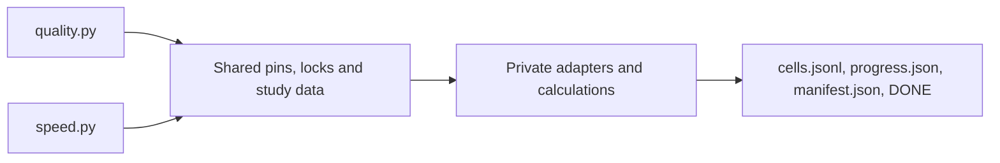

# Measuring quality and CPU speed

Use exactly two measurement entries:

| Entry | Purpose | Study data |
| :--- | :--- | :--- |
| `benchmarks/quality.py` | MTEB, offline SIF fits, STS, recall and score summaries | `benchmarks/config/quality.json` |
| `benchmarks/speed.py` | Paired libraries, table dtypes and streamed writing | `benchmarks/config/speed.json` |

A new study adds data. A new Python library adds a native factory and a registry entry in `_speed_pipeline.py`. Do not add a separate runner. The retained Hub preparation and publication tools have another owner. These commands never publish models or change README values.

## Common contract

`benchmarks/config/pins.json` holds source revisions, model revisions, the corpus revision and the Linux image digest. The same directory holds dependency locks, study definitions and one bootstrap template. Review a changed pin as a new configuration. Never silently resolve `main` in place of a recorded revision.

Both entries write:

- `cells.jsonl`: one terminal record per requested cell, immediately flushed and synchronized.
- `progress.json`: current stage, cell, counts and estimated remaining time.
- `manifest.json`: every result member's relative path, size and SHA256.
- `DONE`: exit status and the manifest SHA256. Its presence means finished, including failure.

Additional files retain per-round operations, correctness checks, input identities, fitted state and diagnostic telemetry. Models and full output matrices belong in the external work directory, never in Git or its evidence branch. No single Git file may exceed 10 MB without the coordinator's approval. Before every push inspect `git diff --stat` and new file sizes.



## Eleven measurement rules

1. Publish speed only from Linux. M1 timings and calls with only about 5,000 texts are withdrawn. Every measured fse call must last at least two seconds. Aim for three seconds with headroom. Rehearsal observations are never speed evidence.
2. Every number needs machine, CPU, date, workers, model, dimensions, table/output formats and text length. Report words or tokens per text beside texts/s. Sentences and paragraphs are different workloads.
3. One physical allocation is one cohort. Do not combine machines into a ratio. A CPU flavor does not guarantee a specific processor. Read the CPU and allowed affinity after allocation.
4. Use identical input within each pair on one machine. Alternate arms over at least three rounds. Report the median and the median of same-round time ratios. Different pairs may have different declared counts and digests. They are not a fixed-input scaling curve.
5. Correctness precedes speed. Check shape, dtype and a fixed sample, including saved UNK cases. Library pairs retain `rtol=3e-5`, `atol=3e-6`. Dtype controls are bit-exact. A failed check supplies no speed claim.
6. Load each library through its native API. Use its documented parallel path. ST uses its reusable CPU process pool, batch size 1024, one native thread per process and a checked, raised open-file limit. Do not substitute a compatibility loader that changes UNK behavior.
7. Record an initial quiet observation and rotate arms. Synchronize and remove owned output after checking it, before the next arm. A quiet start is not proof of later quietness. The approved library protocol has no duplicate A/A arm. Dtype controls retain an explicit symmetric 10 percent A/A gate.
8. Record load, memory, disk space and I/O before and after each operation. Preserve failures. Do not assign a cause to drift without the required telemetry. Host load on shared hardware is recorded, not treated as exclusive container load.
9. Before a paid run, rehearse every selected cell in the same pinned Linux image with small inputs. Preserve the memory calculation for real production sizes. Include restart, normal completion, SIGTERM and budget admission checks. A small rehearsal cannot prove full-size descriptor or shared-memory capacity.
10. Agree on cost and runtime before allocation, including setup, full warmups, slow arms, storage and collection reserve. Admission limits are soft and do not kill an active pair. Bootstrap remains in `sleep infinity` after success or failure. A restart never launches another measurement. The lifecycle owner collects, verifies and promptly deletes the allocation.
11. A watcher separates transport failure from a missing file during setup. Read-only monitoring must never start a second controller. Fetch progress and results continuously. On failure, preserve and collect first, then analyze locally.

## Local Unix development

The explicit `--diagnose` mode compares installed builds on macOS, Linux and other
Unix systems. Windows is rejected. Every local result is labelled `publishable: false`,
including Linux results. These are development indications, never README evidence.
The existing pinned Linux commands, studies and publication rules remain separate.

```sh
python benchmarks/speed.py --local-info
python benchmarks/speed.py --diagnose \
  --base-python /external/base/bin/python --candidate-python /external/candidate/bin/python \
  --cells potion-stsb-tokenizer potion-wikitext-tokenizer \
  --worker-name feature-owner --results /external/speed-01 --work /external/work-01
python benchmarks/quality.py --diagnose \
  --base-python /external/base/bin/python --candidate-python /external/candidate/bin/python \
  --worker-name feature-owner --results /external/quality-01 --work /external/quality-work-01
```

`benchmarks/config/development.json` declares two pinned public models, STS-B and
WikiText, and four stages. Select cells explicitly for a bounded study. `--input`
or `--development-input` accepts a strict local contract. A venv directory is also
accepted as an interpreter, without resolving away its venv identity.

The stages are tokenizer-only, pooling-only without normalization, regular encoding
to memory and regular file encoding through ShardSink close. Pooling reads an identical
batch exported by the base, rather than retokenizing separately inside each timer.
Model loading, input preparation, output checks, external sync and cleanup are outside
the timer. Sink-open time is reported separately. The sink stage keeps large output
on disk; a RAM cell that cannot fit is reported, never silently changed to a sink.

Quality uses the complete original STS-B train/dev/test texts and unrounded labels,
and every original WikiText-103 raw-v1 test row, including empty rows and headings.
Timing explicitly collapses whitespace to one space while preserving those row
positions, so file input has exactly one physical line per row. Every timing stage
uses that same text view. Workloads repeat whole fixed corpus cycles in source order.
The result records corpus hashes, count, preprocessing and repetition. Download is
anonymous and restricted to recorded public revisions. `--hf-cache` reads an existing
external cache first; missing artifacts download to the owned external work cache.

Defaults are six-second calls, at least two full warmups totaling twelve seconds and
fifteen pairs per block. AB/BA alternates; a cell can explicitly select ABBA. Its factor
is the sum of A times divided by the sum of B times. Every measured call meets the
frozen duration floor, never a sum of short calls. `--diagnostic-rehearsal` labels
small functional probes and disables timing decisions, not correctness checks.

Calibration first sizes a common workload with reserve on both builds. It measures
A/A at targets six, twelve and twenty-four seconds, seeking a ratio IQR below 0.02.
The first suitable tier needs an independent A/A validation block. Limits are three
tiers, twenty-four seconds target and sixty active calibration minutes per cell.
Load/lock waiting is separate from active work. An active operation finishes before
a soft budget stop. Exhausted noise or resource limits produce an explicit inconclusive
or non-executable cell. No outliers are removed or repeated until a favorable sample.
These longer defaults are a policy choice, not a proven guarantee of lower noise.
Four fifteen-pair AB blocks at the six-second tier need at least 36 minutes per cell.

The factor is base/candidate time. Saving is `1 - 1 / median(paired factors)`.
Keep requires saving at least `max(3 * same-cell A/A IQR, 0.02)` and an independent
confirmation with positive saving and at least half the main effect. Maximum factor
and maximum distance from one remain descriptive. Required cells cannot offset one
another. `--local-phase` selects `prepare`, `calibrate`, `aa`, `screen`, `compare` or
`confirm`; the default `compare` includes controls and confirmation. A screen cannot
yield a final keep decision. Separate confirmation requires `--comparison-results`.
`--aa-results` can reuse a completed matching control with `compare` or `screen`.
`--reuse-work` reuses prepared external inputs. Reuse checks final manifests, source
hashes, builds, machine, cell, order, dtype, corpus and affinity. A session interrupted
for fifteen minutes requires new controls. Continuous long runs have no global
thirty-minute expiry.

The byte gate compares complete direct and stored float32, float16 and int8 payloads,
including scales and stored inverse norms, and checks direct/store equality within
each build. Logical rows are compared independently of shard layout. STS-B Pearson
and Spearman additionally compare exact little-endian float64 bits on each split.
The first difference stops further cells. Scores are confirmation data, not new
published benchmark values. Quality and stage-specific correctness precede speed.

`FSE_BENCH_LOCK` and `FSE_HEAVY_LOCK` configure shared mkdir locks across worktrees.
Defaults share a user-specific temporary directory. Each acquisition checks the peer
before and after mkdir. Never take over an existing owner, even if its PID disappeared.
Timing holds bench.lock for a complete cell and rechecks heavy.lock before each arm.
Builds and checks use the same reverse exclusion:

```sh
python benchmarks/speed.py --local-heavy --worker-name feature-owner -- make check PYTEST_N=4
```

Timing waits for `os.getloadavg()[0] < 5` before each cell, arm and measured call.
Foreign processes above fifty percent CPU are telemetry only; process arguments are
never collected. Measurement priority targets nice 0. Builds/checks use nice 10 when
available. macOS uses `taskpolicy -B` when available. Linux supports explicitly
requested `--cpu-affinity` and reports a readable governor without changing it.
Optional capabilities are reported rather than required. Missing RAM detection needs
`--memory-limit-bytes`; automatic admission uses at most 85 percent of the detected
physical/cgroup limit. No privileged frequency or scheduling changes are performed.

Results retain raw operations, warmups, telemetry, checks, decisions and build identities
with the existing `cells.jsonl`, `progress.json`, manifest and DONE collection contract.
Models, full output tensors and corpora stay in the external work directory. A nonzero
DONE is not success; rejected/inconclusive decisions are preserved.

The [benchmark skill](../../.agents/skills/fse-benchmark/SKILL.md#local-unix-development)
shows the pinned development Dockerfile and read-only repository mounts. It builds
this checkout's extension on Linux using CPython 3.13.16, keeps models/data outside
the image and is never pushed to a registry. Rebuild after product changes. A container
functional probe establishes function only, with no Linux or host-Mac speed claim.

## Inspect and set up

Describe without importing optional measurement packages:

```sh
python benchmarks/speed.py --describe
python benchmarks/quality.py --describe
```

Install into fresh external directories, using Python from the pinned Linux image:

```sh
python benchmarks/speed.py --setup /speed-env --allocated-at "$MEASURE_ALLOCATED_AT"
python benchmarks/quality.py --setup /quality-env --allocated-at "$MEASURE_ALLOCATED_AT"
```

The timestamp is the actual allocation start, including setup. Setup installs the pinned fse source into isolated environments. Python packages use exact versions and required hashes. uv's `unsafe-best-match` allows PyPI packages beside CPU Torch. Accepted distributions remain constrained by the hashes. Rust builds with the shared Cargo lock and pinned source. `uv pip check` verifies each Python environment.

Generate the single bootstrap for an immutable, pushed source commit:

```sh
python benchmarks/speed.py --bootstrap --source-revision FULL_COMMIT_SHA > /external/speed-bootstrap.sh
python benchmarks/quality.py --bootstrap --source-revision FULL_COMMIT_SHA > /external/quality-bootstrap.sh
```

The lifecycle owner uses `/bin/bash` as entrypoint with the generated script. Enable SSH injection and `22/tcp` when remote collection needs SSH. `PUBLIC_KEY` is read directly by the script. Set `MEASURE_ALLOCATED_AT`. Optional `MEASURE_INPUT` selects another reviewed study file. `MEASURE_STUDY` selects `libraries`, `dtypes`, `headline` or `all` for speed. No provider API is called by either entry.

The bootstrap starts SSH before setup, claims one persistent start marker and preserves existing results on restart. The default result/work/environment paths are `/speed-results`, `/speed-work`, `/speed-env` or their `quality` equivalents. Cache paths are outside the checkout. Never copy a credential into a study or result file.

## Rehearse before allocation

Use the exact image digest from `pins.json`, Linux amd64, at most two CPU quota units and four GiB RAM. Give the ST process pool at least one GiB `/dev/shm` and an adequate hard `nofile` limit. Inputs and generated outputs stay outside the repository. The production memory plan remains attached even though the actual rehearsal data are small.

```sh
/speed-env/main/bin/python /source/benchmarks/speed.py --rehearse --study all \
  --results /proof/speed-results --work /proof/speed-work \
  --reference-python /speed-env/reference/bin/python --allocated-at "$MEASURE_ALLOCATED_AT"
/quality-env/main/bin/python /source/benchmarks/quality.py --rehearse \
  --results /proof/quality-results --work /proof/quality-work \
  --allocated-at "$MEASURE_ALLOCATED_AT"
```

The speed rehearsal runs all configured pairs, dtype controls and writing with reduced sizes. The quality rehearsal exercises deterministic tiny SIF calculations, the real FineWeb sampling algorithm on eight local fixture shards, historical STS evaluation, neighbor recall and an entire small MTEB task. Functional records are labelled and excluded from publication summaries. Control proofs are written inside `controls/` in the result directory, before its final manifest and DONE. A failed control produces a nonzero outer completion. They exercise the real result writer, signal handler and budget gate. The bootstrap restart proof executes the actual restart guard with only its setup leaf disabled. Keep this scope distinct from a full container restart, which the lifecycle owner should also check before a fresh launch.

Do not add repository tests for these measurement tools. Run the functional modes and the ordinary repository gates. These tools do not change the fse hot path, so no local performance result is required for moving them.

## Speed study data

A library cell declares `model`, `reference`, `workers`, `texts`, `dimensions`, `dtype`, `rounds`, `planned_input_bytes` and `estimated_seconds`. Keep the common input digest within a pair. Do not shrink only the slow arm. If the common workload is too expensive, obtain a new agreed workload before starting.

Dtype cells use `reference: fse-control`, the same table dtype in both arms and bit-exact output checks. For a source-code comparison, a reviewed data cell can use `reference: fse-base` with `--base-python /external/base-env/bin/python`. The base and candidate use their own installed package identities. Such a pair is a base/candidate comparison, not an identical-code A/A control.

Writing cells record first native-file read through ShardSink close. They use a float32 table, int8 storage and `durability: none`. Model loading, input generation and verification are outside this timer. Sink opening and external file/directory synchronization have separate observations. Codes, scales, row counts and file inventories are checked before deletion. Logical file bytes are not device write amplification. Separate sequential worker configurations do not isolate a CPU-scaling effect.

Select an agreed study:

```sh
/speed-env/main/bin/python /source/benchmarks/speed.py --run --study libraries \
  --results /speed-results --work /speed-work \
  --reference-python /speed-env/reference/bin/python --allocated-at "$MEASURE_ALLOCATED_AT"
```

The checked-in numbers and billing fields describe the original study, not current hardware prices or a new spending authorization. Update the data and obtain the agreed budget first. `--study headline` additionally requires `--workers 16` or `--workers 32`.

ST checks `RLIMIT_NOFILE` inside its adapter and raises the soft limit to at least 524288 before creating the pool. A lower hard limit fails clearly. The first historical pool attempt failed at soft limit 1024 with `received 0 items of ancdata`. The same code succeeded after the limit changed. This supports descriptor pressure, without a captured EMFILE syscall. Large shared outputs also require enough `/dev/shm`.

## Quality study data

Quality cells declare source model and revision through the common pins, backend, workers, corpus and task selection. Supported calculation kinds are offline SIF `fit`, plain `mean`, historical `sts`, `mteb`, neighbor `recall`. A fitted artifact is referenced by its preceding cell ID. The retired one-off GloVe corpus-selection experiment is not part of this entry.

MTEB remains pinned at 2.26.25 and unmodified. Expansion preserves the benchmark's actual language subsets, evaluation splits and seed. Evaluation resolves the configured benchmark task, not an unrestricted task with the same name. Summaries separate worker configurations. English evaluation excludes MindSmallReranking and is labelled 40 of 41 tasks. Its two failed attempts do not yield a score. NanoBEIR has 13 tasks. A single named task runs in full. Neither production nor rehearsal silently samples evaluation rows.

SIF uses wordfreq English weights and ten uncentered components fitted only on the pinned training corpus. The fit receipt includes corpus digest, revision, seed, frequency implementation, component state hash and exported encoder hash. FastText retains its OOV ngrams. ParaNMT can use the separate plain-mean action. Classical external-tokenizer evaluation uses the preserved historical tokenization. STS Pearson and MTEB Spearman are different metrics.

The historical STS helper reads a fixed object from a Git clone. Setup supplies that clone. An existing environment can set `--fixture-repo` explicitly. No STS fixture or model output is copied into Git.

Use `--cells` with explicit data IDs for a bounded selection. Include prerequisite fit cells. `--summarize` reads completed results and reports means only for complete matching coverage:

```sh
/quality-env/main/bin/python /source/benchmarks/quality.py --run --cells FIT_ID EVALUATION_ID \
  --results /quality-results --work /quality-work --allocated-at "$MEASURE_ALLOCATED_AT"
python benchmarks/quality.py --summarize /quality-results > /external/quality-summary.json
```

Model cards and the README consume reviewed summaries. Summarization never writes either file. Diagnostic quality wall times are not inference-throughput claims. Existing published quality values and protected 1.1 baselines remain unchanged.

### Published SIF-10 fit

The released SIF-10 variants use the FineWeb-Edu annotations corpus at revision `72df4c92fb1b48beceb16016e8f695ec40a6c3a5`. `published-sif10-*` data cells reproduce that frozen recipe, separately from historical WikiText quality configurations. They call the retained `sampled_corpus`, which streams `paragraphs` twice, chooses 859,346 eligible paragraphs without replacement at seed 0, then preserves source order. The tokenized published corpus must have xxh3-128 `88146a7f61a2c157c4710cfaf3e0cb4b`.

Only an explicitly selected production cell downloads the pinned source shards and fits on the full corpus. No full corpus fit was run during this tool consolidation. The small rehearsal uses a labelled local fixture, exercises both sampling and cache validation, and cannot provide a published-corpus or speed result.

Each source fits wordfreq weights and ten uncentered components, folds them into word and FastText ngram tables, and records the actual state and artifact hashes. Published-fit artifacts use `fse_words@1`. The corresponding `published-sts-*` and `published-recall-*` cells calculate controlled model-card correlations and neighbor recall for the precision variants. The fit also exports an external `*-selection.json` compatible with the retained builder's `--selection` input. It records a frozen corpus choice, not a new selection experiment. Compare generated fingerprints with the published manifest before claiming bit-identical reproduction.

The original GloVe comparison used STS and NanoBEIR to choose FineWeb. That comparison is retired, while its chosen sampling and fit recipe remains reproducible. These selection scores are not untouched holdout estimates. Controlled STS retains the historical external-tokenizer view and reports saved-tokenizer Pearson separately.

## Fit corpus equivalence

The shared WikiText verifier accepts two explicit xxh3-128 values:

- Historical raw serialization: `c89c1a2929270add9040835399b8bea4`.
- Cold-cache one-space serialization: `ca7a595ff0547a4a847a849d749d3604`.

The independently verified audit established identical `line.split()` tokens for all 859,346 paragraphs. Only whitespace differs in 6,063 lines, removing 7,930 bytes. Both files therefore feed the same fit inputs. The verifier accepts no other digest, does not rewrite either file, and each new fit receipt records the actual corpus SHA256. Existing quality scores are unchanged.

The original audit is preserved inside [the source-evidence bundle at `608cf02a`](https://github.com/oborchers/Fast_Sentence_Embeddings/blob/608cf02a9557ef8bade83ae6c0c2fadd5b8d5012/archives/comparison-source-2026-11.tar.gz). Its member SHA256 is `f3203379bec429743381efc41ab03125837615702a147c8b6aa9169396d7a008`. The bundle's manifest identifies the original member path and bytes. No new full corpus fit was run for this verifier correction.

## Monitor, collect and retain

Monitor `progress.json`, `cells.jsonl` and `DONE` at the agreed interval. SIGTERM prevents new cells after the current safe boundary. A failed cell remains failed. No automatic retry relaxes a requirement. A missing or nonzero completion is never success.

After read-only transfer, verify and bundle locally:

```sh
python benchmarks/speed.py --collect /external/copied-speed-results --archive /external/speed-evidence.tar.gz
python benchmarks/quality.py --collect /external/copied-quality-results --archive /external/quality-evidence.tar.gz
```

Collection rejects changed bytes, unsafe paths, symlinks and extra files. It writes a transfer receipt with archive size and SHA256. This is an external local artifact, not permission to commit raw data, weights, matrices or reconstruction output. Keep only small reviewed summaries and provenance in Git. The owner confirms verified collection, then deletes the rented allocation. Analyze completeness on the local copy.

The original pre-consolidation source is preserved byte-for-byte at [evidence commit `1e1165b`](https://github.com/oborchers/Fast_Sentence_Embeddings/blob/1e1165b7a892555b201897fc91377a68f31f298f/archives/measurement-tools-before-consolidation.tar.gz), SHA256 `9c81b21dcd56b393e50292c188b9aa656a7ff4716cd569df6e7e6d4a6c6acad0`. This archive holds source, not measurement output. Historical result provenance remains in [the comparison guide](../fse-comparison.md).

Primary API references: [ST process-pool API](https://www.sbert.net/docs/package_reference/sentence_transformer/model.html), [PyTorch file-descriptor sharing](https://docs.pytorch.org/docs/2.15/multiprocessing.html#file-descriptor-file-descriptor).
